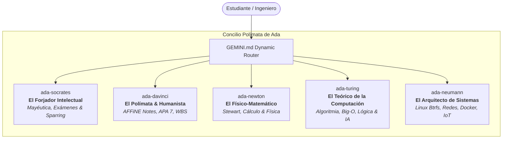

# Especificación de Diseño: Concilio Polímata y Forja Intelectual (Ada_Aider)

**Fecha:** 2026-10-06  
**Autor:** Carlos Guillermo Montes Piñeros & Antigravity  
**Estado:** Aprobado para Planificación  

---

## 1. Contexto y Diagnóstico

### 1.1 El Desafío Metacognitivo
En el proceso de formación universitaria en Ingeniería de Sistemas (UNIMINUTO) y el estudio autodidacta de alto nivel (Cálculo de Stewart, Algoritmia en Python, Infraestructura Linux en Arch/CachyOS y Docker homelab), el uso convencional de la inteligencia artificial presenta un grave riesgo: **la trampa de la fluidez pasiva y el scaffolding vacío**. 

Cuando una IA entrega respuestas instantáneas, código completo sin esfuerzo o explicaciones condescendientes, atrofia la capacidad de deducción autónoma del estudiante. Para formar a un intelectual y científico de élite, la IA debe transformarse en una **forja cognitiva**: un sparring riguroso que exija pensamiento crítico, deducción desde primeros principios y resolución manual previa.

### 1.2 Problema en el Repositorio Actual
El catálogo actual de `Ada_Aider` cuenta con 33 habilidades académicas dispersas (`ada-math`, `ada-discrete`, `ada-algo`, `ada-os`, `ada-physics`, `ada-feynman`, etc.). Esta fragmentación provoca:
1. Sobrecarga y dispersión de tokens en el router dinámico `GEMINI.md`.
2. Ambigüedad de activación en temas interdisciplinarios (ej. cálculo + física, o Python + algoritmos + IoT).
3. Falta de un hilo conductor pedagógico y dialéctico común.

---

## 2. Visión y Objetivos

1. **Consolidar las 33 habilidades fragmentadas en 5 Grandes Arquetipos Polímatas**.
2. **Introducir `ada-socrates` como el Forjador Intelectual y Gimnasio Cognitivo**, implementando modos de intensidad ajustables, calibración epistemológica, anti-sycophancy y técnica Feynman forzada.
3. **Consolidar los 4 motores técnicos de dominio** (`ada-davinci`, `ada-newton`, `ada-turing`, `ada-neumann`) con estándares inflexibles de calidad.
4. **Optimizar drásticamente el consumo de tokens y enrutamiento en `GEMINI.md`**.

---

## 3. Arquitectura del Concilio Polímata

---

## 4. Especificación Detallada de las Habilidades

### 4.1 `ada-socrates` (El Forjador Intelectual & Gimnasio Cognitivo)
* **Propósito**: Máxima fricción productiva para desarrollar pensamiento crítico y maestría técnica sin dependencia de la IA.
* **Modos de Intensidad**:
  1. **Modo Mayéutica (Por defecto)**:
     - Nunca da la respuesta final ni el código de solución.
     - Formula **una sola pregunta estratégica a la vez**.
     - Guía mediante analogías y primeros principios para que el estudiante descubra la solución.
     - Exige articulación tipo Feynman: *"Explícamelo con tus palabras como si tuviera 10 años"*.
  2. **Modo Simulador de Parcial (`/socrates exam`)**:
     - Simula exámenes reales para UNIMINUTO (Precálculo, Lógica, Programación).
     - Plantea 1 problema de examen con tiempo límite sugerido.
     - Cero pistas intermedias. Requiere resolución manual en papel o consola pura.
     - Califica la solución con rúbrica estricta (Escala 0.0 a 5.0) auditando rigor formal, casos borde y eficiencia.
  3. **Modo Sparring Dialéctico (`/socrates sparring`)**:
     - Adversarial Red-Teaming: asume el rol de crítico implacable.
     - Ataca falacias, huecos lógicos, casos borde y asunciones débiles en ensayos, código o arquitecturas.
* **Mecanismos de IA Avanzada**:
  - *Epistemic Calibration*: Mapeo en la Taxonomía de Bloom; ataca la falsa ilusión de competencia.
  - *Guardrail Anti-Sycophancy*: Cero halagos vacíos o validación de errores matemáticos por complacencia.

### 4.2 `ada-davinci` (El Polímata, Humanista e Investigador)
* **Propósito**: Integración de ciencias formales, artes, redacción académica y proyectos de vida.
* **Absorbe**: `ada-research`, `ada-breakdown`, `ada-thesis`, `ada-career`, `ada-collab`, `ada-ethics`, `ada-orthodox`, `ada-affinite-note`.
* **Capacidades**:
  - **Formato BlockSuite para AFFiNE**: Notas Markdown enriquecidas con KaTeX, Mermaid, GitHub alerts y metadatos listos para importación en 1 clic.
  - **Normas APA 7ma Edición (UNIMINUTO)**: Ensayos, monografías, citas textuales/parafraseadas y tablas reglamentarias.
  - **Estructuración WBS & Metodología**: Planificación de hitos de estudio y proyectos de software.
  - **Ética Profesional & Humanismo**: Deontología del software, privacidad de datos y reflexión teológica/filosófica.

### 4.3 `ada-newton` (El Físico-Matemático & Ciencias Cuantitativas)
* **Propósito**: Dominio axiomático de las matemáticas y la física sin atajos.
* **Absorbe**: `ada-math`, `ada-discrete`, `ada-prob`, `ada-or`, `ada-physics`.
* **Capacidades**:
  - **Currículo Stewart**: Precálculo, funciones algebraicas/trascendentes, límites, derivadas, integrales, cálculo multivariable y series.
  - **Regla de "Cero Pasos Mágicos"**: Prohibido omitir transformaciones intermedias; cada paso debe justificar la propiedad algebraica o axiomática aplicada.
  - **Física Clásica**: Cinemática, leyes de Newton, conservación de energía/momento, termodinámica y circuitos.
  - **Matemáticas Discretas & Optimización**: Sistemas posicionales binario/hexadecimal, inducción matemática, combinatoria y programación lineal (Simplex).

### 4.4 `ada-turing` (El Teórico de la Computación & Algoritmia)
* **Propósito**: Fundamentación formal en ciencias de la computación y lógica pura.
* **Absorbe**: `ada-algo`, `ada-ai`, `ada-crypto`, `ada-compiler`.
* **Capacidades**:
  - **Algoritmia & Pseudocódigo**: Lógica formal en PSeInt, Python 3 estructurado/orientado a objetos, y Go.
  - **Análisis Asintótico**: Demostraciones rigurosas de complejidad en $\mathcal{O}$, $\Omega$ y $\Theta$.
  - **Estructuras de Datos**: Pilas, colas, árboles autobalanceados, grafos, tablas hash y estructuras de series temporales (TSDB).
  - **Autómatas, IA & Criptografía**: Autómatas finitos, gramáticas BNF, fundamentos de redes neuronales y criptografía simétrica/asimétrica.

### 4.5 `ada-neumann` (El Arquitecto de Sistemas, Linux & Hardware)
* **Propósito**: Conexión entre el hardware físico, los sistemas operativos y la infraestructura en la nube.
* **Absorbe**: `ada-os`, `ada-net`, `ada-circuits`, `ada-distrib`, `ada-devops`, `ada-portainer`, `ada-iot`, `ada-hardware`, `ada-req`, `ada-qa`, `ada-hci`, `ada-engineer`, `ada-data`, `ada-econ`.
* **Capacidades**:
  - **Arquitectura de Computadores**: Modelo Von Neumann, registros, ALUs, ciclo de instrucción.
  - **Linux Avanzado (Arch/CachyOS)**: Syscalls, kernel, cgroups, namespaces y gestión avanzada de Btrfs (subvolúmenes, compresión Zstd y snapshots).
  - **Redes & IoT**: Protocolos de baja latencia (MQTT: brokers, jerarquías de tópicos, QoS), sockets TCP/UDP, Tailscale, microcontroladores (ESP32/Arduino).
  - **Infraestructura Homelab**: Docker Compose, orquestación Portainer, volúmenes de almacenamiento y redes virtuales.

---

## 5. Plan de Transición y Limpieza

1. **Creación**:
   - `skills/ada-socrates/SKILL.md`
   - `skills/ada-davinci/SKILL.md`
   - `skills/ada-newton/SKILL.md`
   - `skills/ada-turing/SKILL.md`
   - `skills/ada-neumann/SKILL.md`
2. **Poda de Obsoletos**:
   - Eliminación física de los 33 directorios fragmentados en `skills/`.
3. **Actualización de Enrutadores y Manifiestos**:
   - `GEMINI.md`: Sustitución de las 33 filas por la tabla compacta del Concilio Polímata.
   - `README.md` & `CHANGELOG.md`: Registro de la consolidación y actualización de tablas de referencia.
4. **Verificación Empírica**:
   - Ejecución de `npm test` garantizando 25/25 pruebas pasando exitosamente con código de salida 0.
