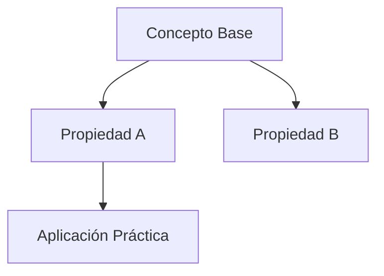
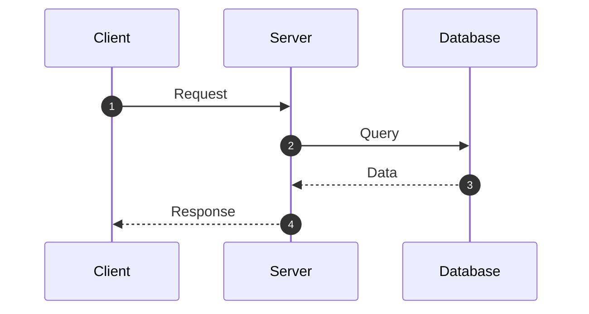

# ada-affinite-note (AFFiNITe BlockSuite Notes Generator & Math Suite)

## Overview
Generates high-fidelity academic, mathematical, scientific, and software engineering notes formatted in clean GitHub Flavored Markdown (GFM) strictly optimized for **AFFiNITe** and its **BlockSuite** editor engine.

Every note is automatically structured into modular blocks, rendered with pedagogical clarity (Feynman Technique), enriched with native KaTeX scientific macros, and saved directly into `~/Documents/Affinite_Notes/<Categoria>/` ready for immediate import via **Import → Markdown files (.md)** in AFFiNITe.

---

## When to Use
- User asks: *"haz una nota para affinite sobre [tema]"*
- User asks: *"crea una nota de affinite de [problema matemático / física / software / etc.]"*
- User asks: *"genera apuntes para affinite de [concepto o materia]"*
- Need to produce structured study notes with LaTeX math equations, matrices, systems of equations, Mermaid diagrams, callouts, and code blocks for AFFiNITe.

When NOT to use:
- Generating internal codebase modifications for the AFFiNITe core repository itself (use `ada-code`, `ada-plan`, etc.).
- Simple conversational Q&A without requesting note files.

---

## Target Directory Structure

All notes are saved into the user's local notes directory:
```
~/Documents/Affinite_Notes/
├── Matematicas/            # Precálculo, Álgebra Lineal, Lógica, Cálculo, Probabilidad
├── Ciencias_Fisica/        # Física Clásica, Termodinámica, Electromagnetismo, Mecánica
├── Ingenieria_Software/    # Arquitectura, Algoritmos, Redes, Linux, Docker, Rust, React
├── Investigacion/          # Metodología, Estado del Arte, Papers, Resúmenes Académicos
└── General/                # Planes de estudio, proyectos personales, productividad
```

---

## BlockSuite Block Matrix & Syntax Rules

AFFiNITe parses markdown into native BlockSuite blocks. Follow these exact syntax standards:

| Bloque en AFFiNITe | Sintaxis Markdown Estricta | Ejemplo / Uso |
| :--- | :--- | :--- |
| **Título de Página** | H1 `# Título` (Único al inicio) | `# Diagonalización de Matrices y Valores Propios` |
| **Metadatos & Tags** | Cita / Cursiva bajo el título | `> 📅 **Fecha**: YYYY-MM-DD \| 🏷️ **Categoría**: #matematicas #algebra-lineal` |
| **Callout / Alerta** | `> [!TIPO]` | `> [!NOTE]`, `> [!TIP]`, `> [!IMPORTANT]`, `> [!WARNING]` |
| **Fórmulas Centradas** | Bloque `$$ ... $$` o `\[ ... \]` | `$$\det(A - \lambda I) = 0$$` (compatible con KaTeX y macros científicas) |
| **Fórmulas Inline** | `$ ... $` o `$$ ... $$` | `Sea $\lambda \in \R$ el valor propio asociado al vector $\bm{v}$.` |
| **Entornos Multilínea** | `\begin{aligned} ... \end{aligned}` | Sistemas de ecuaciones alineados en el signo `=` |
| **Matrices y Determinantes** | `\begin{pmatrix}`, `\begin{vmatrix}` | Matrices $2\times2$, $3\times3$, $N\times M$, vectores columna y determinantes |
| **Sistemas por Casos** | `\begin{cases} ... \end{cases}` | Funciones definidas por partes y condiciones lógicas |
| **Diagramas / Grafos** | Bloque ````mermaid ```` | Mapas conceptuales, diagramas de flujo, arquitecturas de software |
| **Tablas de Datos** | Tablas Markdown GFM | `\| Variable \| Significado \| Unidad \|` con separadores `\|:---\|:---\|` |
| **Bloques de Código** | Fenced blocks con lenguaje | ````python ````, ````rust ````, ````cpp ````, ````bash ```` |
| **Checklists** | `- [ ]` y `- [x]` | Lista interactiva para repaso activo y ejercicios |
| **Citas & Teoremas** | `> Texto` con negrita | `> **Teorema Fundamental**: Toda matriz simétrica real...` |

---

## 🧮 Diccionario de Macros Científicas Nativas en AFFiNITe

AFFiNITe cuenta con un motor KaTeX con macros científicas precargadas. Al generar notas, aprovecha estas macros para obtener un código LaTeX limpio y legible:

### 1. Conjuntos Numéricos
* `\R` $\to \mathbb{R}$ (Números Reales)
* `\N` $\to \mathbb{N}$ (Números Naturales)
* `\Z` $\to \mathbb{Z}$ (Números Enteros)
* `\Q` $\to \mathbb{Q}$ (Números Racionales)
* `\C` $\to \mathbb{C}$ (Números Complejos)
* `\K` $\to \mathbb{K}$ (Cuerpo/Campo arbitrario)

### 2. Cálculo Vectorial & Multivariable
* `\bm{v}` $\to \boldsymbol{v}$ (Vector o tensor en negrita)
* `\vec{v}` $\to \mathbf{v}$ (Vector con notación en negrita)
* `\grad` $\to \nabla$ (Operador Gradiente)
* `\curl` $\to \nabla \times$ (Operador Rotacional)
* `\div` $\to \nabla \cdot$ (Operador Divergencia)
* `\laplacian` $\to \nabla^2$ (Operador Laplaciano)

### 3. Operadores, Derivadas & Física
* `\diff{y}{x}` $\to \frac{\mathrm{d}y}{\mathrm{d}x}$ (Derivada ordinaria)
* `\pdiff{f}{x}` $\to \frac{\partial f}{\partial x}$ (Derivada parcial)
* `\d` $\to \mathrm{d}$ (Diferencial en integrales, ej: `\int f(x) \, \d x`)
* `\norm{x}` $\to \left\|x\right\|$ (Norma de un vector)
* `\abs{x}` $\to \left|x\right|$ (Valor absoluto o módulo)
* `\degree` $\to ^\circ$ (Símbolo de grados)
* `\hbar` $\to \hbar$ (Constante reducida de Planck)

---

## ⚡ Comandos Nativos de Ecuaciones en la Interfaz de AFFiNITe

Cuando los usuarios interactúen directamente con la aplicación AFFiNITe, pueden utilizar los siguientes atajos integrados:

1. **Ecuación Gráfica (Visual Builder)**:
   * Comando: `/greq` o `/visual-equation` o `/vmath`
   * Abre el **Visual Builder** con paletas interactivas (Álgebra, Cálculo, Matrices, Símbolos Griegos, Fórmulas Famosas con 1-clic) y casillas $\square$ navegables con `⇥ Next Slot □`.
2. **Bloque de Ecuación (Code Mode)**:
   * Comando: `/eq` o `$$$$ `
   * Abre el editor directo en código LaTeX con panel dual de Live KaTeX Preview en tiempo real.
3. **Ecuación en Línea**:
   * Escribir `$fórmula$` o `$$fórmula$$` dentro de cualquier bloque de texto.
4. **Copiado Rápido**:
   * Pasar el cursor sobre cualquier bloque de ecuación revela el botón flotante **"Copiar LaTeX"** en la esquina superior derecha con feedback visual instantáneo.

---

## 🔬 Integración con Herramientas de Cálculo (GeoGebra & Qalculate)

* **GeoGebra**: Para exportar curvas, cónicas o derivadas desde GeoGebra hacia AFFiNITe, copiar la fórmula en formato LaTeX y pegarla en un bloque de ecuación `$$ ... $$` o usando `/eq`.
* **Qalculate (`qalculate-gtk`)**: Los resultados de cálculo simbólico y conversiones de unidades pueden formatearse directamente con las macros `\d`, `\diff` y `\norm` en las notas de AFFiNITe.

---

## Plantillas de Estructura por Dominio

### 1. Dominio Matemático & Científico (Precálculo, Álgebra, Física, Cálculo)
```markdown
# [Nombre del Tema / Teorema / Problema]
> 📅 **Fecha**: YYYY-MM-DD | 🏷️ **Tags**: #[categoria] #[subtema]

> [!NOTE]
> **Idea Central en 2 Oraciones**: Resumen conceptual sin tecnicismos innecesarios (Feynman Technique).

## 1. Fundamentos Teóricos & Definición Formal
- Explicación intuitiva del concepto físico o matemático.
- Definición rigurosa con fórmulas y macros de KaTeX:
  $$\begin{aligned}
    \nabla \times \bm{E} &= -\pdiff{\bm{B}}{t} \\
    \nabla \cdot \bm{E} &= \frac{\rho}{\varepsilon_0}
  \end{aligned}$$

## 2. Propiedades & Teoremas Clave
- **Propiedad 1**: Para todo elemento en el conjunto de los reales $x \in \R$, se cumple:
  $$\norm{\bm{v}} \ge 0$$
- **Interpretación Geométrica**:
  > [!TIP]
  > Explicación intuitiva de por qué la fórmula tiene sentido geométrico o analítico.

## 3. Ejercicios Resueltos Paso a Paso
### Problema 1: [Enunciado Claro]
1. **Paso 1: Planteamiento y delimitación de variables**:
   $$f(x) = \begin{cases}
     \int_{0}^{x} \frac{1}{\sqrt{2\pi}} e^{-\frac{t^2}{2}} \, \d t & \text{si } x > 0 \\
     0 & \text{si } x \le 0
   \end{cases}$$
2. **Paso 2: Desarrollo algebraico y derivación**:
   $$\pdiff{f}{x} = \frac{1}{\sqrt{2\pi}} e^{-\frac{x^2}{2}}$$
3. **Paso 3: Resultado e interpretación**:
   > [!IMPORTANT]
   > **Solución**: $\text{Resultado final}$ con conclusión física/matemática.

## 4. Mapa Conceptual


## 5. Checklist de Repaso Activo (Active Recall)
- [ ] ¿Puedo explicar la diferencia entre X e Y sin ver mis notas?
- [ ] ¿Puedo resolver el problema 1 desde cero en papel?
- [ ] ¿Entiendo el significado geométrico de la fórmula?
```

---

### 2. Dominio Técnico & Software (Arquitectura, Sistemas, DevOps, Algoritmos)
```markdown
# [Título del Sistema / Protocolo / Algoritmo]
> 📅 **Fecha**: YYYY-MM-DD | 🏷️ **Tags**: #ingenieria #devops #backend

> [!NOTE]
> **Propósito del Sistema**: Descripción clara del problema que resuelve y su arquitectura base.

## 1. Arquitectura & Flujo de Datos


## 2. Componentes & Especificaciones
| Componente | Rol en el Sistema | Tecnologías / Algoritmos |
| :--- | :--- | :--- |
| **Engine** | Procesamiento central | Rust / Tokio |
| **Storage** | Persistencia local | SQLite / CRDT |

## 3. Implementación & Código de Referencia
```python
def ejemplo_implementacion():
    # Código limpio, comentado y funcional
    pass
```

## 4. Consideraciones de Rendimiento & Errores Comunes
> [!WARNING]
> Cuidado con [error común o cuello de botella].

## 5. Checklist de Verificación
- [ ] Compila y pasa los tests unitarios.
- [ ] Verificado en entorno local.
```

---

## Procedimiento de Ejecución al Invocar la Skill

1. **Analizar el Tema**: Identificar si pertenece a Matemáticas, Física, Ingeniería, Investigación o General.
2. **Determinar la Ruta de Guardado**:
   - `~/Documents/Affinite_Notes/<Categoria>/<nombre-en-kebab-case>.md`
3. **Generar la Nota**: Aplicar la plantilla correspondiente con máximo rigor pedagógico, fórmulas LaTeX completas utilizando las macros científicas de AFFiNITe (`\R`, `\bm`, `\diff`, `\pdiff`, `\d`, `\norm`), diagramas Mermaid y Callouts.
4. **Guardar el Archivo**: Utilizar `write_to_file` para escribir el archivo directamente en la ruta especificada.
5. **Respuesta al Usuario**:
   - Notificar que la nota ha sido creada.
   - Proporcionar la ruta absoluta en un enlace markdown clicable: `[nombre_nota.md](file:///home/rousseau/Documents/Affinite_Notes/.../nombre_nota.md)`.
   - Recordar los atajos nativos: *"Para abrir o editar en AFFiNITe: Importa la nota vía Menú Import → Markdown files (.md), y recuerda que puedes editar fórmulas con `/greq` (Visual Builder) o `/eq` (Code Mode)."*
