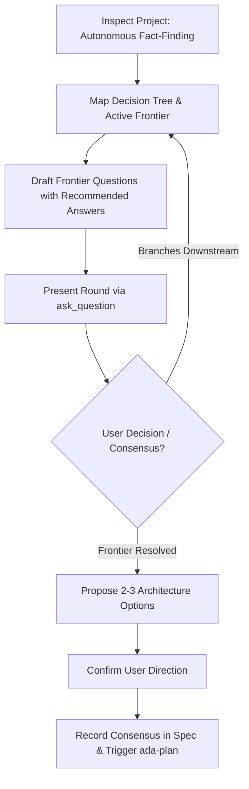

# ada-brainstorm (Interactive Maieutic & Architectural Alignment)

<EXTREMELY-IMPORTANT>
Do NOT write code, scaffold files, or create implementation plans until requirements are explored and architectural consensus is reached with the user.
</EXTREMELY-IMPORTANT>

## Core Principles

1. **Autonomous Fact-Finding vs. User Decisions**: Finding facts (inspecting code, configs, dependencies, schema, AST) is strictly the agent's job. Never ask the user questions that can be answered from the filesystem or tools. Decisions (trade-offs, priorities, constraints, product direction) belong strictly to the user.
2. **Decision Tree Frontier Model**: Model the problem as a decision tree where each choice branches into downstream decisions. The active **Frontier** consists only of questions whose prerequisites are already settled. Query questions strictly along the active frontier in structured rounds using `ask_question`.
3. **Recommended Answer Convention**: Every question MUST include the agent's recommended default (`➡️ Recommended Answer: [Option] - [rationale]`). Format prompts so the user can reply with a single "yes" or "confirm" to accept all recommendations, or selectively adjust.
4. **Architectural Consensus Gate**: Lock down scope, interface boundaries, and data models before transitioning to `ada-plan`.

## Execution Workflow

### Phase 1: Autonomous Fact-Finding
- Inspect repository files, configurations, dependencies, schemas, and git history.
- Distinguish facts from decisions: If an answer exists in code or documentation, discover it autonomously.
- Never burden the user with questions about discoverable codebase facts.

### Phase 2: Decision Tree Frontier Mapping
- Structure unknown decisions into a dependency tree where root choices unlock downstream choices.
- Identify the active **Frontier**: questions whose prerequisites are settled.
- Group frontier questions into focused rounds. Do not ask downstream questions until upstream branch nodes are decided.

### Phase 3: Grilling with Recommended Answers
- Execute rounds using `ask_question` with structured, actionable options.
- For every question, present 2-3 concrete options and explicitly specify the agent's recommended choice:
  - `➡️ Recommended Answer: [Option A] - [rationale based on repo patterns/minimal complexity]`.
- Minimize cognitive load: allow the user to confirm all recommendations with a 1-word "yes" or "confirm", or override specific choices.

### Phase 4: Focused Architecture Proposals
When choices involve system design, frame 2-3 distinct approaches:
- **Option A (Recommended)**: Best alignment with existing patterns, minimal complexity.
- **Option B**: Alternative trade-off (e.g., higher flexibility vs higher initial complexity).
- **Option C**: Minimalist / pragmatic fallback.

### Phase 5: Consensus Gate & Specification
- Record agreed architectural decisions, boundary interfaces, and data models in `docs/specs/YYYY-MM-DD-<topic>.md` (or task brief).
- Obtain explicit user approval before transitioning to `ada-plan`.
