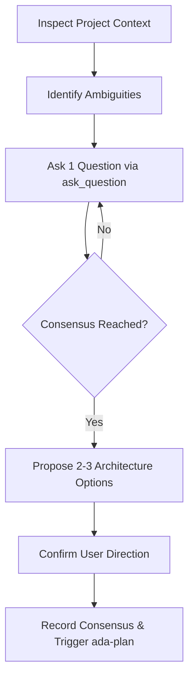

# ada-brainstorm (Interactive Maieutic & Architectural Alignment)

<EXTREMELY-IMPORTANT>
Do NOT write code, scaffold files, or create implementation plans until requirements are explored and architectural consensus is reached with the user.
</EXTREMELY-IMPORTANT>

## Core Principles

1. **Maieutic Discovery**: Ask **ONE** focused question at a time using `ask_question`. Avoid overwhelming walls of questions.
2. **2-3 Concrete Options**: When presenting architectural alternatives, provide 2 to 3 distinct approaches with explicit trade-offs and a recommended choice.
3. **Architectural Consensus**: Lock down scope, interface boundaries, and data models before transitioning to planning.

## Execution Workflow

### Phase 1: Context Exploration
- Check relevant repository files, documentation, dependencies, and git history.
- Identify implicit assumptions, architectural constraints, and boundary conditions.

### Phase 2: Maieutic Questioning
- Formulate the single most critical unknown.
- Call `ask_question` with structured, actionable options (including recommended option first).
- Never bundle multiple orthogonal questions into one prompt.

### Phase 3: Focused Design Proposals
When choices involve architecture, frame 2-3 distinct approaches:
- **Option A (Recommended)**: Best alignment with existing patterns, minimal complexity.
- **Option B**: Alternative trade-off (e.g., higher flexibility vs higher complexity).
- **Option C**: Minimalist / pragmatic fallback.

### Phase 4: Consensus Gate
- Confirm the selected approach and record design conclusions in `docs/specs/YYYY-MM-DD-<topic>.md` (or task brief).
- Ensure explicit user approval before transitioning to `ada-plan`.
