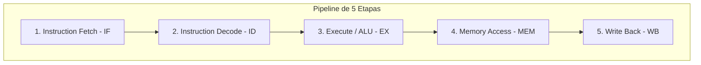
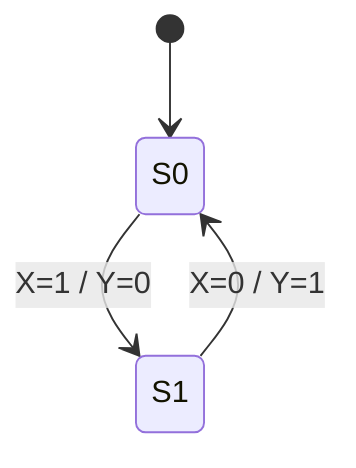

# ada-circuits (Lógica Digital, Circuitos y Arquitectura de Computadores)

## Overview
Proporciona diseño, análisis y optimización formal para **Circuitos Lógicos Digitales y Arquitectura de Computadores**.

Abarca minimización booleana (Álgebra de Boole, Mapas de Karnaugh de 2 a 6 variables, condiciones Don't Care), diseño de circuitos combinacionales (decodificadores, multiplexores, demultiplexores, sumadores Ripple-Carry y Carry-Lookahead, ALUs), circuitos secuenciales (Latches SR/D, Flip-Flops D, T, JK con tablas de excitación), diseño formal de Máquinas de Estados Finitos (**FSM Mealy y Moore**), registros, contadores, organización de memoria (SRAM, DRAM, Jerarquía de Caché L1/L2/L3) y microarquitectura del procesador (Ruta de datos, Unidad de control, ciclo Fetch-Decode-Execute, Hazards de Pipeline y comparación Von Neumann vs. Harvard).

---

## When to Use
- Simplificación de expresiones booleanas en Suma de Productos (SOP) o Producto de Sumas (POS) mediante Mapas de Karnaugh.
- Diseño de bloques lógicos combinacionales (multiplexores, comparadores, sumadores completos).
- Síntesis de circuitos secuenciales sincronizados por reloj (Flip-Flops D/JK) a partir de diagramas de estados.
- Modelado de FSMs tipo **Moore** (la salida depende solo del estado actual) y **Mealy** (la salida depende del estado y las entradas).
- Análisis de la microarquitectura de la CPU: Datapath, hazards de datos/control/estructurales en pipeline de 5 etapas (IF, ID, EX, MEM, WB).
- Generación de notas y diagramas de circuitos para AFFiNE BlockSuite.

---

## 💻 Arquitectura de la CPU y Ruta de Datos



### 1. FSM: Comparación Mealy vs. Moore

| Característica | Máquina de Moore | Máquina de Mealy |
| :--- | :--- | :--- |
| **Salida $Y$** | Función exclusiva del estado actual $Y = g(S)$ | Función del estado y las entradas $Y = g(S, X)$ |
| **Sincronismo** | Las salidas cambian solo en los flancos de reloj | Las salidas pueden cambiar asíncronamente con las entradas |
| **Número de Estados** | Generalmente requiere más estados | Suele requerir menos estados |
| **Resistencia a Ruido / Glitches** | Más segura y predecible | Susceptible a glitches en las entradas |

### 2. Tablas de Excitación de Flip-Flops

| Transición $Q(t) \to Q(t+1)$ | Flip-Flop D | Flip-Flop T | Flip-Flop JK ($J, K$) |
| :---: | :---: | :---: | :---: |
| $0 \to 0$ | $0$ | $0$ | $0, \text{X}$ |
| $0 \to 1$ | $1$ | $1$ | $1, \text{X}$ |
| $1 \to 0$ | $0$ | $1$ | $\text{X}, 1$ |
| $1 \to 1$ | $1$ | $0$ | $\text{X}, 0$ |
*(Donde $\text{X}$ denota una condición No Importa / Don't Care)*

---

## ⚡ Mapa de Karnaugh de 4 Variables ($AB \setminus CD$)

```
       CD
  AB   00   01   11   10
  00 [ m0 | m1 | m3 | m2 ]
  01 [ m4 | m5 | m7 | m6 ]
  11 [ m12| m13| m15| m14]
  10 [ m8 | m9 | m11| m10]
```
- **Regla de Adyacencia**: El código Gray asegura que celdas contiguas difieran en solo 1 bit.
- **Agrupamientos**: Potencias de 2 ($1, 2, 4, 8, 16$), cubriendo los bordes y las 4 esquinas.

---

## 📝 Plantilla para Notas de Lógica Digital en AFFiNE

Al generar apuntes para `~/Documents/GitHub/Universidad/Affinite_Notes/Ingenieria_Software/<tema> (YYYY-MM-DD).md`:

```markdown
# [Tema de Lógica Digital / Arquitectura] (YYYY-MM-DD)
> 📅 **Fecha**: YYYY-MM-DD | 🏷️ **Tags**: #logica-digital #arquitectura-computadores #fsm #[subtema]

> [!NOTE]
> **Especificación**: Requerimientos del circuito combinacional, secuencial o componente de procesador.

## 1. Tabla de Verdad / Tabla de Transición de Estados
| Estado Actual $Q_1 Q_0$ | Entrada $X$ | Siguiente Estado $Q_1^+ Q_0^+$ | Salida $Y$ |
| :---: | :---: | :---: | :---: |
| 00 | 0 | 00 | 0 |
| 00 | 1 | 01 | 1 |

## 2. Minimización por Mapas de Karnaugh
- Expresión simplificada en Suma de Productos:
  $$Y = A \bar{B} + C D$$

## 3. Diagrama de Estados FSM


## 4. Checklist de Verificación
- [ ] ¿Verifiqué condiciones de carrera (*race conditions*) y tiempos de establecimiento (*setup/hold time*)?
- [ ] ¿Simplifiqué al máximo número de términos esenciales sin redundancias?
```
