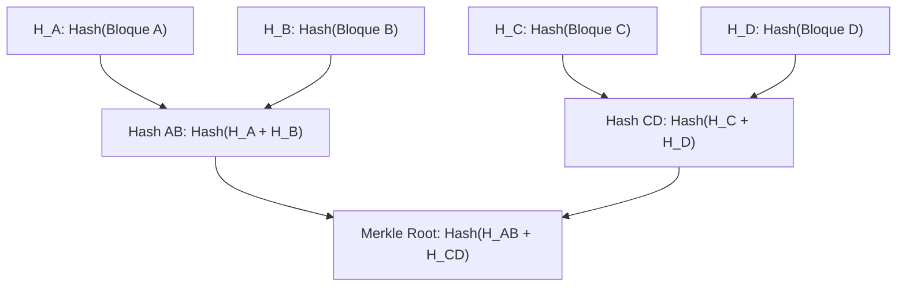
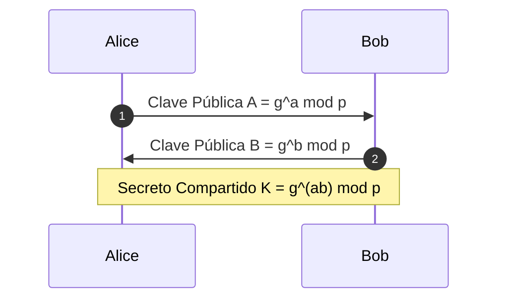

# ada-crypto (Criptografía Aplicada, Seguridad de la Información y Protocolos Seguros)

## Overview
Proporciona diseño, análisis matemático e implementación de primitivas para **Criptografía Aplicada** y **Seguridad de la Información**.

Cubre criptografía simétrica (Cifrado por bloques: **AES-128/256** en modos CBC, GCM autenticado; Cifrado de flujo: ChaCha20-Poly1305), criptografía asimétrica de clave pública (**RSA** con padding OAEP/PSS, Criptografía de Curva Elíptica **ECC** sobre secp256k1 y Curve25519 / Ed25519), intercambio de claves (**Diffie-Hellman** efímero ECDHE), funciones hash criptográficas unidireccionales (**SHA-256/3, BLAKE3**, Argon2 / bcrypt para contraseñas), firmas digitales (**ECDSA, EdDSA**), Árboles de Merkle para integridad criptográfica, Infraestructura de Clave Pública (**PKI**, certificados X.509, cadenas de confianza y revocación CRL/OCSP) e introducción a Pruebas de Conocimiento Cero (**ZKP** zk-SNARKs).

---

## When to Use
- Selección e implementación de primitivas de cifrado autenticado (**AEAD - Authenticated Encryption with Associated Data** como AES-GCM o ChaCha20-Poly1305).
- Generación de pares de claves asimétricas y firmas digitales seguras (evitando ataques de reutilización de $k$ en ECDSA).
- Almacenamiento seguro de credenciales mediante algoritmos de derivación de claves resistentes a fuerza bruta y GPUs (**Argon2id**, PBKDF2).
- Verificación de cadenas de certificados X.509 y negociación del handshake seguro **TLS 1.3**.
- Construcción y validación de pruebas de inclusión con **Árboles de Merkle**.
- Auditoría contra vulnerabilidades criptográficas clásicas: Padding Oracle, ataques de repetición (*Replay Attacks*), claves débiles y generadores pseudoaleatorios no criptográficos (CSPRNG vs. `Math.random()`).
- Generación de notas y desarrollos matemáticos para AFFiNE BlockSuite.

---

## 🔐 Matriz de Primitivas Criptográficas Estándar

| Dominio | Algoritmo Recomendado | Longitud de Clave / Salida | Propósito Principal |
| :--- | :--- | :---: | :--- |
| **Cifrado Simétrico Autenticado** | **AES-256-GCM** / ChaCha20-Poly1305 | 256 bits (Nonce: 96 bits) | Confidencialidad + Integridad de datos en reposo y tránsito. |
| **Firma Digital Asimétrica** | **Ed25519** (EdDSA) / ECDSA (secp256r1) | 256 bits | Autenticidad, integridad y no repudio de mensajes. |
| **Intercambio de Claves** | **X25519** (ECDHE) | 256 bits | Establecimiento de secreto compartido efímero (*Forward Secrecy*). |
| **Hashing de Datos / Archivos** | **SHA-256** / SHA-3 / BLAKE3 | 256 / 512 bits | Huellas digitales de integridad inmutables. |
| **Hashing de Contraseñas** | **Argon2id** (o bcrypt) | Sal regulable + memoria | Protección de contraseñas contra ataques de diccionarios en GPU. |

---

## ⚡ Estructura de un Árbol de Merkle


- **Prueba de Inclusión (*Merkle Proof*)**: Para verificar que el `Bloque A` pertenece a la raíz `Root`, solo se necesitan los hashes $H_B$ y $H_{CD}$ (complejidad $O(\log N)$).

---

## 📝 Plantilla para Notas de Criptografía en AFFiNE

Al generar apuntes para `~/Documents/GitHub/Universidad/Affinite_Notes/Ingenieria_Software/<tema> (YYYY-MM-DD).md`:

```markdown
# [Tema de Criptografía / Protocolo de Seguridad] (YYYY-MM-DD)
> 📅 **Fecha**: YYYY-MM-DD | 🏷️ **Tags**: #criptografia #seguridad #aes #rsa #pki #[subtema]

> [!NOTE]
> **Modelo de Amenaza**: Capacidades del adversario (Eavesdropping, Man-in-the-Middle, Manipulación activa).

## 1. Fundamento Matemático & Primitivas
- **Ecuación / Problema Difícil**:
  - Logaritmo Discreto sobre Curvas Elípticas (ECDLP): $P = k \cdot G$
  - Factorización de enteros grandes: $N = p \cdot q$

## 2. Flujo del Protocolo de Cifrado / Autenticación


## 3. Checklist de Seguridad Criptográfica
- [ ] ¿Los Nonces e IVs son generados con CSPRNG y NUNCA se reutilizan con la misma clave?
- [ ] ¿Se utiliza cifrado autenticado (AEAD) para prevenir ataques de manipulación de texto cifrado?
```
