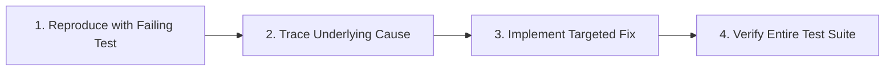

# ada-debug (Systematic Root Cause Analysis)

<EXTREMELY-IMPORTANT>
NO FIXES WITHOUT ROOT CAUSE INVESTIGATION FIRST.
Never patch symptoms, silence warnings, or wrap failures in generic try/catch blocks without understanding the root failure mechanism.
</EXTREMELY-IMPORTANT>

## 4-Step Root Cause Analysis Protocol

### Step 1: Reproduce with Failing Test
- Construct a minimal, reproducible test case capturing the exact failure.
- Run the test to confirm it triggers the bug and produces the reported error or assertion failure.
- If unable to reproduce locally, inspect environmental factors, fixtures, and configuration before modifying code.

### Step 2: Trace Underlying Cause
- Read the complete stack trace, noting precise files, lines, and variable values.
- Trace the data flow backward from the point of failure to the origin of invalid state.
- Formulate an explicit hypothesis: "Component X fails because state Y was not initialized when Z occurred."
- Validate the hypothesis against logs or debugging assertions before changing code.

### Step 3: Implement Targeted Fix
- Address the defect at its root origin rather than suppressing the symptom at the surface.
- Avoid anti-patterns:
  - ❌ Wrapping code in empty `catch` blocks or swallowing errors.
  - ❌ Inserting arbitrary nullish coalescing operators (`?? null`) without validating why values are null.
  - ❌ Adding sleep/delays to bypass race conditions.
- Make the minimal necessary correction to restore intended system invariants.

### Step 4: Verify Entire Test Suite
- Run the reproduction test to verify it transitions from RED to GREEN.
- Execute the full test suite (`npm test`, `pytest`, etc.) to guarantee zero unintended regressions.
- Confirm clean exit code 0 before concluding the debugging session.
