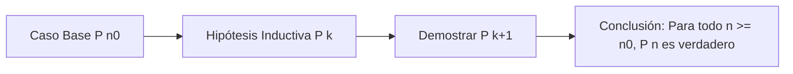

# ada-discrete (Matemáticas Discretas, Lógica y Teoría de Grafos)

## Overview
Proporciona rigor formal, métodos de demostración matemática y resolución de problemas para **Matemáticas Discretas**, el fundamento teórico esencial de las Ciencias de la Computación y la Ingeniería de Software.

Cubre lógica proposicional y de primer orden, demostraciones por inducción matemática débil y fuerte, teoría formal de conjuntos, relaciones binarias y de orden, funciones inyectivas/sobreyectivas/biyectivas, combinatoria y conteo, teoría de grafos y árboles, y estructuras algebraicas discretas (retículos y álgebras de Boole).

---

## When to Use
- Demostración de propiedades de algoritmos mediante **inducción matemática** o principio del buen orden.
- Formalización de argumentos lógicos, tablas de verdad, inferencia lógica (Modus Ponens, Resolución) y álgebra booleana.
- Problemas de conteo, principio de inclusión-exclusión, permutaciones, combinaciones y principio del palomar (*Pigeonhole Principle*).
- Modelado de redes y dependencias con **teoría de grafos** (grafos dirigidos/no dirigidos, conectividad, árboles generadores mínimos, coloreado de grafos, caminos de Euler y Hamilton).
- Análisis de relaciones de equivalencia, clases de equivalencia, particiones de conjuntos y órdenes parciales (diagramas de Hasse).
- Generación de notas y ejercicios resueltos para AFFiNE BlockSuite.

---

## 📐 Núcleo Teórico y Métodos de Demostración

### 1. Métodos de Demostración Formal
1. **Demostración Directa**: Probar $P \implies Q$ asumiendo que $P$ es verdadero y deduciendo $Q$ mediante axiomas y teoremas.
2. **Por Contraposición**: Probar $P \implies Q$ demostrando equivalentemente su contrarrecíproca $\neg Q \implies \neg P$.
3. **Por Reducción al Absurdo (Contradicción)**: Asumir $P \land \neg Q$ y derivar una falsedad lógica ($R \land \neg R$).
4. **Inducción Matemática**:
   - **Caso Base**: Demostrar que $P(n_0)$ es verdadero.
   - **Paso Inductivo**: Asumir como Hipótesis de Inducción que $P(k)$ es verdadero para $k \ge n_0$, y probar formalmente que $P(k+1)$ es verdadero.
   - **Inducción Fuerte**: Asumir que $P(i)$ es verdadero para todo $n_0 \le i \le k$, y probar $P(k+1)$.



### 2. Teoría de Grafos
* **Grafo**: $G = (V, E)$ donde $V$ es el conjunto de vértices y $E \subseteq V \times V$ es el conjunto de aristas.
* **Lema del Apretón de Manos (Handshaking Lemma)**:
  $$\sum_{v \in V} \text{deg}(v) = 2|E|$$
* **Fórmula de Euler para Grafos Planares Conexos**:
  $$|V| - |E| + |F| = 2$$
  *(donde $|F|$ es el número de caras/regiones).*
* **Árbol**: Grafo conexo y acíclico con exactamente $|V| - 1$ aristas.

### 3. Combinatoria y Principios de Conteo
* **Permutaciones sin repetición**: $P(n, r) = \frac{n!}{(n-r)!}$
* **Combinaciones**: $\binom{n}{r} = \frac{n!}{r!(n-r)!}$
* **Combinaciones con repetición**: $\binom{n + r - 1}{r}$
* **Principio de Inclusión-Exclusión**:
  $$|A \cup B \cup C| = |A| + |B| + |C| - (|A \cap B| + |A \cap C| + |B \cap C|) + |A \cap B \cap C|$$

---

## ⚡ Tabla de Equivalencias Lógicas Fundamentales

| Nombre de la Ley | Equivalencia Lógica |
| :--- | :--- |
| **Leyes de De Morgan** | $\neg(p \land q) \equiv \neg p \lor \neg q \quad\Big\vert\quad \neg(p \lor q) \equiv \neg p \land \neg q$ |
| **Implicación como Disyunción** | $p \implies q \equiv \neg p \lor q$ |
| **Contrarrecíproca** | $p \implies q \equiv \neg q \implies \neg p$ |
| **Distributividad** | $p \land (q \lor r) \equiv (p \land q) \lor (p \land r)$ |
| **Bicondicional** | $p \iff q \equiv (p \implies q) \land (q \implies p)$ |

---

## 📝 Plantilla para Notas de Matemáticas Discretas en AFFiNE

Al generar apuntes para `~/Documents/GitHub/Universidad/Affinite_Notes/Matematicas/<tema> (YYYY-MM-DD).md`:

```markdown
# [Tema de Matemáticas Discretas] (YYYY-MM-DD)
> 📅 **Fecha**: YYYY-MM-DD | 🏷️ **Tags**: #matematicas-discretas #logica #grafos #[subtema]

> [!NOTE]
> **Definición Formal**: Enunciado riguroso del teorema, estructura discreta o concepto algebraico.

## 1. Fundamento Teórico & Simbología Lógica
- Definiciones formales en lenguaje matemático:
  $$\forall x \in S, \quad P(x) \implies \exists y \in T \text{ tal que } Q(x, y)$$

## 2. Demostración Paso a Paso
### Teorema: [Enunciado]
1. **Hipótesis**: [Supuestos iniciales]
2. **Paso 1: [Desarrollo lógico o Caso Base]**
3. **Paso 2: [Paso inductivo o deducción por contraposición]**
4. **Conclusión**:
   > [!IMPORTANT]
   > $\text{Q.E.D. (Quod Erat Demonstrandum)}$ — El resultado queda demostrado formalmente.

## 3. Ejemplos de Aplicación en Algoritmos & Computación
- Conexión con estructuras de datos (árboles binarios, detección de ciclos, autómatas).

## 4. Checklist de Comprensión
- [ ] ¿Identifico la diferencia entre implicación directa, recíproca y contrapositiva?
- [ ] ¿Puedo reproducir la demostración sin consultar la solución?
```
