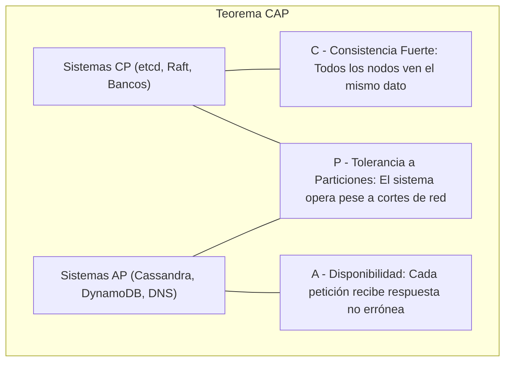
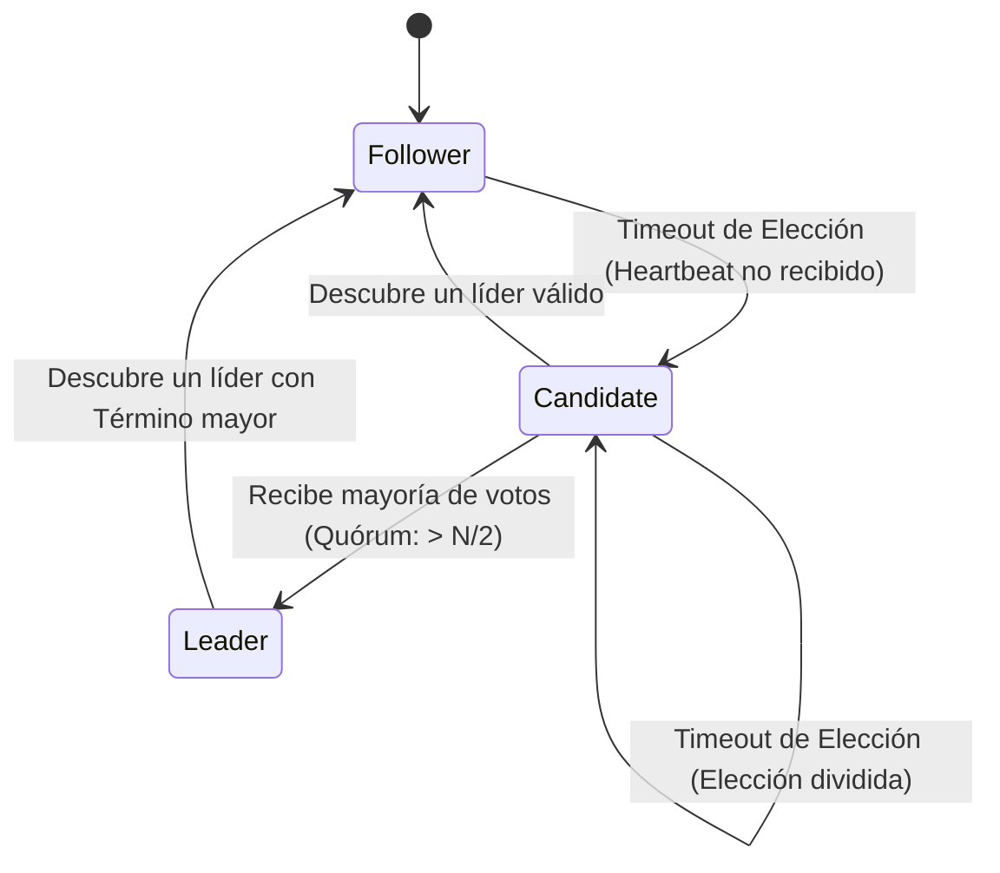
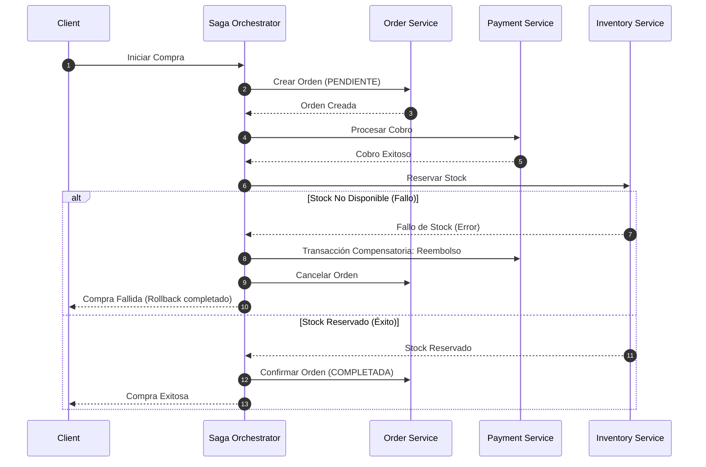

# ada-distrib (Sistemas Distribuidos, Consenso y Computación en la Nube)

## Overview
Proporciona arquitectura, modelos de consistencia y protocolos para **Sistemas Distribuidos y Computación en la Nube**.

Cubre los fundamentos teóricos de la concurrencia distribuida (Teorema **CAP** de Brewer, PACELC, Modelos de Fallas bizantinas vs. crash-stop, Relojes Lógicos de Lamport y Relojes Vectoriales), algoritmos de consenso distribuido (**Raft** con elección de líder y replicación de log, Paxos), modelos de consistencia de datos (Linealizabilidad, Consistencia Secuencial, Consistencia Causal, Consistencia Eventual), Estructuras de Datos Replicadas Libres de Conflicto (**CRDTs** basadas en estado y en operaciones como Yjs y Automerge), comunicación de alto rendimiento (**gRPC / Protocol Buffers**), arquitecturas guiadas por eventos con brokers (Apache Kafka, RabbitMQ) y patrones de transacción distribuida (**Patrón Saga** Orquestado y Coreografiado, Outbox Pattern, 2-Phase Commit).

---

## When to Use
- Diseño de arquitecturas de microservicios resilientes y sistemas de alta disponibilidad.
- Evaluación de compromisos de almacenamiento y particionamiento bajo el teorema **CAP**:
  - **CP** (Consistencia + Tolerancia a Particiones): Sistemas bancarios / transaccionales (etcd, Consul, Zookeeper, PostgreSQL con replicación sincrónica).
  - **AP** (Disponibilidad + Tolerancia a Particiones): Redes sociales / analítica en tiempo real (Cassandra, DynamoDB con consistencia eventual, DNS).
- Implementación y depuración del algoritmo de consenso **Raft** (Términos, Heartbeats, Log Matching Property).
- Modelado de colaboración multiusuario en tiempo real sin bloqueos mediante **CRDTs**.
- Especificación de contratos RPC tipados con archivos `.proto` en gRPC.
- Gestión de transacciones distribuidas y compensaciones ante fallas mediante el **Patrón Saga**.
- Generación de notas y diagramas distribuidos para AFFiNE BlockSuite.

---

## 🌐 Teorema CAP & Algoritmo de Consenso Raft



### Estados y Ciclo de Vida de un Nodo en Raft



---

## ⚡ Patrón Saga Orquestado para Transacciones Distribuidas



---

## 📝 Plantilla para Notas de Sistemas Distribuidos en AFFiNE

Al generar apuntes para `~/Documents/GitHub/Universidad/Affinite_Notes/Ingenieria_Software/<tema> (YYYY-MM-DD).md`:

```markdown
# [Tema de Sistemas Distribuidos / Microservicios] (YYYY-MM-DD)
> 📅 **Fecha**: YYYY-MM-DD | 🏷️ **Tags**: #sistemas-distribuidos #raft #cap #grpc #[subtema]

> [!NOTE]
> **Modelo del Sistema**: Supuestos de red (asíncrona / parcialmente sincrónica) y modelo de fallas (Crash-Recovery / Byzantine).

## 1. Compromisos Arquitectónicos (CAP / PACELC)
- **Clasificación**: Sistema CP / AP
- **Mecanismo de Consenso**: Algoritmo Raft con quórum mayoritario $\lfloor N/2 \rfloor + 1$

## 2. Definición del Contrato gRPC / Protobuf
```protobuf
syntax = "proto3";
package universidad.distrib;

service OrdenService {
  rpc ProcesarOrden (OrdenRequest) returns (OrdenResponse);
}

message OrdenRequest {
  string id_usuario = 1;
  double monto_total = 2;
}
```

## 3. Checklist de Confiabilidad Distribuida
- [ ] ¿Los endpoints son estrictamente idempotentes mediante claves de deduplicación?
- [ ] ¿Se implementó el patrón Circuit Breaker y Retry con Exponential Backoff y Jitter?
```
