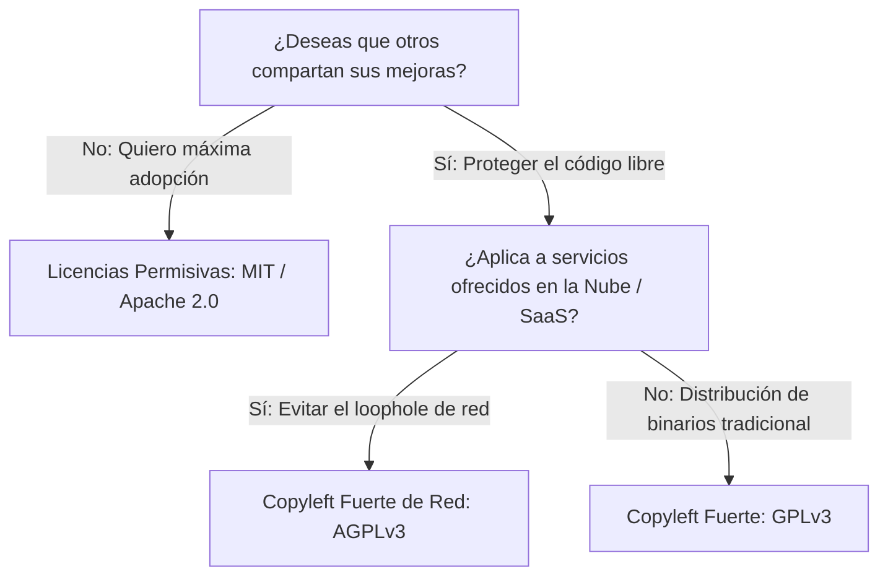

# ada-ethics (Ética Profesional en Ingeniería, Deontología y Legislación Tecnológica)

## Overview
Proporciona marcos de juicio ético, análisis deontológico y cumplimiento normativo para la **Ética Profesional en Ingeniería** y el **Derecho Informático**.

Cubre los códigos de ética profesional internacionales (**ACM / IEEE-CS Code of Ethics**, Leyes de ejercicio profesional de la ingeniería como COPNIA / colegios de ingenieros), matrices de compatibilidad de **Licencias de Software de Código Abierto (Open Source - OSI)** (Permisivas: MIT, BSD, Apache 2.0; Copyleft débil: LGPL, MPL; Copyleft fuerte y de red: GPLv3, AGPLv3), legislación y cumplimiento de **Protección de Datos Personales y Privacidad** (Habeas Data, GDPR / RGPD de la UE: principios de minimización, consentimiento explícito, derecho al olvido y privacidad por diseño), marcos de ciberseguridad legal (responsabilidad civil, delitos informáticos) y principios de **Ética en Inteligencia Artificial** (Transparencia, Explicabilidad XAI, Prevención de sesgos algorítmicos, Supervisión humana y Seguridad).

---

## When to Use
- Análisis de dilemas éticos en proyectos de ingeniería de software (privacidad vs. monetización, presiones de entrega vs. deuda de seguridad crítica).
- Selección y auditoría de compatibilidad de licencias de dependencias externas en proyectos comerciales o de código abierto.
- Diseño de sistemas cumpliendo con el principio de **Privacidad por Diseño y por Defecto (*Privacy by Design*)** de GDPR y legislaciones de Habeas Data.
- Evaluación del impacto ético y sesgo en modelos de Inteligencia Artificial (Fairness, Accountability, Transparency - FAccT).
- Análisis de responsabilidades legales y deontológicas ante fallos de software críticos para la seguridad humana (Safety-Critical Systems).
- Generación de notas y análisis éticos para AFFiNE BlockSuite.

---

## ⚖️ Árbol de Selección de Licencias Open Source



---

## 📜 Comparativa de Licencias de Software

| Licencia | Tipo | Modificaciones Comerciales | Exigencia de Liberar Código Derivado | Patente Explícita |
| :--- | :--- | :---: | :---: | :---: |
| **MIT** | Permisiva | Sí | No | No |
| **Apache 2.0** | Permisiva | Sí | No | **Sí (Concesión explícita)** |
| **LGPLv3** | Copyleft Débil | Sí (si se enlaza dinámicamente) | Solo modificaciones a la librería | Sí |
| **GPLv3** | Copyleft Fuerte | Sí | **Sí (Misma licencia GPLv3)** | Sí |
| **AGPLv3** | Copyleft de Red | Sí | **Sí (Incluso si se ejecuta como SaaS)** | Sí |

---

## 🛡️ Principios Fundamentales del Código de Ética ACM / IEEE-CS

1. **Contribuir a la sociedad y al bienestar humano**: Reconocer que todas las personas son partes interesadas en la computación.
2. **Evitar daños**: Prevenir consecuencias negativas graves (pérdida de datos, brechas de seguridad, discriminación algorítmica).
3. **Ser honesto y digno de confianza**: Declarar capacidades y limitaciones técnicas reales sin falsas promesas.
4. **Respetar la privacidad y confidencialidad**: Proteger datos sensibles y cumplir con la legislación de protección de datos.
5. **Aceptar la responsabilidad profesional**: Velar por la máxima calidad técnica antes de liberar sistemas críticos.

---

## 📝 Plantilla para Análisis Éticos y Legales en AFFiNE

Al generar apuntes para `~/Documents/GitHub/Universidad/Affinite_Notes/General/<tema> (YYYY-MM-DD).md`:

```markdown
# [Análisis Ético / Cumplimiento Legal] (YYYY-MM-DD)
> 📅 **Fecha**: YYYY-MM-DD | 🏷️ **Tags**: #etica-ingenieria #licencias #gdpr #privacidad #[subtema]

> [!NOTE]
> **Dilema o Escenario**: Descripción de la situación técnica, actores involucrados y posibles conflictos de interés.

## 1. Análisis de Impacto & Derechos de los Usuarios
- **Datos Personales Recolectados**: [Listado justificado bajo principio de minimización]
- **Posibles Riesgos de Discriminación o Fuga**: [Evaluación de impacto PIA]

## 2. Marco Legal & Licenciamiento Aplicable
- **Licencia Recomendada**: Apache 2.0 (protección de patentes y compatibilidad comercial).
- **Cumplimiento Normativo**: Artículos clave de Habeas Data / GDPR aplicados.

## 3. Resolución y Decisión de Ingeniería Justificada
- **Principio Deontológico Aplicado**: [Principio ACM/IEEE invocado]
- **Mitigaciones Implementadas**: [Controles técnicos de seguridad y transparencia]

## 4. Checklist de Responsabilidad Profesional
- [ ] ¿El sistema garantiza el consentimiento libre, previo e informado de los usuarios?
- [ ] ¿Se verificó que ninguna dependencia de terceros viole las licencias del proyecto?
```
