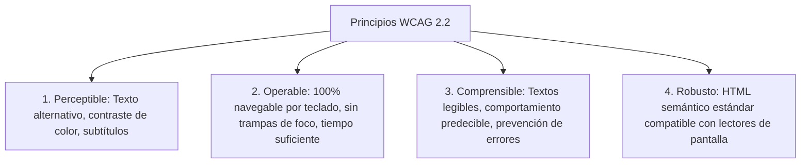

# ada-hci (Interacción Humano-Computador, Usabilidad y Accesibilidad WCAG)

## Overview
Proporciona metodologías rigurosas para la **Interacción Humano-Computador (HCI / IPO)**, el **Diseño Centrado en el Usuario (UCD)** y la **Accesibilidad Web y Móvil (WCAG 2.2)**.

Cubre las **10 Heurísticas de Usabilidad de Jakob Nielsen**, modelado cognitivo del usuario (Ley de Fitts, Ley de Hick, Ley de Miller de la memoria a corto plazo $7 \pm 2$), diseño de Arquitectura de Información (Card Sorting, Wireframing, Jerarquías visuales), diseño y ejecución de **Pruebas de Usabilidad con Usuarios** (Protocolo Think-Aloud, Métricas SUS - *System Usability Scale*, SEQ - *Single Ease Question*, Tasa de Éxito de Tareas y Tiempo en Tarea), y cumplimiento exhaustivo de las pautas de accesibilidad **WCAG 2.2 Niveles A, AA y AAA** (Perceptible, Operable, Comprensible y Robusto - POUR).

---

## When to Use
- Conducción de evaluaciones heurísticas de interfaces de usuario (identificación de severidad de fallos de 0 a 4).
- Auditoría de **Accesibilidad Universal (WCAG 2.2)**: Contraste de color (mínimo 4.5:1 para texto normal en AA, 7:1 en AAA), navegación por teclado (`tabindex`, focus visible), roles semánticos WAI-ARIA y compatibilidad con lectores de pantalla.
- Cálculo e interpretación de la escala de usabilidad de sistemas (**SUS Score** de 0 a 100).
- Aplicación de leyes de interacción humana:
  - **Ley de Fitts**: $T = a + b \log_2\left(1 + \frac{D}{W}\right)$ (el tiempo para alcanzar un objetivo depende de la distancia $D$ y el tamaño del botón $W$).
  - **Ley de Hick**: $T = b \log_2(n + 1)$ (el tiempo de decisión aumenta logarítmicamente con el número de opciones $n$).
- Generación de notas y reportes de evaluación de UX/HCI para AFFiNE BlockSuite.

---

## 🧭 Las 10 Heurísticas de Usabilidad de Nielsen

| # | Heurística | Regla de Oro en la Interfaz |
| :---: | :--- | :--- |
| **1** | **Visibilidad del estado del sistema** | Proporcionar feedback continuo e inmediato (spinners, barras de progreso, badges). |
| **2** | **Correspondencia entre el sistema y el mundo real** | Hablar el lenguaje del usuario, no tecnicismos internos de base de datos. |
| **3** | **Control y libertad del usuario** | Ofrecer salidas de emergencia claras ("Deshacer", "Cancelar", "Cerrar modal"). |
| **4** | **Consistencia y estándares** | Los mismos términos e iconos deben significar lo mismo en toda la app. |
| **5** | **Prevención de errores** | Eliminar condiciones propensas a fallos (confirmación antes de acciones destructivas). |
| **6** | **Reconocimiento antes que recuerdo** | Hacer visibles los objetos, opciones y acciones sin obligar a memorizar. |
| **7** | **Flexibilidad y eficiencia de uso** | Atajos de teclado para usuarios avanzados y flujos sencillos para novatos. |
| **8** | **Diseño estético y minimalista** | Eliminar diálogos o elementos visuales irrelevantes que compitan por atención. |
| **9** | **Ayudar a reconocer, diagnosticar y recuperarse de errores** | Mensajes de error en lenguaje claro con soluciones explícitas y constructivas. |
| **10** | **Ayuda y documentación** | Fácil de buscar, enfocada en la tarea del usuario y con pasos concisos. |

---

## ♿ Principios de Accesibilidad POUR (WCAG 2.2)



---

## 📝 Plantilla para Reportes de Usabilidad en AFFiNE

Al generar apuntes para `~/Documents/GitHub/Universidad/Affinite_Notes/Ingenieria_Software/<tema> (YYYY-MM-DD).md`:

```markdown
# [Evaluación Heurística / Auditoría de Usabilidad] (YYYY-MM-DD)
> 📅 **Fecha**: YYYY-MM-DD | 🏷️ **Tags**: #hci #usabilidad #nielsen #wcag #[subtema]

> [!NOTE]
> **Interfaz Evaluada**: Sistema / pantalla analizada y perfil de usuario objetivo (*User Persona*).

## 1. Hallazgos Heurísticos de Nielsen
| ID | Heurística Violada | Problema Detectado | Severidad (0-4) | Recomendación de Diseño |
| :---: | :--- | :--- | :---: | :--- |
| H-01 | #1 Visibilidad de Estado | Al enviar formulario no hay indicador de carga. | 3 (Mayor) | Agregar botón con spinner deshabilitado. |
| H-02 | #5 Prevención de Errores | Borrado de cuenta sin confirmación modal. | 4 (Catastrófico) | Modal de confirmación con tipeo de palabra clave. |

## 2. Auditoría de Accesibilidad WCAG 2.2 (Nivel AA)
- [x] Contraste de texto en botones $> 4.5:1$
- [x] Navegación completa mediante tecla `Tab` sin pérdida de foco
- [x] Atributos `aria-label` en iconos sin texto visible

## 3. Puntuación SUS (System Usability Scale)
- **SUS Score Obtenido**: $82.5 / 100$ (Calificación: Excelente / Grado A)

## 4. Checklist de Entrega
- [ ] ¿Se validó el flujo con usuarios reales aplicando el protocolo Think-Aloud?
```
