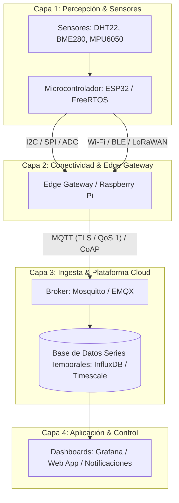

# ada-iot (Internet de las Cosas, Protocolos Telemétricos y Edge Computing)

## Overview
Proporciona diseño de arquitectura, conectividad telemétrica y programación de sistemas para el **Internet de las Cosas (IoT)** y **Sistemas Ciberfísicos**.

Cubre la arquitectura de 4 capas IoT (Percepción, Red/Edge Gateway, Plataforma/Cloud, Aplicación), interfaces de hardware y buses de comunicación de sensores (GPIO, ADC, I2C, SPI, UART, PWM), protocolos de transporte ligero (**MQTT v3.1.1/v5 con niveles QoS 0/1/2**, **CoAP** sobre UDP, HTTP REST, WebSockets, BLE GATT, LoRa / LoRaWAN y Zigbee), microcontroladores (ESP32 con FreeRTOS y ESP-IDF, STM32, Arduino), procesamiento en el borde (*Edge Computing* / TinyML) y gestión de energía (modos Deep Sleep, RTC memory y battery management).

---

## When to Use
- Diseño de proyectos y sistemas IoT de extremo a extremo (desde el sensor hasta el dashboard en la nube).
- Implementación de clientes y brokers **MQTT** (tópicos jerárquicos `casa/piso1/temperatura`, mensajes Retained, Last Will and Testament - LWT, QoS).
- Configuración de buses de sensores:
  - **I2C**: 2 hilos (SDA, SCL), direccionamiento de 7/10 bits, resistencias pull-up.
  - **SPI**: 4 hilos (MOSI, MISO, SCK, CS), full-duplex de alta velocidad.
  - **UART**: Transmisión asíncrona serial (TX, RX, Baudrate).
- Optimización de consumo energético en nodos inalámbricos mediante ciclos de trabajo (*Duty Cycle*) y **Deep Sleep** en ESP32/ESP8266.
- Integración con plataformas de telemetría y visualización (ThingsBoard, InfluxDB + Grafana, AWS IoT Core, Home Assistant).
- Generación de notas y diagramas IoT para AFFiNE BlockSuite.

---

## 📡 Arquitectura de 4 Capas IoT



---

## ⚡ Protocolos de Comunicación IoT: Matriz Comparativa

| Protocolo | Capa de Transporte | Modelo de Comunicación | Sobrecarga de Cabecera | Escenario Ideal |
| :--- | :--- | :--- | :--- | :--- |
| **MQTT** | TCP (con TLS opcional) | Publicador / Suscriptor (Broker) | Muy baja (2 bytes) | Telemetría continua, redes Wi-Fi/Celulares confiables. |
| **CoAP** | UDP | Request / Response (RESTful) | Ultrabaja (4 bytes) | Redes con restricciones severas de ancho de banda y batería. |
| **HTTP/REST** | TCP / TLS | Request / Response | Alta (encabezados de texto) | Envío infrecuente de datos pesados a servidores web estándar. |
| **LoRaWAN** | Radiofrecuencia sub-GHz | Estrella de topología abierta | Baja (tramas compactas) | Sensores agrícolas/industriales a larga distancia (hasta 15 km). |
| **BLE (GATT)** | Radio 2.4 GHz | Cliente / Servidor de Perfiles | Muy baja | Dispositivos personales (wearables) y sensores de proximidad. |

---

## 🔧 Niveles de Calidad de Servicio (QoS) en MQTT

1. **QoS 0 (At most once)**: El mensaje se envía una vez sin acuse de recibo (*Fire and forget*). Pérdida tolerable en telemetría de alta frecuencia.
2. **QoS 1 (At least once)**: El mensaje se envía con acuse `PUBACK`. Garantiza entrega pero puede generar duplicados.
3. **QoS 2 (Exactly once)**: Protocolo de 4 pasos (`PUBLISH` -> `PUBREC` -> `PUBREL` -> `PUBCOMP`). Garantiza entrega única sin duplicados (crítico para comandos de control/facturación).

---

## 📝 Plantilla para Notas de IoT en AFFiNE

Al generar apuntes para `~/Documents/GitHub/Universidad/Affinite_Notes/Ingenieria_Software/<tema> (YYYY-MM-DD).md`:

```markdown
# [Proyecto / Arquitectura IoT] (YYYY-MM-DD)
> 📅 **Fecha**: YYYY-MM-DD | 🏷️ **Tags**: #iot #mqtt #esp32 #sensores #[subtema]

> [!NOTE]
> **Resumen del Sistema**: Propósito de la red de sensores, actuadores y plataforma de procesamiento.

## 1. Diagrama de Conexiones & Hardware
- **Microcontrolador**: ESP32 NodeMCU (3.3V)
- **Buses Utilizados**:
  - I2C (GPIO 21 SDA, GPIO 22 SCL) -> Sensor BME280 (0x76)
  - GPIO 4 -> Relé digital

## 2. Configuración de Telemetría MQTT
- **Broker**: `mqtt.servidor.local:1883`
- **Tópicos**:
  - Publicación: `universidad/laboratorio/sensores/bme280` (QoS 1)
  - Suscripción a Comandos: `universidad/laboratorio/actuadores/rele` (QoS 2)

## 3. Código Firmware de Referencia (C++ / Arduino / ESP-IDF)
```cpp
#include <WiFi.h>
#include <PubSubClient.h>

void setup() {
  Serial.begin(115200);
  // Inicializar sensores y WiFi
}

void loop() {
  // Lectura periódica y publicación MQTT
}
```

## 4. Checklist de Verificación de Campo
- [ ] ¿Se configuró el modo Deep Sleep para optimizar la batería?
- [ ] ¿Los tópicos MQTT siguen una jerarquía semántica limpia y escalable?
```
