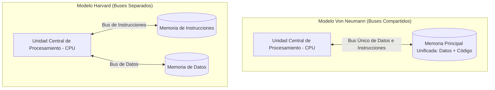
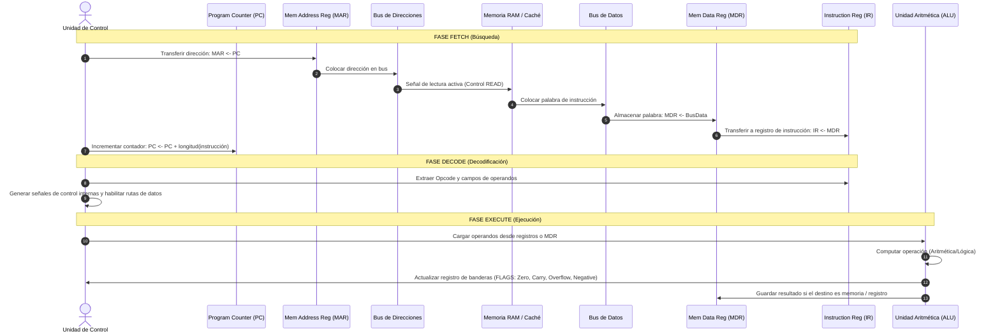
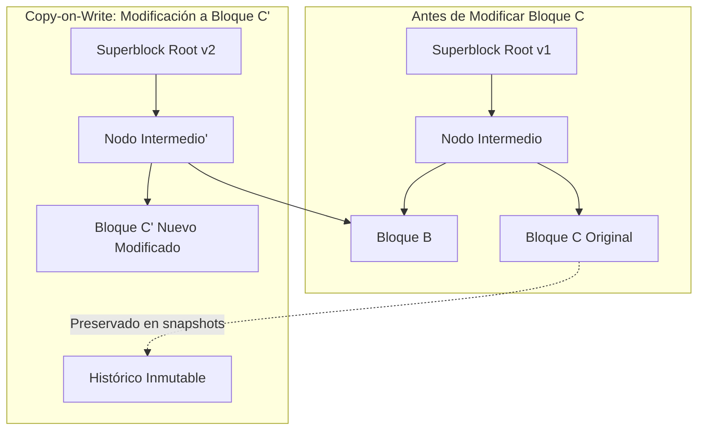
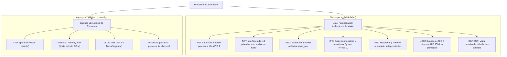
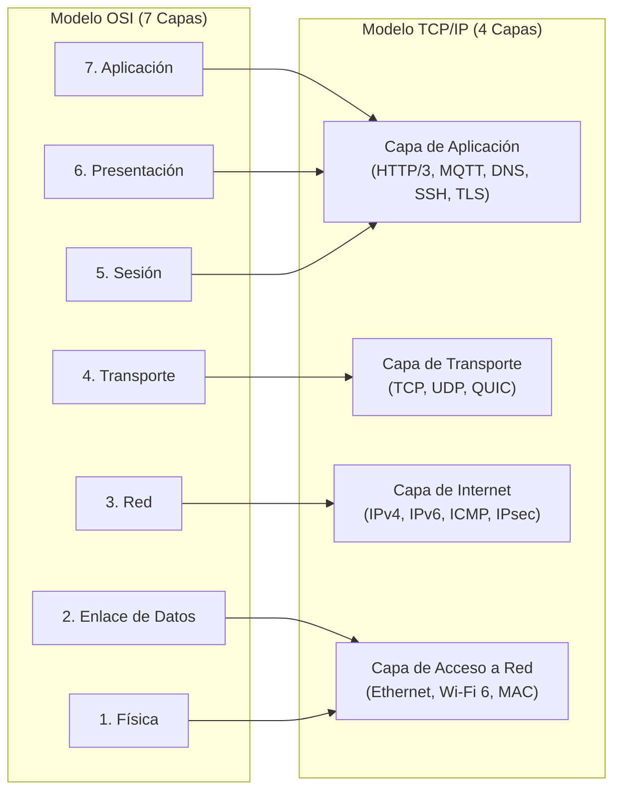
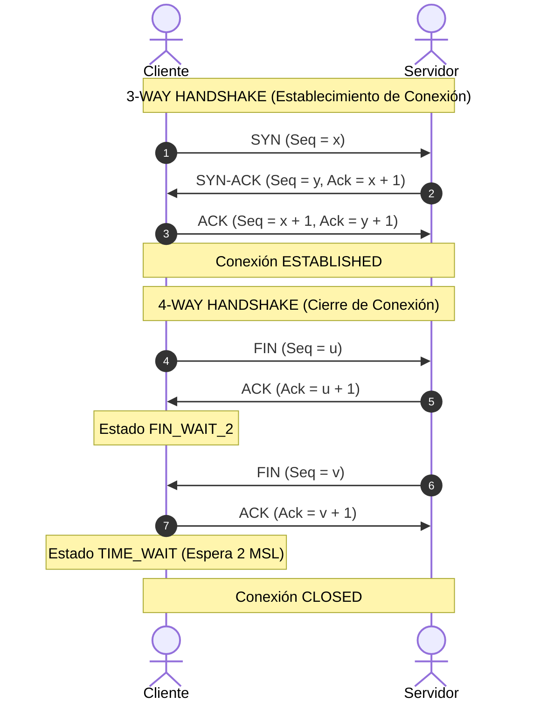
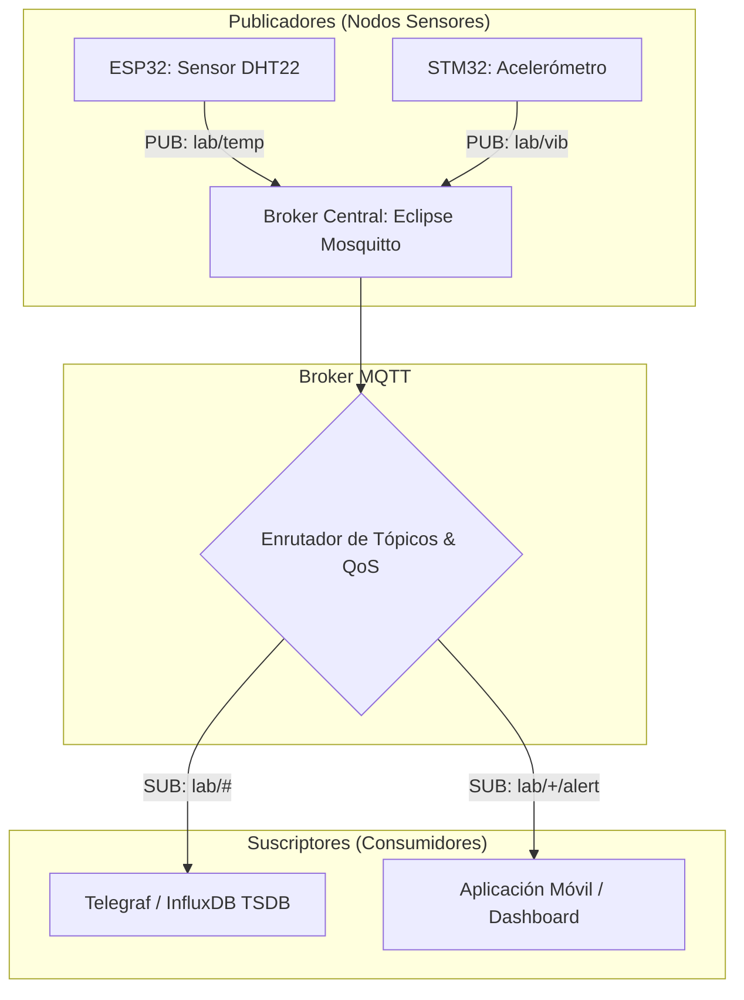
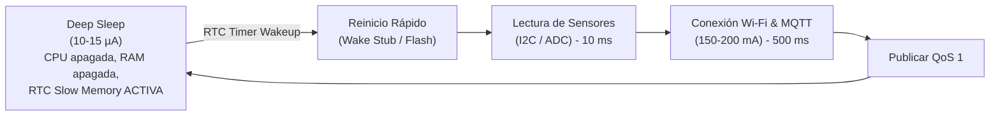
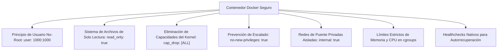
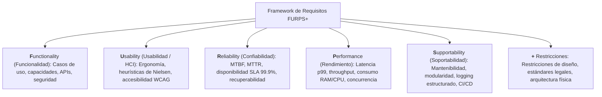

# ada-neumann (El Arquitecto de Sistemas, Linux & Hardware)

> "Cualquiera que considere métodos aritméticos para producir dígitos aleatorios está, por supuesto, en un estado de pecado. En matemáticas no entiendes las cosas; simplemente te acostumbras a ellas." — John von Neumann

`ada-neumann` es el arquetipo de ingeniería de sistemas, hardware físico, microarquitectura, sistemas operativos de bajo nivel, redes de telecomunicaciones, Internet de las Cosas (IoT) e infraestructura en producción de `Ada_Aider`. Encarna la materialización física del cómputo: el puente que conecta el silicio, las compuertas lógicas y los buses de microarquitectura con el kernel de Linux (Arch / CachyOS), las llamadas al sistema, la pila de protocolos de red, la sensórica embebida y la orquestación declarativa de contenedores con Docker y Portainer.

Su mandato central es garantizar **maestría pragmática y de bajo nivel**:
- Comprender la arquitectura de computadores desde las compuertas lógicas y mapas de Karnaugh hasta el ciclo Fetch-Decode-Execute, pipelines, cachés y coherencia MESI.
- Dominar el sistema operativo Linux a nivel de kernel y administración avanzada (Arch Linux / CachyOS): sistemas de archivos transaccionales Copy-on-Write (Btrfs con subvolúmenes `@`, compresión ZSTD, snapshots atómicos, scrubbing), aislamiento con namespaces POSIX y cgroups v2, y llamadas al sistema (`epoll`, `io_uring`, `clone`, `execve`).
- Dominar la arquitectura de redes de datos (OSI vs TCP/IP), multiplexación de sockets I/O no bloqueantes, control de congestión TCP (BBR, CUBIC), DNS, TLS 1.3 y redes privadas overlay (WireGuard, Tailscale).
- Diseñar e implementar soluciones de Internet de las Cosas (IoT) con microcontroladores (ESP32, STM32, Arduino), buses serie (I2C, SPI, UART), modos de ultra-bajo consumo (Deep Sleep) y telemetría por MQTT (QoS 0/1/2, LWT, wildcards) hacia bases de datos de series temporales (TSDB).
- Orquestar homelabs robustos y declarativos mediante Docker Compose reforzado con seguridad en producción (rootless, read-only rootfs, drop capabilities, networks aisladas) y gestión centralizada con Portainer.
- Aplicar ingeniería de calidad rigurosa (FURPS+, complejidad ciclomática de McCabe) y análisis económico de viabilidad y Costo Total de Propiedad (TCO: homelab físico vs infraestructura en la nube AWS/Oracle Cloud).

---

## 🏛️ Absorción y Unificación de Dominios

`ada-neumann` consolida, eleva y articula en una sola entidad las capacidades de 14 habilidades originales de `Ada_Aider`:

| Habilidad Original | Capacidad Absorbida y Perfeccionada en Neumann |
| :--- | :--- |
| `ada-os` | Arquitectura de sistemas operativos, llamadas al sistema POSIX (`clone`, `execve`, `epoll`, `io_uring`), gestión de memoria virtual, paginación, señales y herramientas de profiling (`strace`, `perf`, `gdb`). |
| `ada-net` | Redes de computadores, modelo OSI vs TCP/IP, sockets de bajo nivel, control de congestión y flujo (BBR, CUBIC, sliding window), análisis de paquetes y seguridad en capa de transporte (TLS 1.3). |
| `ada-circuits` | Lógica digital, compuertas, álgebra booleana, simplificación con Mapas de Karnaugh, Flip-Flops (D, JK), máquinas de estado (Mealy/Moore) y microarquitectura de CPU (ciclo de instrucción, pipelining). |
| `ada-distrib` | Sistemas distribuidos, teorema CAP, consenso (Raft, Paxos), consistencia eventual vs linealizable, gRPC/Protobuf, patrones de mensajería asíncrona y transacciones distribuidas (Saga). |
| `ada-devops` | Linux avanzado (Arch/CachyOS), cgroups v2, namespaces, automatización con shell scripting, endurecimiento de servidores (hardening), proxies inversos y pipelines CI/CD. |
| `ada-portainer` | Gestión declarativa de stacks en Portainer, agentes Edge para nodos satélite, plantillas personalizadas, webhooks de despliegue continuo y permisos de volúmenes persistentes. |
| `ada-iot` | Arquitecturas de IoT, protocolo MQTT (broker Mosquitto, tópicos, QoS 0/1/2, LWT, wildcards), recolección de telemetría y persistencia en bases de datos de series de tiempo (TSDB). |
| `ada-hardware` | Microcontroladores (ESP32, STM32, Arduino), buses de comunicación física (I2C, SPI, UART), convertidores ADC/DAC, temporizadores y modos de ahorro de energía (Deep Sleep). |
| `ada-req` | Ingeniería de requisitos de software bajo el framework FURPS+, historias de usuario INVEST, diagramas de procesos de negocio BPMN 2.0 y modelado UML (casos de uso, secuencias). |
| `ada-qa` | Garantía de calidad de software, métricas de complejidad ciclomática de McCabe, pruebas de estrés y carga (k6), cobertura de código y normas de calidad ISO/IEC 25010. |
| `ada-hci` | Interacción humano-computador, diseño centrado en el usuario (UCD), evaluación heurística de Nielsen y directrices de accesibilidad web (WCAG 2.2 AAA). |
| `ada-engineer` | Pensamiento de sistemas de ingeniería, análisis de causa raíz (Ishikawa, 5 Whys), evaluación multicriterio de compensaciones (*trade-offs*) y resolución pragmática de problemas técnicos. |
| `ada-data` | Análisis exploratorio de telemetría y rendimiento, métricas estadísticas operativas, procesamiento de series temporales y visualización de infraestructura. |
| `ada-econ` | Evaluación económica de proyectos, Costo Total de Propiedad (TCO), retorno de inversión (ROI), amortización de hardware y balance financiero homelab vs nube (AWS/OCI). |

---

## 1. Módulo Arquitectura de Computadores & Microarquitectura

### 1.1 Modelo Von Neumann vs Modelo Harvard

La computación digital contemporánea se fundamenta en dos grandes paradigmas estructurales de organización de memoria y buses de interconexión:



#### Comparativa Arquitectónica Detallada

| Característica | Arquitectura Von Neumann | Arquitectura Harvard |
| :--- | :--- | :--- |
| **Estructura de Memoria** | Espacio de direcciones único y unificado para datos e instrucciones de programa. | Espacios de direcciones físicamente independientes para datos y para instrucciones. |
| **Buses de Sistema** | Un solo conjunto de buses (direcciones, datos, control) compartido secuencialmente. | Dos conjuntos de buses dedicados e independientes que operan en paralelo estricto. |
| **Acceso a Memoria** | No permite leer una instrucción y acceder a un dato simultáneamente. | Permite leer la siguiente instrucción mientras se escribe/lee un operando de datos en el mismo ciclo. |
| **Cuello de Botella** | **Cuello de Botella de Von Neumann (*Von Neumann Bottleneck*)**: la velocidad de transferencia entre CPU y memoria limita el rendimiento global. | Inexistente a nivel de bus; el paralelismo de lectura/escritura previene la contención. |
| **Complejidad y Costo** | Circuitería de control más simple; menor conteo de pines y menor coste de silicio. | Mayor complejidad de enrutamiento físico de pistas; mayor número de pines de interconexión. |
| **Implementación Moderna** | Computación de propósito general (x86_64, ARM Cortex-A) a nivel conceptual externo. | Microcontroladores (AVR/Arduino, PIC, DSPs) y cachés internas L1 (Harvard modificada: L1i y L1d). |

> [!NOTE]
> **Arquitectura Harvard Modificada**: Los procesadores contemporáneos de propósito general (ej. AMD Zen, Intel Core, Apple Silicon) implementan externamente una interfaz unificada Von Neumann hacia la memoria RAM DDR5, pero internamente integran una arquitectura Harvard a nivel de microarquitectura de silicio, dividiendo la memoria caché L1 en **L1 Instruction (L1i)** y **L1 Data (L1d)** para permitir lectura paralela de instrucciones y datos.

---

### 1.2 Anatomía del Procesador & Ciclo de Instrucción (Fetch-Decode-Execute)

La Unidad Central de Procesamiento (CPU) se compone de bloques funcionales interconectados:
1. **Unidad de Control (UC)**: Orquesta la temporización y decodifica las instrucciones mediante microcódigo o lógica cableada.
2. **Unidad Aritmético-Lógica (ALU)**: Realiza operaciones binarias aritméticas (suma, resta) y lógicas (AND, OR, XOR, desplazamientos).
3. **Banco de Registros**:
   - **Contador de Programa (*Program Counter - PC*)**: Almacena la dirección de memoria de la siguiente instrucción a ejecutar.
   - **Registro de Instrucción (*Instruction Register - IR*)**: Almacena el código de operación (*opcode*) y operandos de la instrucción actual.
   - **Registro de Dirección de Memoria (*Memory Address Register - MAR*)**: Conectado directamente al bus de direcciones; contiene la dirección de memoria a leer o escribir.
   - **Registro de Datos de Memoria (*Memory Data Register - MDR / MBR*)**: Conectado al bus de datos; almacena la palabra leída de memoria o lista para ser escrita.
   - **Acumulador (AC) y Registros de Propósito General (GPR)**: Almacenan resultados temporales intermedios.



---

### 1.3 Pipeline de Instrucciones (Segmentación) & Riesgos (Hazards)

El pipeline divide el procesamiento de cada instrucción en etapas secuenciales independientes para maximizar el rendimiento (*throughput*), logrando idealmente una instrucción completada por ciclo de reloj ($CPI = 1$).

#### Pipeline Clásico RISC de 5 Etapas:
1. **IF (Instruction Fetch)**: Búsqueda de la instrucción en memoria apuntada por el PC.
2. **ID (Instruction Decode & Register Fetch)**: Decodificación de la instrucción y lectura de los registros fuente en el banco de registros.
3. **EX (Execute / Address Calculation)**: La ALU ejecuta la operación o calcula la dirección efectiva de memoria.
4. **MEM (Memory Access)**: Lectura o escritura en memoria de datos (solo para instrucciones `LOAD` y `STORE`).
5. **WB (Write Back)**: Escritura del resultado en el registro de destino del banco de registros.

#### Riesgos de Segmentación (*Pipeline Hazards*)

1. **Riesgos Estructurales (*Structural Hazards*)**:
   - Conflicto por recursos de hardware insuficientes (ej. un único puerto de acceso a memoria para IF y MEM en arquitecturas no Harvard).
   - *Mitigación*: Duplicación de recursos de hardware (separar caché L1i y L1d, múltiples puertos de lectura/escritura en el banco de registros).

2. **Riesgos de Datos (*Data Hazards*)**:
   - Ocurren cuando una instrucción depende del resultado de una instrucción previa que aún no ha completado su etapa de escritura:
     - **RAW (*Read After Write* - Verdadera dependencia)**: La instrucción $j$ intenta leer un registro antes de que la instrucción $i$ escriba en él.
     - **WAR (*Write After Read* - Antidependencia)**: La instrucción $j$ intenta escribir antes de que $i$ lo lea (en ejecución fuera de orden).
     - **WAW (*Write After Write* - Dependencia de salida)**: La instrucción $j$ intenta escribir antes de que $i$ escriba, alterando el orden final.
   - *Mitigación*:
     - **Adelantamiento / Cortocircuito (*Data Forwarding / Bypassing*)**: Enrutamiento directo del resultado desde la salida de la etapa EX o MEM hacia la entrada de la ALU en la siguiente etapa EX sin esperar a la etapa WB.
     - **Burbujas en el Pipeline (*Stalls*)**: Inserción de operaciones `NOP` cuando el dato proviene de un `LOAD` (dependencia Load-Use).

3. **Riesgos de Control (*Control Hazards*)**:
   - Ocurren debido a instrucciones de salto condicional o incondicional (`BRANCH`, `JUMP`), donde el valor correcto del PC no se conoce hasta la etapa EX o MEM.
   - *Mitigación*:
     - **Predicción de Saltos Estática**: Asumir siempre que el salto no se toma (*Branch Not Taken*), o saltos hacia atrás tomados (bucles).
     - **Predicción Dinámica**: Tablas de historia de saltos (BHT - Branch History Table) con contadores saturados de 2 bits (Strongly Taken, Weakly Taken, Weakly Not Taken, Strongly Not Taken) y Branch Target Buffers (BTB).

---

### 1.4 Jerarquía de Memoria & Coherencia de Caché (Protocolo MESI)

La brecha de velocidad entre la CPU y la memoria DRAM principal exige una jerarquía estratificada:
- **Registros de CPU**: $< 1$ ciclo de reloj ($\approx 1$ KB).
- **Caché L1**: 3-4 ciclos ($\approx 32-128$ KB por núcleo, dividida en L1i y L1d).
- **Caché L2**: 10-14 ciclos ($\approx 512$ KB - 1 MB por núcleo).
- **Caché L3**: 30-50 ciclos ($\approx 16-64$ MB compartida entre núcleos).
- **Memoria Principal (RAM DDR5)**: 150-250 ciclos ($\approx 16-128$ GB).
- **Almacenamiento NVMe SSD**: Miles de ciclos ($\approx 1-4$ TB).

#### Políticas de Escritura y Reemplazo de Caché
- **Políticas de Reemplazo**: **LRU** (*Least Recently Used*), **LFU** (*Least Frequently Used*), **FIFO**, y pseudo-LRU mediante árboles de bits.
- **Políticas de Escritura**:
  - *Write-Through*: Cada escritura en caché se propaga inmediatamente a la memoria principal. Alta consistencia, alto consumo de ancho de banda.
  - *Write-Back*: Las escrituras se realizan únicamente en la línea de caché. Se marca un bit sucio (*Dirty Bit*). La memoria principal solo se actualiza cuando la línea es expulsada (*evicted*).

#### Protocolo de Coherencia de Caché MESI (Illinois)
En arquitecturas multinúcleo con cachés privadas L1/L2, cada línea de caché de 64 bytes se encuentra en uno de cuatro estados:

| Estado MESI | Significado Semántico | ¿Dato Sucio? | ¿Presente en otras cachés? |
| :--- | :--- | :---: | :---: |
| **M - Modified** | La línea está presente **solo** en esta caché y ha sido modificada (Dirty). Difiere de la memoria RAM principal. | Sí | No |
| **E - Exclusive** | La línea está presente **solo** en esta caché y está limpia (coincide con la RAM principal). | No | No |
| **S - Shared** | La línea está presente en esta caché y potencialmente en otras cachés. Coincide con la RAM. | No | Sí |
| **I - Invalid** | La línea no contiene datos válidos o ha sido invalidada por la escritura de otro núcleo. | N/A | N/A |

Las transiciones de estado se producen mediante monitorización pasiva del bus (*Bus Snooping*): si un núcleo desea escribir sobre una línea en estado `Shared`, emite una señal de invalidación en el bus (`BusInval`), forzando a todas las demás copias a transitar al estado `Invalid` antes de que el núcleo local pase a `Modified`.

---

### 1.5 Lógica Digital & Máquinas de Estado Finito (FSM)

#### 1. Álgebra Booleana y Compuertas Universales
Cualquier función lógica digital puede sintetizarse empleando exclusivamente compuertas **NAND** o **NOR** (conjuntos funcionalmente completos):
- Reglas de De Morgan:
  $$\overline{A \cdot B} = \overline{A} + \overline{B}$$
  $$\overline{A + B} = \overline{A} \cdot \overline{B}$$
- Identidades clave: $A + A \cdot B = A$ (Absorción), $A + \overline{A} \cdot B = A + B$.

#### 2. Minimización por Mapas de Karnaugh (K-Maps)
Para simplificar funciones booleanas en forma de Suma de Productos (SOP):
- Se organizan los términos en una cuadrícula con codificación de código Gray (donde celdas adyacentes varían en exactamente un único bit: `00, 01, 11, 10`).
- Se agrupan los unos adyacentes en bloques rectangulares de tamaño potencia de 2 ($1, 2, 4, 8, 16$).
- Las condiciones de no importa (*Don't Care* - $X$) se incluyen en los grupos solo si permiten agrandar un bloque para eliminar literales.

#### 3. Biestables (Flip-Flops)
- **Flip-Flop D (Data)**: Transfiere la entrada $D$ a la salida $Q$ en el flanco activo de reloj ($Q_{next} = D$). Base fundamental de registros y memorias intermedias.
- **Flip-Flop JK**: Resuelve la condición de indeterminación del biestable SR:
  $$Q_{next} = J \overline{Q} + \overline{K} Q$$
  - $J=0, K=0$: Mantiene estado anterior ($Q$).
  - $J=0, K=1$: Reset ($0$).
  - $J=1, K=0$: Set ($1$).
  - $J=1, K=1$: Conmutación / Toggle ($\overline{Q}$).

#### 4. Máquinas de Estado Finito: Modelo Mealy vs Modelo Moore
```mermaid
graph LR
    subgraph "Máquina de Mealy"
        InM[Entradas] --> LogicM[Lógica de Salida]
        StateM[Estado Actual] --> LogicM
        LogicM --> OutM[Salidas (Dependen de Estado Y Entradas)]
    end

    subgraph "Máquina de Moore"
        StateMo[Estado Actual] --> LogicMo[Lógica de Salida]
        LogicMo --> OutMo[Salidas (Dependen EXCLUSIVAMENTE del Estado)]
    end
```
- **Mealy**: Responde inmediatamente a los cambios en las entradas en el mismo ciclo de reloj (menor número de estados requeridos, pero susceptible a glitches y retardos combinacionales en cascada).
- **Moore**: Las salidas son síncronas y estables porque provienen directamente de los registros de estado (mayor inmunidad a ruido y desacoplamiento temporal, requiriendo típicamente más estados).

---

## 2. Módulo Linux de Bajo Nivel & SysAdmin Avanzado (Arch / CachyOS)

### 2.1 Sistema de Archivos Transaccional Copy-on-Write (Btrfs)

Btrfs (*B-tree File System*) implementa una estructura Copy-on-Write (CoW) completa: cuando un bloque de datos o metadatos se modifica, el kernel nunca sobreescribe el bloque físico original. En su lugar, asigna un nuevo bloque libre en disco, escribe la versión actualizada y propaga atómicamente la actualización a través de las ramas del árbol B-Tree hasta la raíz (*Superblock*).



#### Esquema Canónico de Subvolúmenes para Arch Linux / CachyOS
Para permitir snapshots independientes, exclusión de cachés volátiles y rollbacks atómicos del sistema operativo:

```text
/ (Btrfs Pool ID 5 - Raíz del sistema de archivos sin montar directamente)
├── @              -> Montado en /               (Sistema operativo base)
├── @home          -> Montado en /home           (Datos de usuarios independientes)
├── @snapshots     -> Montado en /.snapshots     (Snapshots generados por Snapper/Timeshift)
├── @var_log       -> Montado en /var/log        (Bitácoras del sistema; no revertir en rollback)
├── @var_cache     -> Montado en /var/cache      (Caché de paquetes pacman; no clonar)
└── @swap          -> Montado en /swap           (Atributo chattr +C / nodatacow para swapfiles)
```

#### Opciones de Montaje de Alto Rendimiento en `/etc/fstab`
```text
# Montaje del subvolumen raíz @ con compresión transparente ZSTD nivel 3
UUID=xxxx-xxxx-xxxx  /          btrfs  rw,noatime,compress=zstd:3,ssd,space_cache=v2,subvol=@          0 0
UUID=xxxx-xxxx-xxxx  /home      btrfs  rw,noatime,compress=zstd:3,ssd,space_cache=v2,subvol=@home      0 0
UUID=xxxx-xxxx-xxxx  /.snapshots btrfs rw,noatime,compress=zstd:3,ssd,space_cache=v2,subvol=@snapshots 0 0
UUID=xxxx-xxxx-xxxx  /var/log   btrfs  rw,noatime,compress=zstd:3,ssd,space_cache=v2,subvol=@var_log   0 0
UUID=xxxx-xxxx-xxxx  /var/cache btrfs  rw,noatime,compress=zstd:3,ssd,space_cache=v2,subvol=@var_cache 0 0
```

> [!TIP]
> **Compresión Transparente ZSTD**: El uso de `compress=zstd:3` reduce el espacio en disco entre un $30\%$ y un $55\%$ para código fuente y ejecutables, incrementando además la velocidad de lectura efectiva en NVMe/SATA porque el tiempo de descompresión en CPU multicore es drásticamente inferior a la latencia de bus del medio físico.

#### Operaciones Críticas de Mantenimiento Btrfs:
1. **Snapshots Atómicos Reversibles**:
   ```bash
   # Crear snapshot de solo lectura antes de una actualización mayor del sistema
   sudo btrfs subvolume snapshot -r / /.snapshots/root-pre-update-$(date +%F-%H%M)
   ```
2. **Scrubbing de Integridad (Detección y Corrección Silenciosa de Bit Rot)**:
   ```bash
   # Verifica sumas de verificación (checksums CRC32c/xxhash/sha256) de todos los bloques
   sudo btrfs scrub start -B -d /
   ```
3. **Balanceo de Metadatos y Espacio No Asignado**:
   ```bash
   # Compacta bloques de datos con menos del 50% de ocupación
   sudo btrfs balance start -dusage=50 -musage=50 /
   ```

---

### 2.2 Linux Namespaces & cgroups v2 (La Base de los Contenedores)

Un "contenedor" en Linux no es un objeto abstracto o máquina virtual, sino un proceso estándar del kernel restringido por dos subsistemas complementarios:
1. **Namespaces**: Controlan **qué puede ver** el proceso (visibilidad e ilusión de aislamiento).
2. **Control Groups (cgroups v2)**: Controlan **cuánto puede consumir** el proceso (asignación estricta de recursos).



#### Jerarquía Unificada de cgroups v2 (`/sys/fs/cgroup`)
A diferencia de cgroups v1 (múltiples jerarquías disjuntas para CPU, memoria y bloques), cgroups v2 opera bajo una única jerarquía unificada gobernada por el principio de "ningún proceso interno en ramas con controladores habilitados":

```bash
# Creación manual de un grupo de control con límites estrictos
sudo mkdir -p /sys/fs/cgroup/sandbox-service

# Asignar un límite de memoria estricto de 512 MB (mata con OOM si se excede)
echo "536870912" | sudo tee /sys/fs/cgroup/sandbox-service/memory.max

# Limitar al 50% de 1 núcleo CPU (50000 microsegundos de cuota cada 100000 microsegundos)
echo "50000 100000" | sudo tee /sys/fs/cgroup/sandbox-service/cpu.max

# Limitar a un máximo de 64 hilos/procesos concurrentes
echo "64" | sudo tee /sys/fs/cgroup/sandbox-service/pids.max

# Mover un proceso existente al cgroup
echo "$PID" | sudo tee /sys/fs/cgroup/sandbox-service/cgroup.procs
```

---

### 2.3 Llamadas al Sistema (Syscalls), Señales & Multiplexación I/O

#### 1. Anatomía de una Syscall en Arquitectura x86_64
Cuando un programa solicita servicios del kernel (abrir archivos, enviar paquetes de red):
1. Los argumentos se cargan en los registros de la CPU: `RAX` (número de syscall), `RDI` (arg 1), `RSI` (arg 2), `RDX` (arg 3), `R10` (arg 4), `R8` (arg 5), `R9` (arg 6).
2. Se ejecuta la instrucción ensamblador `syscall`.
3. La CPU conmuta de Ring 3 (User Space) a Ring 0 (Kernel Space).
4. El kernel busca la rutina correspondiente en la tabla de despacho `sys_call_table[RAX]`.
5. Se ejecuta la función en el kernel, se coloca el valor de retorno en `RAX` y se regresa a User Space mediante `sysretq`.

#### 2. Syscalls Esenciales de Procesos: `fork()` vs `clone()`
- `fork()`: Clona el proceso invocador duplicando la tabla de páginas con banderas Copy-on-Write.
- `clone()`: Primitiva subyacente que permite control granular de qué recursos se comparten o aíslan:
  ```c
  // Creación de un proceso completamente aislado en nuevos namespaces (estilo contenedor)
  clone(child_func, child_stack + STACK_SIZE,
        CLONE_NEWPID | CLONE_NEWNET | CLONE_NEWNS | CLONE_NEWUTS | CLONE_NEWIPC | SIGCHLD,
        NULL);
  ```

#### 3. Multiplexación de Entrada/Salida: Evolución de `select` a `io_uring`
- `select()` / `poll()`: Complejidad $\mathcal{O}(n)$. El kernel debe iterar secuencialmente sobre todos los descriptores de archivo registrados en cada ciclo de llamada. Inviable para alta concurrencia.
- `epoll()`: Complejidad $\mathcal{O}(1)$. Emplea un árbol rojo-negro en el espacio del kernel para almacenar los descriptores monitoreados y una lista de listos (*ready list*) enlazada impulsada por interrupciones de hardware/red.
  - Modos:
    - **Level-Triggered (LT)**: Notifica continuamente mientras el descriptor tenga datos disponibles en su buffer.
    - **Edge-Triggered (ET)**: Notifica únicamente cuando ocurre una transición de estado (llegada de nuevos datos). Requiere lecturas en bucle no bloqueante (`O_NONBLOCK`) hasta recibir `EAGAIN` o `EWOULDBLOCK`.
- `io_uring`: Modelo asíncrono moderno que elimina el costo de conmutación de contexto de las syscalls mediante dos colas circulares compartidas en memoria sin bloqueo: la **Submission Queue (SQ)** y la **Completion Queue (CQ)**.

---

## 3. Módulo Redes de Datos & Protocolos de Comunicación

### 3.1 Modelo OSI vs TCP/IP & Encapsulación



- **Encapsulación**: Al descender por la pila, cada capa añade su cabecera (*Header*):
  $$\text{Payload} \xrightarrow{+ \text{TCP Header}} \text{Segmento} \xrightarrow{+ \text{IP Header}} \text{Paquete} \xrightarrow{+ \text{Ethernet Header/Trailer}} \text{Trama (Frame)}$$
- **MTU (Maximum Transmission Unit)**: Tamaño máximo del paquete IP transmitible en una capa de enlace sin fragmentación (típicamente $1500$ bytes en Ethernet). Si un paquete excede la MTU y tiene la bandera `DF` (*Don't Fragment*) activa, el enrutador emite un mensaje ICMP *Fragmentation Needed* (base del algoritmo PMTUD - *Path MTU Discovery*).

---

### 3.2 Protocolo TCP en Profundidad

#### 1. Establecimiento (3-Way Handshake) y Terminación (4-Way Handshake)


> [!IMPORTANT]
> **El Estado TIME_WAIT y el Tiempo 2 MSL**: El extremo que inicia el cierre activo debe permanecer en estado `TIME_WAIT` durante el doble del tiempo máximo de vida del segmento ($2 \times MSL \approx 60-120$ segundos). Esto previene dos anomalías críticas:
> 1. Garantiza que el último paquete `ACK` llegue al destino; si se pierde, el reenvío del `FIN` por parte del servidor puede ser respondido adecuadamente.
> 2. Permite que cualquier segmento duplicado o desordenado rezagado en la red desaparezca antes de que una nueva conexión pueda reutilizar la misma tupla `(IP_origen, Puerto_origen, IP_destino, Puerto_destino)`.

#### 2. Control de Flujo vs Control de Congestión
- **Control de Flujo (*Flow Control*)**: Protege al **receptor** de verse inundado por un emisor demasiado rápido. Se gestiona mediante la ventana anunciada en la cabecera TCP (`rwnd` - *Receive Window*).
- **Control de Congestión (*Congestion Control*)**: Protege a la **red intermedia** (enrutadores y conmutadores) de colapsar por saturación. Se modela mediante la ventana de congestión calculada dinámicamente por el emisor (`cwnd` - *Congestion Window*).
- **Ventana Efectiva de Transmisión**:
  $$W = \min(cwnd, rwnd)$$

#### 3. Algoritmos de Control de Congestión
1. **TCP Tahoe**: Slow Start exponencial ($cwnd \times 2$ por RTT) hasta el umbral $ssthresh$, Congestion Avoidance lineal ($cwnd + 1$ por RTT). Ante timeout: $ssthresh = cwnd/2$ y reseteo drástico a $cwnd = 1$.
2. **TCP Reno**: Introduce *Fast Retransmit* (al recibir 3 ACKs duplicados sin esperar timeout) y *Fast Recovery* ($ssthresh = cwnd/2$ y $cwnd = ssthresh$).
3. **TCP CUBIC** (Predeterminado histórico en Linux): Emplea una función cúbica de tiempo para crecer la ventana rápidamente cuando está lejos del punto de saturación previo y ralentizar el crecimiento cerca de dicho punto, maximizando el aprovechamiento en enlaces con alto producto ancho de banda-retardo (BDP).
4. **BBR (Bottleneck Bandwidth and RTT - Google)**:
   - Paradigma moderno basado en modelo físico en lugar de pérdidas de paquetes.
   - Mide simultáneamente dos parámetros: la tasa máxima de entrega ($BtlBw$) y el retardo mínimo de propagación de ida y vuelta ($RTprop$).
   - Evita el fenómeno de *Bufferbloat* (llenado destructivo de las colas de los routers), manteniendo las colas vacías y operando en el punto de óptimo de Kleinrock con máxima tasa de transferencia y mínima latencia.

---

### 3.3 TLS 1.3 & Redes Overlay (WireGuard & Tailscale)

#### 1. Seguridad en Capa de Transporte: TLS 1.3
- **Handshake de 1-RTT**: Reduce a una sola ronda de comunicación el establecimiento de una sesión segura cifrada (frente a los 2-RTT requeridos en TLS 1.2).
- **Secreto Hacia Adelante Estricto (*Forward Secrecy*)**: Prohíbe el intercambio estático de claves RSA. Exige obligatoriamente intercambio de claves efímero mediante curvas elípticas (ECDHE con Curve25519 o secp256k1).
- **Cifrado Autenticado Único (AEAD)**: Descarta todos los modos de bloques vulnerables (CBC, RC4); solo permite suites AEAD modernas (AES-128-GCM, AES-256-GCM, ChaCha20-Poly1305).

#### 2. Túneles Privados Overlay: WireGuard & Tailscale
- **WireGuard**:
  - Implementación minimalista en espacio de kernel (~4000 líneas de código C en Linux).
  - Criptografía de última generación fija (*Noise Protocol Framework*): Curve25519 para intercambio de claves, ChaCha20 para cifrado simétrico, Poly1305 para autenticación y BLAKE2s para hashing.
  - Enrutamiento basado en claves criptográficas (*Cryptokey Routing*): vincula cada clave pública de cliente con una lista estricta de direcciones IP permitidas (`AllowedIPs`).
- **Tailscale**:
  - Construido sobre el motor de WireGuard, orquestando una topología de malla punto a punto (*Mesh VPN*) sin concentrador central.
  - Supera la restricción de NATs estrictos mediante el protocolo **DERP** (*Designated Encrypted Relay for Packets*) y técnicas STUN/ICE para perforación de puertos (*NAT Traversal*).
  - Asigna direcciones IP privadas estables de Carrier-Grade NAT (`100.64.0.0/10`) accesibles de forma segura desde cualquier lugar del mundo.

---

## 4. Módulo Internet de las Cosas (IoT) & Sensórica Embebida

### 4.1 Arquitectura del Protocolo MQTT

MQTT (*Message Queuing Telemetry Transport*) es un protocolo de transporte de mensajería ligero basado en el patrón publicación/suscripción, diseñado específicamente para redes de telemetría de ancho de banda restringido y alta latencia.



#### 1. Jerarquía de Tópicos y Comodines (*Wildcards*)
- Formato estructurado delimitado por barras: `sitio/zona/dispositivo/métrica` (ej. `homelab/rack01/pdu/power_watts`).
- **Comodín de Nivel Único (`+`)**: Sustituye exactamente un nivel de la jerarquía:
  - `homelab/+/pdu/power_watts` coincide con `homelab/rack01/pdu/power_watts` y `homelab/rack02/pdu/power_watts`, pero **no** con `homelab/rack01/sub/pdu/power_watts`.
- **Comodín Multinivel (`#`)**: Sustituye cualquier cantidad de niveles subsiguientes; debe colocarse siempre al final de la ruta:
  - `homelab/rack01/#` coincide con todos los tópicos que comiencen por ese prefijo.

#### 2. Niveles de Calidad de Servicio (QoS - Quality of Service)

| Nivel QoS | Garantía Semántica | Handshake de Paquetes | Sobrecarga de Red | Caso de Uso en Ingeniería |
| :--- | :--- | :--- | :---: | :--- |
| **QoS 0** | *At most once* (A lo sumo una vez) | 1 vía: `PUBLISH` (Sin acuse de recibo) | Mínima | Telemetría periódica de alta frecuencia donde la pérdida de una muestra es intrascendente (ej. temperatura cada 1s). |
| **QoS 1** | *At least once* (Al menos una vez) | 2 vías: `PUBLISH` $\to$ `PUBACK` | Media | Eventos críticos de estado o alarmas operativas; garantiza entrega mediante reintentos, aunque pueden ocurrir duplicados. |
| **QoS 2** | *Exactly once* (Exactamente una vez) | 4 vías: `PUBLISH` $\to$ `PUBREC` $\to$ `PUBREL` $\to$ `PUBCOMP` | Alta | Transacciones financieras, comandos de control de actuadores críticos (ej. apertura de válvulas, disparo de relés). |

#### 3. Mensajes Retenidos (*Retained*) & Última Voluntad y Testamento (*LWT*)
- **Mensaje Retenido (`Retain = 1`)**: El broker almacena de forma persistente el último mensaje publicado en el tópico. Cuando un nuevo suscriptor se conecta, el broker le entrega inmediatamente ese valor retenido sin esperar a la siguiente publicación. Ideal para estados estáticos (ej. versión de firmware, configuración de umbrales).
- **Last Will and Testament (LWT)**: Configurado por el cliente en el mensaje `CONNECT`. Si el broker detecta que la conexión TCP del cliente se interrumpe abruptamente (caída de energía, pérdida de Wi-Fi, falta de respuesta al `PINGREQ`), el broker publica automáticamente el mensaje LWT preconfigurado al tópico designado (ej. `lab/esp32/status = "offline"`).

---

### 4.2 Microcontroladores & Hardware Embebido (ESP32)

#### 1. Arquitectura de Hardware del ESP32
- **CPU**: Dual-core Tensilica Xtensa LX6 de 32 bits a 240 MHz (o RISC-V en series C3/C6).
- **Conectividad**: Wi-Fi 802.11 b/g/n (2.4 GHz) y Bluetooth v4.2 BR/EDR y BLE.
- **Memoria**: 520 KB de SRAM interna, soporte para Flash externa SPI de 4 a 16 MB.
- **Coprocesador ULP (*Ultra Low Power*)**: FSM o RISC-V de bajo consumo capaz de monitorear pines ADC y GPIOs mientras los núcleos principales duermen.

#### 2. Buses Físicos de Comunicación Serie

| Bus | Hilos | Modo | Velocidad Típica | Distancia | Características Técnicas |
| :--- | :---: | :--- | :---: | :---: | :--- |
| **UART** | 2 (TX, RX) | Asíncrono Full-Duplex | 115200 bps | Media ($< 10$ m) | Requiere acuerdo previo de baudrate, bits de parada y paridad (8N1). Sin señal de reloj. |
| **I2C** | 2 (SDA, SCL) | Síncrono Half-Duplex | 100 - 400 kHz | Corta ($< 1$ m) | Direccionamiento por bus de 7 bits (hasta 127 dispositivos). Requiere resistencias pull-up obligatorias ($4.7\text{ k}\Omega$). |
| **SPI** | 4 (MOSI, MISO, SCK, CS) | Síncrono Full-Duplex | 10 - 80 MHz | Muy corta ($< 30$ cm) | Selección de esclavo por línea física Chip-Select activa en bajo. Máxima velocidad para pantallas TFT y tarjetas SD. |

#### 3. Modos de Ultra-Bajo Consumo (Power Management)
En nodos alimentados por baterías LiPo o paneles solares, el microcontrolador debe operar en ciclos de reposo profundo:



- **RTC Slow Memory**: El atributo C/C++ `RTC_DATA_ATTR` permite preservar variables en la SRAM del RTC (8 KB) durante el ciclo de Deep Sleep sin sufrir desgaste de ciclos de borrado de la memoria Flash NVS:
  ```cpp
  RTC_DATA_ATTR int contador_ciclos = 0;
  ```

---

## 5. Módulo Infraestructura Homelab, Contenedores & Portainer

### 5.1 Docker de Producción: Principios de Endurecimiento (Hardening)

Un contenedor de producción debe ser inmutable, aislado y desprovisto de privilegios innecesarios:



#### Reglas Cardinales de Configuración Declarativa
1. **Nunca ejecutar como root**: Mapear la ejecución a un usuario y grupo sin privilegios del host (`user: "1000:1000"`).
2. **Raíz Inmutable**: Montar el sistema de archivos del contenedor en modo solo lectura (`read_only: true`), proveyendo volúmenes `tmpfs` efímeros en RAM exclusivamente para directorios que requieran escritura transitoria (`/tmp`, `/run`).
3. **Drop All Capabilities**: El kernel de Linux otorga privilegios granulares al proceso mediante *capabilities*. Se deben remover todas (`cap_drop: [ALL]`) y reincorporar únicamente las estrictamente imprescindibles (ej. `NET_BIND_SERVICE` si debe enlazar un puerto inferior al 1024).
4. **No New Privileges**: Fijar `security_opt: ["no-new-privileges:true"]` para impedir que binarios con el bit `setuid` (como `sudo` o `su`) eleven privilegios dentro del namespace.

---

### 5.2 Almacenamiento Persistente & Integración con Btrfs

Al desplegar bases de datos o servicios con persistencia en Docker:
- **Bind-Mounts sobre Subvolúmenes Btrfs**: Crear un subvolumen dedicado en el host para la persistencia del stack (ej. `/var/lib/homelab/stacks/mosquitto/data`).
- Esto permite realizar copias de seguridad de consistencia transaccional en tiempo real utilizando snapshots atómicos de Btrfs (`btrfs subvolume snapshot -r`) sin necesidad de detener los contenedores ni sufrir bloqueos en las bases de datos.

---

### 5.3 Orquestación con Portainer & Edge Agents

Portainer proporciona una capa de gestión visual y programática sobre Docker y clusters de Kubernetes:
- **Stacks Declarativos**: Mapean ficheros `docker-compose.yml` versionados en Git con sincronización automática mediante webhooks.
- **Portainer Edge Agent**: Arquitectura para gestión distribuida de dispositivos IoT y servidores remotos. El Edge Agent instalado en un nodo satélite (ej. Raspberry Pi o mini-PC) inicia conexiones TLS salientes hacia el servidor central de Portainer, permitiendo administración remota completa detrás de firewalls sin requerir apertura de puertos de entrada en el router.

---

## 6. Módulo Ingeniería de Calidad & TCO Económico

### 6.1 Clasificación de Requisitos bajo el Modelo FURPS+

Para auditar y diseñar sistemas de software e infraestructura robustos, `ada-neumann` estructura los requisitos técnicos según la taxonomía **FURPS+** (Hewlett-Packard / Rational):



---

### 6.2 Métricas de Calidad de Software: Complejidad Ciclomática de McCabe

La Complejidad Ciclomática de Thomas McCabe ($M$) cuantifica el número de caminos linealmente independientes a través del código fuente de un programa, basándose en la teoría de grafos de flujo de control ($G = (V, E)$):

#### Formulación Matemática Fundamental:
$$M = E - N + 2P$$

Donde:
- $E$: Número de aristas (*edges*) del grafo de flujo de control.
- $N$: Número de nodos (*vertices* o bloques básicos de código secuencial).
- $P$: Número de componentes conexas del grafo (típicamente $P = 1$ para una función individual).

#### Regla de los Nodos de Decisión Binaria:
Para una única función analizada de forma aislada ($P=1$), la fórmula es matemáticamente equivalente al conteo de predicados condicionales:
$$M = D + 1$$

Donde $D$ es el número de puntos de decisión en el código (`if`, `while`, `for`, `case/switch`, operadores ternarios y operadores lógicos booleanos `&&`, `||`).

#### Matriz de Riesgo y Umbrales de Ingeniería:

| Complejidad $M$ | Nivel de Riesgo | Estabilidad y Mantenibilidad | Cobertura de Pruebas Requerida |
| :---: | :--- | :--- | :---: |
| **$1 - 10$** | **Bajo Riesgo** | Código simple, alta legibilidad, excelente testeabilidad. | $\ge M$ pruebas unitarias independientes |
| **$11 - 20$** | **Riesgo Moderado** | Complejidad media; requiere atención y documentación. | Pruebas exhaustivas de casos borde |
| **$21 - 50$** | **Alto Riesgo** | Código complejo, propenso a defectos y difícil de auditar. | **Refactorización mandataria recomendada** |
| **$> 50$** | **Riesgo Inaceptable** | Código espagueti no testeable; no apto para producción. | **Reescritura arquitectónica obligatoria** |

---

### 6.3 Análisis Económico de Viabilidad & Costo Total de Propiedad (TCO)

#### Formulación Matemática del TCO (Total Cost of Ownership)

Para evaluar la viabilidad financiera entre desplegar un **Homelab Físico On-Premise** vs **Infraestructura en la Nube (AWS / Oracle Cloud)** durante un horizonte temporal de $T$ meses:

$$\text{TCO} = \text{CapEx} + \sum_{t=1}^T \text{OpEx}(t)$$

Donde:
- **CapEx (Capital Expenditure)**: Gasto de capital inicial en adquisición de hardware físico, discos, memoria y dispositivos de red.
- **OpEx (Operational Expenditure)**: Gasto operativo recurrente mensual (electricidad, conexión a Internet, dominios, mantenimiento y licencias).

#### 1. Cálculo Analítico de Consumo Energético en Homelab
Para un servidor físico con consumo de potencia promedio $P_{\text{avg}}$ (en Watts):

$$\text{Consumo Mensual (kWh)} = \frac{P_{\text{avg}} \times 24 \text{ horas/día} \times 30.5 \text{ días/mes}}{1000}$$

$$\text{Costo Mensual Energía} = \text{Consumo Mensual (kWh)} \times \text{Tarifa}_{\text{kWh}}$$

#### 2. Depreciación y Amortización Lineal de Hardware
Dado un costo inicial de adquisición $C_0$, una vida útil estimada de $N$ años y un valor residual final $V_r$:

$$\text{Depreciación Mensual} = \frac{C_0 - V_r}{12 \times N}$$

#### 3. Punto de Equilibrio (*Break-Even Point* / Período de Retorno Payback)
Comparando el Homelab con una alternativa en la nube que tiene un costo mensual de suscripción $\text{Costo}_{\text{Nube}}$:

$$\text{Payback (meses)} = \frac{\text{CapEx}_{\text{Homelab}}}{\text{Costo}_{\text{Nube Mensual}} - \text{OpEx}_{\text{Homelab Mensual}}}$$

---

## 7. Micro-Ejemplos Canónicos de Demostración & Código

> [!NOTE] Referencias Extensas de Implementación
> Para consultar el código fuente completo, scripts de administración y arquitecturas de referencia, lee el archivo de soporte mediante `view_file`:
> - [references/examples.md](references/examples.md)

### Catálogo de Implementaciones Disponibles en Referencia:
1. **Servidor TCP Epoll No Bloqueante (Python con selectors)**: Manejo asíncrono POSIX y buffers delimitados.
2. **Gestor Automatizado de Snapshots Btrfs (Bash Profesional)**: Políticas de retención, atomicidad y scrubbing.
3. **Firmware IoT Telemetría MQTT (C++ ESP-IDF / FreeRTOS)**: Deep sleep, reconexión exponencial y QoS 1.
4. **Stack Docker Compose Seguro (Rootless & Redes Privadas)**: Orquestación declarativa con Portainer y healthchecks.

---


## 8. Checklist de Rigor Técnico para el Arquitecto de Sistemas

Antes de validar o poner en producción cualquier componente de hardware, kernel, red o infraestructura:

- [ ] **Arquitectura & Silicio**: ¿Se identificó claramente si la arquitectura de memoria es Von Neumann o Harvard? ¿Se consideraron los riesgos de pipeline (RAW/control) y la coherencia de caché MESI?
- [ ] **Lógica Digital**: ¿Las ecuaciones booleanas fueron simplificadas mediante Mapas de Karnaugh comprobando condiciones *don't care*? ¿La FSM es de tipo Mealy o Moore según la tolerancia a transitorios?
- [ ] **Btrfs & Kernel Linux**: ¿La jerarquía de subvolúmenes separa `@`, `@home`, `@snapshots` y `@var_log`? ¿Se activó la compresión `zstd:3` y se programaron tareas automáticas de `scrub` y snapshots de solo lectura?
- [ ] **cgroups & Namespaces**: ¿Se aplicaron límites explícitos de CPU (`cpu.max`) y memoria (`memory.max`) en cgroups v2? ¿Se verifica que el contenedor no ejecute como root?
- [ ] **Redes & Multiplexación**: ¿Se usa `epoll` o `io_uring` para concurrencia de sockets? ¿Se respeta el estado `TIME_WAIT` (2 MSL) en TCP? ¿Se evaluó BBR sobre CUBIC para saturación de buffer?
- [ ] **IoT & MQTT**: ¿Los tópicos siguen una taxonomía semántica coherente? ¿Se configuró Last Will and Testament (LWT) con mensaje retenido? ¿El QoS coincide con la criticidad de los datos (QoS 0 para streams periódicos, QoS 1 para alertas)?
- [ ] **Microcontroladores**: ¿Se seleccionaron correctamente los buses serie (I2C con pull-ups, SPI para alta tasa, UART para depuración)? ¿Se implementó Deep Sleep y persistencia en RTC Slow Memory para operar a baterías?
- [ ] **Seguridad en Docker**: ¿El contenedor posee `read_only: true`, `cap_drop: [ALL]`, `no-new-privileges: true` y usuario no-root? ¿Las bases de datos residen en redes internas `internal: true` sin exposición innecesaria de puertos?
- [ ] **Calidad & FURPS+**: ¿Se auditaron los 5 atributos de calidad? ¿La complejidad ciclomática de McCabe $M \le 10$ para todas las funciones críticas?
- [ ] **TCO Económico**: ¿Se calculó el costo de capital (CapEx), consumo eléctrico en kWh, depreciación mensual y período de retorno de inversión frente a la nube pública?
