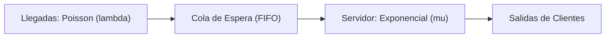

# ada-or (Investigación de Operaciones, Optimización y Teoría de Colas)

## Overview
Proporciona formulación matemática y algoritmos de optimización para **Investigación de Operaciones (IO)** y **Toma de Decisiones en Ingeniería**.

Abarca modelado y resolución de **Programación Lineal (PL)** mediante el método gráfico y el **Método Simplex** (forma estándar, variables de holgura y artificiales, método de las Dos Fases / Gran M), **Teoría de la Dualidad** y análisis de sensibilidad (precios sombra / *shadow prices*), modelos de transporte (Esquina Noroeste, Costo Mínimo, Aproximación de Vogel) y asignación (Método Húngaro), Programación Entera y Binaria (Branch and Bound), **Teoría de Colas y Líneas de Espera** (Notación de Kendall: sistemas $M/M/1$, $M/M/c$, $M/M/1/K$, Fórmulas de Little) y simulación estocástica de eventos discretos con el método de **Monte Carlo**.

---

## When to Use
- Formulación de problemas de optimización de recursos limitados (maximizar utilidades o minimizar costos operativos).
- Resolución algorítmica paso a paso de tablas del **Método Simplex** (identificación de columna pivote por criterio de optimalidad y fila pivote por razón mínima).
- Interpretación económica de la tabla final Simplex mediante variables duales y rangos de variación de coeficientes.
- Dimensionamiento de servidores, ancho de banda y capacidad de atención con **Teoría de Colas** para evitar cuellos de botella y minimizar tiempos de espera.
- Ejecución de simulaciones de Monte Carlo para evaluar riesgos e incertidumbre en proyectos de software.
- Generación de notas y modelos matemáticos para AFFiNE BlockSuite.

---

## 📈 Formulación Canónica de Programación Lineal

$$\begin{aligned}
\text{Optimizar (Max / Min)} \quad & Z = \sum_{j=1}^{n} c_j x_j \\
\text{Sujeto a:} \quad & \sum_{j=1}^{n} a_{ij} x_j \le b_i \quad (i = 1, \dots, m) \\
& x_j \ge 0 \quad (j = 1, \dots, n)
\end{aligned}$$

---

## ⚡ Teoría de Colas: Fórmulas Fundamentales ($M/M/1$)

Para un sistema con tasa de llegada Poisson $\lambda$ y tasa de servicio exponencial $\mu$ ($\rho = \frac{\lambda}{\mu} < 1$ para estabilidad):

| Métrica | Símbolo | Fórmula Analítica |
| :--- | :---: | :---: |
| **Factor de Utilización del Servidor** | $\rho$ | $\rho = \frac{\lambda}{\mu}$ |
| **Probabilidad de Sistema Vacío** | $P_0$ | $P_0 = 1 - \rho$ |
| **Número Promedio de Clientes en el Sistema** | $L$ | $L = \frac{\lambda}{\mu - \lambda} = \frac{\rho}{1 - \rho}$ |
| **Número Promedio de Clientes en la Cola** | $L_q$ | $L_q = \frac{\lambda^2}{\mu(\mu - \lambda)} = \frac{\rho^2}{1 - \rho}$ |
| **Tiempo Promedio de Estancia en el Sistema** | $W$ | $W = \frac{1}{\mu - \lambda} = \frac{L}{\lambda}$ *(Ley de Little)* |
| **Tiempo Promedio de Espera en la Cola** | $W_q$ | $W_q = \frac{\lambda}{\mu(\mu - \lambda)} = \frac{L_q}{\lambda}$ |



---

## 📝 Plantilla para Notas de Investigación de Operaciones en AFFiNE

Al generar apuntes para `~/Documents/GitHub/Universidad/Affinite_Notes/Matematicas/<tema> (YYYY-MM-DD).md`:

```markdown
# [Problema de Optimización / Teoría de Colas] (YYYY-MM-DD)
> 📅 **Fecha**: YYYY-MM-DD | 🏷️ **Tags**: #investigacion-operaciones #simplex #optimizacion #colas #[subtema]

> [!NOTE]
> **Descripción del Problema**: Definición de variables de decisión, objetivo de optimización y restricciones del sistema.

## 1. Modelo Matemático Formal
- **Variables de Decisión**:
  - $x_1$: Cantidad de producto A a fabricar.
  - $x_2$: Cantidad de producto B a fabricar.
- **Función Objetivo**: $\text{Max } Z = 50x_1 + 80x_2$
- **Restricciones**:
  $$\begin{aligned}
    2x_1 + 4x_2 &\le 100 \quad \text{(Horas máquina)} \\
    3x_1 + 2x_2 &\le 90 \quad \text{(Materia prima)} \\
    x_1, x_2 &\ge 0
  \end{aligned}$$

## 2. Tabla Simplex Final & Solución Óptima
| Base | $Z$ | $x_1$ | $x_2$ | $s_1$ | $s_2$ | Solución |
| :---: | :---: | :---: | :---: | :---: | :---: | :---: |
| $Z$ | 1 | 0 | 0 | 17.5 | 5.0 | **2200** |
| $x_2$ | 0 | 0 | 1 | 0.375 | -0.25 | **15** |
| $x_1$ | 0 | 1 | 0 | -0.25 | 0.5 | **20** |

- **Solución Óptima**: $x_1^* = 20$, $x_2^* = 15$, $Z^* = \$2,200$.

## 3. Checklist de Validación
- [ ] ¿Verifiqué la condición de no negatividad de todas las variables?
- [ ] ¿Los precios sombra (*Shadow Prices*) reflejan el valor marginal de cada recurso?
```
