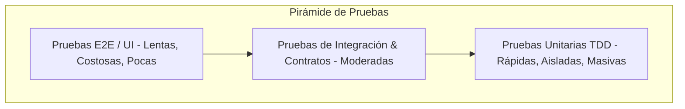

# ada-qa (Aseguramiento de la Calidad de Software, Pruebas y Métricas)

## Overview
Proporciona estrategias avanzadas de **Aseguramiento de Calidad de Software (QA)**, métricas cuantitativas de código y pruebas de rendimiento/mutación.

Cubre la **Pirámide de Pruebas** (Unitarias, Integración, Componentes, E2E y Contratos con Pact), pruebas no funcionales de carga y estrés con **k6** y Apache JMeter, análisis estático y dinámico de código, cálculo formal de la **Complejidad Ciclomática de McCabe** ($V(G) = E - N + 2P$), métricas de acoplamiento y cohesión (LCOM), pruebas de mutación (Stryker / PIT), auditoría de deuda técnica con reglas de **SonarQube** y alineación con el estándar internacional de calidad **ISO/IEC 25010** (Adecuación funcional, Eficiencia de desempeño, Compatibilidad, Usabilidad, Confiabilidad, Seguridad, Mantenibilidad, Portabilidad).

---

## When to Use
- Diseño de planes de prueba integrales (*Master Test Plan* según IEEE 829 / ISO/IEC/IEEE 29119).
- Formulación de escenarios de pruebas de carga, estrés (*Stress Test*), picos (*Spike Test*) y resistencia (*Soak Test*) con scripts de **k6**.
- Cálculo de la Complejidad Ciclomática $V(G)$ sobre funciones complejas para determinar el número mínimo de casos de prueba de caja blanca con cobertura de caminos básica (*Basis Path Testing*).
- Pruebas de mutación para evaluar la efectividad real de la suite de pruebas unitarias (*Mutation Score*).
- Evaluación de métricas de calidad en pipelines de CI/CD: Cobertura de ramas (*Branch Coverage*), Duplicación de código, Índices de Mantenibilidad (MI).
- Generación de notas y reportes de calidad para AFFiNE BlockSuite.

---

## 🏛️ La Pirámide de Pruebas y Métricas de Calidad



### 1. Complejidad Ciclomática de McCabe
Para un grafo de flujo de control $G = (V, E)$ donde $E$ es el número de aristas, $V$ el número de nodos y $P$ el número de componentes conexos ($P = 1$ para un único método):
$$V(G) = E - V + 2P = \text{Número de Nodos Predicado (condiciones booleanas } \text{if, while, for, case}) + 1$$

| Rango de $V(G)$ | Nivel de Riesgo | Mantenibilidad & Capacidad de Prueba |
| :---: | :--- | :--- |
| **$1 - 10$** | Código Simple / Bajo Riesgo | Fácil de probar y mantener. |
| **$11 - 20$** | Riesgo Moderado | Complejidad aceptable; requiere pruebas exhaustivas. |
| **$21 - 50$** | Alto Riesgo | Difícil de entender; candidato prioritario a refactorización. |
| **$> 50$** | Código No Testeable / Inmantenible | Urgente descomposición en funciones más pequeñas. |

---

## ⚡ Script Canónico de Pruebas de Carga en k6

```javascript
import http from 'k6/http';
import { check, sleep } from 'k6';

export const options = {
  stages: [
    { duration: '30s', target: 50 },  // Ramp-up a 50 usuarios concurrentes
    { duration: '1m', target: 50 },   // Carga constante
    { duration: '20s', target: 0 },   // Ramp-down
  ],
  thresholds: {
    http_req_duration: ['p(95)<200'], // El 95% de las peticiones debe responder en <200ms
    http_req_failed: ['rate<0.01'],    // Tasa de error < 1%
  },
};

export default function () {
  const res = http.get('https://api.universidad.local/v1/materias');
  check(res, {
    'status es 200': (r) => r.status === 200,
    'tiempo < 200ms': (r) => r.timings.duration < 200,
  });
  sleep(1);
}
```

---

## 📝 Plantilla para Reportes de QA en AFFiNE

Al generar apuntes para `~/Documents/GitHub/Universidad/Affinite_Notes/Ingenieria_Software/<tema> (YYYY-MM-DD).md`:

```markdown
# [Plan / Reporte de QA y Pruebas] (YYYY-MM-DD)
> 📅 **Fecha**: YYYY-MM-DD | 🏷️ **Tags**: #qa #testing #k6 #metricas-software #[subtema]

> [!NOTE]
> **Objetivo de Calidad**: Criterios de aceptación y métricas de desempeño requeridas.

## 1. Métricas de Complejidad y Cobertura
- **Complejidad Ciclomática Máxima**: $V(G) = 6$ (Aceptable)
- **Cobertura de Ramas (*Branch Coverage*)**: $92\%$
- **Puntuación de Mutación (*Mutation Score*)**: $88\%$

## 2. Resultados de Pruebas de Rendimiento (k6 / JMeter)
| Métrica | Valor Obtenido | Umbral (*Threshold*) | Estado |
| :--- | :---: | :---: | :---: |
| **Latencia P95** | 142 ms | < 200 ms | PASS |
| **Throughput (RPS)** | 850 req/s | > 500 req/s | PASS |
| **Tasa de Fallos** | 0.02 % | < 1 % | PASS |

## 3. Checklist de Certificación de Calidad
- [ ] ¿Se ejecutaron pruebas de regresión automáticas en el pipeline de CI/CD?
- [ ] ¿El análisis estático no reporta vulnerabilidades de seguridad (*Security Hotspots*)?
```
