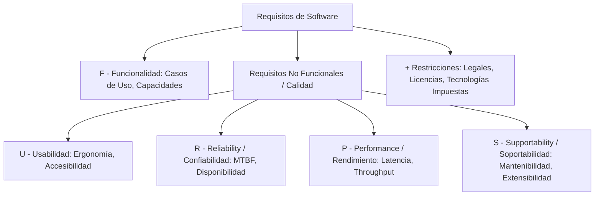
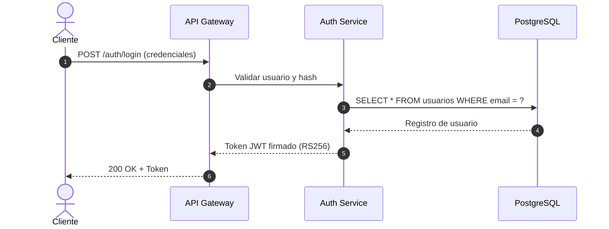

# ada-req (Ingeniería de Requisitos, Modelado UML y Procesos BPMN)

## Overview
Proporciona rigor metodológico para la **Ingeniería de Requisitos de Software** y el **Modelado de Sistemas con UML y BPMN 2.0**.

Cubre las fases del ciclo de vida de requisitos (Elicitación, Análisis, Especificación, Validación y Gestión de Cambios / Trazabilidad), clasificación mediante el modelo **FURPS+** (Funcionalidad, Usabilidad, Confiabilidad, Rendimiento, Soportabilidad + Restricciones de diseño/implementación), redacción de Historias de Usuario con criterios **INVEST** y formatos Gherkin (Given-When-Then), especificación formal de Casos de Uso con flujos alternativos y de excepción, y modelado gráfico con diagramas estándar de **UML 2.5** (Casos de Uso, Clases, Secuencia, Actividades, Estados) y **BPMN 2.0** para procesos de negocio.

---

## When to Use
- Definición formal de especificaciones de requisitos de software (SRS / IEEE 830 / ISO/IEC/IEEE 29148).
- Clasificación y priorización de requisitos mediante el método **MoSCoW** (Must have, Should have, Could have, Won't have).
- Redacción de Historias de Usuario ágiles con criterios de aceptación claros:
  ```gherkin
  Dado [contexto inicial]
  Cuando [el usuario ejecuta una acción]
  Entonces [se verifica el resultado esperado]
  ```
- Construcción de diagramas de secuencia UML para validar flujos de interacción asíncronos y síncronos entre servicios.
- Modelado de procesos empresariales de negocio con BPMN 2.0 (Eventos de inicio/fin, Compuertas exclusivas/paralelas, Pools y Lanes).
- Matrices de trazabilidad de requisitos (RTM) para auditar cobertura contra pruebas de software.
- Generación de notas y especificaciones para AFFiNE BlockSuite.

---

## 📊 Modelo FURPS+ para Clasificación de Requisitos



---

## ⚡ Criterios INVEST para Historias de Usuario

| Letra | Criterio | Significado & Buena Práctica |
| :---: | :--- | :--- |
| **I** | **Independent** (Independiente) | La historia puede implementarse y desplegarse sin bloqueos duros con otras. |
| **N** | **Negotiable** (Negociable) | No es un contrato rígido; el equipo puede ajustar el alcance con el Product Owner. |
| **V** | **Valuable** (Valiosa) | Aporta valor perceptible directo al usuario final o al negocio. |
| **E** | **Estimable** (Estimable) | El equipo técnico entiende el alcance lo suficiente para estimar su esfuerzo. |
| **S** | **Small** (Pequeña) | Debe caber holgadamente dentro de una iteración o sprint (1-2 semanas). |
| **T** | **Testable** (Verificable) | Cuenta con criterios de aceptación inequívocos y automatizables. |

---

## 📝 Plantilla para Especificación de Requisitos en AFFiNE

Al generar apuntes para `~/Documents/GitHub/Universidad/Affinite_Notes/Ingenieria_Software/<tema> (YYYY-MM-DD).md`:

```markdown
# [Especificación del Sistema / Módulo] (YYYY-MM-DD)
> 📅 **Fecha**: YYYY-MM-DD | 🏷️ **Tags**: #requisitos #uml #bpmn #casos-de-uso #[subtema]

> [!NOTE]
> **Alcance del Proyecto**: Descripción concisa del objetivo de negocio y actores involucrados.

## 1. Requisitos Funcionales (RF) & No Funcionales (RNF - FURPS+)
| ID | Tipo | Descripción | Prioridad (MoSCoW) |
| :---: | :---: | :--- | :---: |
| RF-01 | Funcional | El sistema permitirá autenticación con 2FA. | Must |
| RNF-01 | Rendimiento | El tiempo de respuesta P95 será < 200 ms. | Must |

## 2. Diagrama de Secuencia UML


## 3. Matriz de Trazabilidad de Requisitos (RTM)
- `RF-01` $\implies$ Caso de Prueba `TC-AUTH-01` $\implies$ Componente `auth_controller.rs`

## 4. Checklist de Calidad de Requisitos
- [ ] ¿Los requisitos están libres de ambigüedad y contradicciones?
- [ ] ¿Cada historia cumple con los criterios INVEST?
```
