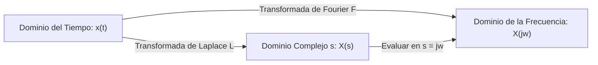

# ada-signals (Señales y Sistemas Lineales e Invariantes en el Tiempo)

## Overview
Proporciona análisis analítico y computacional para **Señales y Sistemas Lineales e Invariantes en el Tiempo (LTI)** en tiempo continuo y discreto.

Cubre clasificación de señales (energía vs. potencia, periódicas/aperiódicas, pares/impares), operaciones fundamentales (escalamiento, traslación, inversión), convolución analítica y gráfica, respuesta al impulso $h(t)$ / $h[n]$, estabilidad BIBO, causalidad, Series y Transformadas de Fourier (CTFT, DTFT, FFT), Transformada de Laplace con Región de Convergencia (ROC), Transformada Z y respuesta en frecuencia (diagramas de Bode y polos/ceros).

---

## When to Use
- Análisis de señales continuas $x(t)$ y discretas $x[n]$ (escalón unitario $u(t)$, impulso de Dirac $\delta(t)$, exponenciales complejas).
- Cálculo de la integral de convolución $y(t) = x(t) * h(t)$ o suma de convolución $y[n] = x[n] * h[n]$.
- Determinación de propiedades de sistemas: Linealidad, Invarianza en el Tiempo, Causalidad, Estabilidad BIBO ($\int |h(t)|\,\d t < \infty$).
- Análisis en el dominio de la frecuencia mediante Transformada de Laplace $\mathcal{L}\{x(t)\} = X(s)$ y Transformada Z $\mathcal{Z}\{x[n]\} = X(z)$.
- Diseño y análisis de filtros digitales y analógicos (pasa-bajas, pasa-altas, polos y ceros).
- Generación de notas y desarrollos matemáticos para AFFiNE BlockSuite.

---

## 📻 Transformadas y Operadores Clave

### 1. Convolución LTI
* **Tiempo Continuo**:
  $$y(t) = (x * h)(t) = \int_{-\infty}^{\infty} x(\tau) h(t - \tau) \, \d \tau$$
* **Tiempo Discreto**:
  $$y[n] = (x * h)[n] = \sum_{k=-\infty}^{\infty} x[k] h[n - k]$$

### 2. Transformada de Fourier (CTFT & DTFT)
* **Transformada Continua de Fourier (CTFT)**:
  $$X(j\omega) = \int_{-\infty}^{\infty} x(t) e^{-j\omega t} \, \d t \quad\Longleftrightarrow\quad x(t) = \frac{1}{2\pi} \int_{-\infty}^{\infty} X(j\omega) e^{j\omega t} \, \d\omega$$
* **Transformada Discreta de Fourier (DTFT)**:
  $$X(e^{j\Omega}) = \sum_{n=-\infty}^{\infty} x[n] e^{-j\Omega n}$$

### 3. Transformada de Laplace y Transformada Z
* **Transformada de Laplace Bilateral**:
  $$X(s) = \int_{-\infty}^{\infty} x(t) e^{-st} \, \d t \quad (s = \sigma + j\omega)$$
  - *Estabilidad LTI*: El eje imaginario $j\omega$ debe estar contenido dentro de la ROC.
* **Transformada Z**:
  $$X(z) = \sum_{n=-\infty}^{\infty} x[n] z^{-n} \quad (z = r e^{j\Omega})$$
  - *Estabilidad LTI*: El círculo unitario $|z| = 1$ debe estar contenido dentro de la ROC.



---

## ⚡ Pares de Transformadas Comunes

| Señal en el Tiempo $x(t)$ | Transformada de Laplace $X(s)$ | ROC |
| :--- | :--- | :--- |
| **Impulso Unitario** $\delta(t)$ | $1$ | Todo el plano $s$ |
| **Escalón Unitario** $u(t)$ | $\frac{1}{s}$ | $\text{Re}(s) > 0$ |
| **Exponencial** $e^{-at} u(t)$ | $\frac{1}{s + a}$ | $\text{Re}(s) > -\text{Re}(a)$ |
| **Coseno Amortiguado** $\cos(\omega_0 t) u(t)$ | $\frac{s}{s^2 + \omega_0^2}$ | $\text{Re}(s) > 0$ |

---

## 📝 Plantilla para Notas de Señales y Sistemas en AFFiNE

Al generar apuntes para `~/Documents/GitHub/Universidad/02_Segundo_Cerebro/Affine_Notes/01_Matematicas_y_Fisica/<tema> (YYYY-MM-DD).md`:

```markdown
# [Tema de Señales y Sistemas] (YYYY-MM-DD)
> 📅 **Fecha**: YYYY-MM-DD | 🏷️ **Tags**: #senales #sistemas-lti #fourier #laplace #[subtema]

> [!NOTE]
> **Definición del Sistema**: Ecuación diferencial / en diferencias que modela la entrada $x(t)$ y salida $y(t)$.

## 1. Función de Transferencia $H(s)$ / $H(z)$
- Expresión algebraica:
  $$H(s) = \frac{Y(s)}{X(s)} = \frac{K(s - z_1)}{(s - p_1)(s - p_2)}$$
- **Ubicación de Polos y Ceros**:
  - Ceros: $s = z_1$
  - Polos: $s = p_1, p_2$

## 2. Respuesta al Impulso & Estabilidad BIBO
1. **Descomposición en Fracciones Parciales**:
2. **Transformada Inversa**:
   $$h(t) = \mathcal{L}^{-1}\{H(s)\}$$
3. **Criterio de Estabilidad**:
   > [!IMPORTANT]
   > Sistema **Estable / Inestable**: Todos los polos tienen parte real estrictamente negativa ($\text{Re}(p_i) < 0$).

## 3. Checklist de Verificación
- [ ] ¿Identifiqué la Región de Convergencia (ROC) correcta?
- [ ] ¿Verifiqué la condición de causalidad (ROC a la derecha del polo más positivo)?
```
