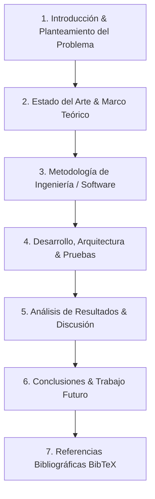

# ada-thesis (Metodología de Grado, Redacción Académica y Formato IEEE/APA)

## Overview
Proporciona estructura metodológica, redacción científica rigurosa y gestión de referencias para **Proyectos de Grado, Tesis Universitarias y Artículos de Investigación**.

Cubre las etapas del proyecto de grado (Planteamiento del Problema, Pregunta de Investigación, Objetivos Generales y Específicos según taxonomía de Bloom, Justificación, Marco Teórico, Estado del Arte sistemático según metodología PRISMA, Metodología experimental o de desarrollo de software según IEEE/ACM, Análisis de Resultados, Conclusiones y Trabajo Futuro), estándares de citación y estilo (**IEEE Transactions** para ingeniería y **APA 7ma edición**), gestión bibliográfica mediante **BibTeX** y Zotero, y estructuración de diapositivas de sustentación ante jurados académicos.

---

## When to Use
- Formulación del anteproyecto de grado: Delimitación del problema, árbol de problemas/objetivos y matriz de congruencia metodológica.
- Construcción de revisiones sistemáticas de literatura (RSL) con ecuaciones de búsqueda booleanas para bases de datos científicas (IEEE Xplore, ScienceDirect, Scopus, ACM Digital Library).
- Redacción de artículos científicos en LaTeX utilizando la plantilla oficial `IEEEtran.cls`.
- Gestión y depuración de archivos `.bib` (campos requeridos `author`, `title`, `booktitle`/`journal`, `year`, `doi`).
- Redacción de resúmenes estructurados (*Abstract*) con los 4 componentes esenciales (Contexto/Problema, Propuesta/Método, Resultados principales cuantitativos, Conclusión).
- Preparación de guiones de sustentación oral y respuestas a preguntas de jurados evaluadores.
- Generación de notas y avances de tesis para AFFiNE BlockSuite.

---

## 🏛️ Estructura Canónica de un Proyecto de Grado en Ingeniería



---

## ⚡ Taxonomía de Verbos de Bloom para Objetivos

| Nivel Cognitivo | Verbos Recomendados para Objetivos Específicos |
| :--- | :--- |
| **1. Conocimiento / Comprensión** | *Identificar, Clasificar, Describir, Caracterizar, Comparar.* |
| **2. Aplicación / Análisis** | *Implementar, Modelar, Analizar, Calcular, Descomponer, Simular.* |
| **3. Síntesis / Evaluación** | *Diseñar, Desarrollar, Formular, Validar, Evaluar, Optimizar.* |

> [!IMPORTANT]
> **Regla de Oro**: El Objetivo General debe responder al *¿Qué se va a hacer?*, *¿Cómo?* y *¿Para qué?*, alineado en infinitivo con el título del proyecto.

---

## 📝 Ejemplo de Entrada BibTeX Válida

```bibtex
@article{stewart2020calculus,
  author    = {James Stewart and Daniel Clegg and Saleem Watson},
  title     = {Calculus: Early Transcendentals},
  journal   = {Cengage Learning},
  edition   = {9th},
  year      = {2020},
  isbn      = {978-1337613927}
}

@inproceedings{vaswani2017attention,
  author    = {Ashish Vaswani and Noam Shazeer and Niki Parmar and Jakob Uszkoreit},
  title     = {Attention Is All You Need},
  booktitle = {Advances in Neural Information Processing Systems (NeurIPS)},
  volume    = {30},
  pages     = {5998--6008},
  year      = {2017}
}
```

---

## 📝 Plantilla para Avances de Tesis en AFFiNE

Al generar apuntes para `~/Documents/GitHub/Universidad/Affinite_Notes/Investigacion/<tema> (YYYY-MM-DD).md`:

```markdown
# [Capítulo / Avance de Proyecto de Grado] (YYYY-MM-DD)
> 📅 **Fecha**: YYYY-MM-DD | 🏷️ **Tags**: #tesis #grado #ieee #metodologia #[subtema]

> [!NOTE]
> **Resumen del Capítulo**: Propósito del entregable y contribución a los objetivos específicos del proyecto.

## 1. Planteamiento & Pregunta de Investigación
- **Pregunta Central**: ¿De qué manera la arquitectura X optimiza el rendimiento Y en entornos Z?
- **Hipótesis de Trabajo**: La implementación de X reducirá la latencia en al menos un 25% frente a Y.

## 2. Metodología & Desarrollo
- **Fases Metodológicas**:
  1. Fase 1: Levantamiento y revisión del estado del arte (Scopus / IEEE).
  2. Fase 2: Diseño de la arquitectura y modelado matemático.
  3. Fase 3: Pruebas experimentales y validación estadística.

## 3. Conclusiones Parciales & Referencias Clave
- Cita IEEE: [1] J. Stewart et al., *Calculus*, 2020.

## 4. Checklist de Avance de Tesis
- [ ] ¿Los objetivos específicos son medibles y alcanzables?
- [ ] ¿Todas las figuras y tablas cuentan con numeración y fuente explícita?
```
