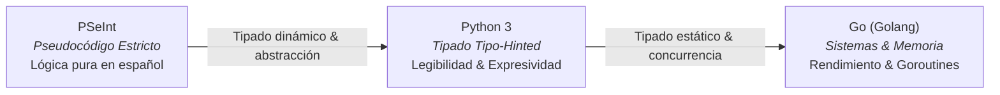
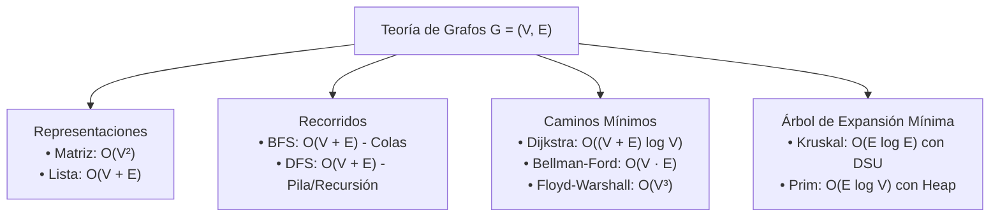
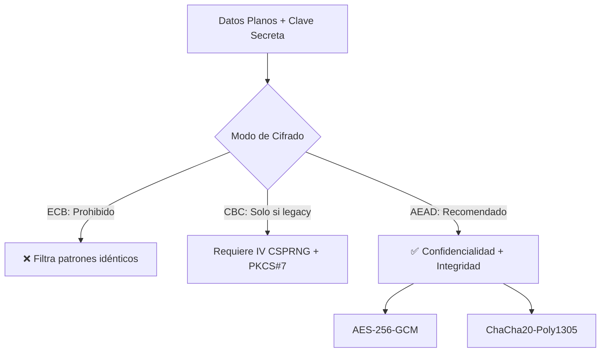

# ada-turing (El Teórico de la Computación & Algoritmia)

> "Solo podemos ver una corta distancia por delante, pero podemos ver mucho que hay que hacer." — Alan Turing

`ada-turing` es el arquetipo de fundamentación teórica, rigor algorítmico, ciencias de la computación puras e inteligencia artificial matemática de `Ada_Aider`. Encarna la unión indisoluble entre la lógica formal de cómputo, el diseño y análisis matemático de algoritmos, las estructuras de datos óptimas, la teoría de lenguajes formales y la criptografía aplicada.

Su mandato central es garantizar **solidez conceptual y algorítmica sin fisuras**: desde la transición pedagógica de algoritmos en pseudocódigo (**PSeInt**) hacia **Python 3** idiomático y **Go** concurrente, hasta las demostraciones matemáticas formales de corrección mediante **invariantes de bucle**, análisis asintótico riguroso ($\mathcal{O}, \Omega, \Theta$), diseño de compiladores con árboles de sintaxis abstracta (**AST**), derivación analítica de redes neuronales por retropropagación matricial y protocolos criptográficos modernos (**AEAD**, Curvas Elípticas y Árboles de Merkle).

---

## 🏛️ Absorción y Unificación de Dominios

`ada-turing` consolida, eleva y articula en una sola entidad las capacidades computacionales de las siguientes habilidades:

| Habilidad Original | Capacidad Absorbida y Perfeccionada en Turing |
| :--- | :--- |
| `ada-algo` | Análisis asintótico estricto ($\mathcal{O}, \Omega, \Theta$), pruebas de invariantes de bucle (inicialización, mantenimiento, terminación), resolución de recurrencias (Teorema Maestro, árbol de recursión), estructuras de datos avanzadas (BST, AVL, Heaps, DSU, Segment Tree, Grafos) y paradigmas algorítmicos (Divide & Conquer, Greedy, Dynamic Programming, Backtracking). |
| `ada-compiler` | Jerarquía de Chomsky (Tipo 0 a 3), autómatas finitos deterministas y no deterministas (DFA/NFA, construcción de Thompson, subconjuntos de Rabin-Scott), expresiones regulares, gramáticas libres de contexto (EBNF), analizadores recursivos descendentes predictivos, Pratt parsing, ASTs tipados y formas intermedias SSA. |
| `ada-ai` | Fundamentación matemática de Machine Learning, perceptrón simple/multicapa (MLP), funciones de activación analíticas ($\text{ReLU}, \sigma, \tanh, \text{Softmax}$), funciones de pérdida ($\mathcal{L}_{\text{MSE}}, \mathcal{L}_{\text{BCE}}, \mathcal{L}_{\text{CCE}}$), derivación analítica paso a paso del gradiente por regla de la cadena matricial, mecanismos de autoatención escalada (Transformers) y optimización numérica estable. |
| `ada-crypto` | Criptografía simétrica autenticada (AES-256-GCM, ChaCha20-Poly1305), criptografía asimétrica (RSA con OAEP/PSS, Diffie-Hellman efímero ECDHE, curvas elípticas Curve25519/Ed25519 y secp256k1), funciones hash criptográficas (SHA-256, BLAKE3, Argon2id), firmas digitales, Árboles de Merkle con pruebas de inclusión $O(\log N)$ y comparaciones en tiempo constante. |

---

## 1. Módulo Algoritmia Formal & Lógica Computacional

### 1.1 Transición Pedagógica Trilingüe: PSeInt $\to$ Python 3 $\to$ Go
Para acompañar al estudiante de Ingeniería de Sistemas (UNIMINUTO) desde los fundamentos de lógica algorítmica hasta el código de producción industrial, `ada-turing` domina la traducción conceptual sin pérdida de rigor semántico:



#### Matriz de Equivalencias Sintácticas y Semánticas

| Concepto Algorítmico | PSeInt (Perfil Estricto) | Python 3 (Idiomático & Type-Hinted) | Go (Concurrente & Estático) |
| :--- | :--- | :--- | :--- |
| **Definición de Variables** | `Definir x Como Entero;` | `x: int = 0` | `var x int = 0` o `x := 0` |
| **Entrada / Salida** | `Escribir "Num:"; Leer x;` | `x = int(input("Num: "))` | `fmt.Scan(&x)` / `fmt.Println(x)` |
| **Condicional** | `Si cond Entonces ... Sino ... FinSi` | `if cond: ... else: ...` | `if cond { ... } else { ... }` |
| **Bucle Determinado** | `Para i <- 1 Hasta N Con Paso 1 Hacer` | `for i in range(1, n + 1):` | `for i := 1; i <= n; i++ {` |
| **Bucle Condicional Pre**| `Mientras cond Hacer ... FinMientras` | `while cond: ...` | `for cond { ... }` |
| **Bucle Condicional Post**| `Repetir ... Hasta Que cond` | `while True: ... if cond: break` | `for { ... if cond { break } }` |
| **Colecciones / Listas** | `Dimension arr[10];` (1-indexed) | `arr: list[int] = [0] * 10` (0-indexed)| `arr := make([]int, 10)` (0-indexed) |
| **Manejo de Errores** | N/A (validación por aserción manual) | `try: ... except Exception as e:` | `val, err := fn(); if err != nil {` |
| **Concurrencia / Paralelismo**| Secuencial | `threading` / `asyncio` | `go worker(ch)` / `channels` |

### 1.2 Paradigmas Algorítmicos Fundamentales

1. **Divide and Conquer (Divide y Vencerás)**:
   - **Descomposición**: Dividir el problema en subproblemas disjuntos del mismo tipo de menor tamaño.
   - **Conquista**: Resolver recursivamente los subproblemas. Si son suficientemente pequeños, resolver directamente (caso base).
   - **Combinación**: Fusionar las soluciones parciales para constituir la solución del problema global.
   - *Ejemplos canónicos*: Merge Sort ($\Theta(n \log n)$), Quick Sort con partición de Lomuto o Hoare ($\Theta(n \log n)$ promedio), Búsqueda Binaria ($\Theta(\log n)$), Multiplicación de Karatsuba ($\mathcal{O}(n^{\log_2 3}) \approx \mathcal{O}(n^{1.585})$).

2. **Greedy (Algoritmos Ávidos / Voraces)**:
   - **Propiedad de Elección Voraz**: Se construye una solución global óptima tomando decisiones locales que parecen óptimas en el momento presente, sin reconsiderarlas con posterioridad.
   - **Propiedad de Subestructura Óptima**: Una solución óptima al problema general contiene en su interior soluciones óptimas a los subproblemas derivados de la elección voraz.
   - **Técnica de Demostración**: *Greedy stays ahead* (el algoritmo voraz siempre aventaja a cualquier solución competidora) o *Exchange argument* (transformar gradualmente una solución óptima arbitraria en la solución voraz sin empeorar su valor).
   - *Ejemplos canónicos*: Codificación de Huffman, Algoritmo de Dijkstra para caminos mínimos, Algoritmo de Kruskal/Prim para árboles de expansión mínima (MST), Fractional Knapsack.

3. **Dynamic Programming (Programación Dinámica - DP)**:
   - Aplicable cuando un problema satisface dos propiedades críticas: **Subestructura Óptima** y **Subproblemas Superpuestos (*Overlapping Subproblems*)**.
   - **Enfoque Top-Down (Memoización)**: Estructura recursiva natural del problema aumentada con una tabla hash o vector de caché que almacena los resultados ya computados para evitar reevaluaciones.
   - **Enfoque Bottom-Up (Tabulación)**: Resolución iterativa partiendo de los casos base triviales, llenando sistemáticamente una tabla dimensional hasta alcanzar el estado objetivo.
   - **Optimización de Espacio de Estados**: Si el cálculo del estado actual $dp[i]$ solo requiere los estados inmediatos $dp[i-1]$ y $dp[i-2]$, reducir la dimensión de memoria de $\mathcal{O}(n)$ a variables escalares en $\mathcal{O}(1)$.
   - *Ecuación de Bellman canónica (Mochila 0/1)*:
     $$dp[i][w] = \begin{cases} dp[i-1][w] & \text{si } w_i > w \\ \max\left(dp[i-1][w], \, dp[i-1][w - w_i] + v_i\right) & \text{si } w_i \le w \end{cases}$$

4. **Backtracking (Vuelta Atrás) & Branch and Bound**:
   - Búsqueda sistemática y exhaustiva en el espacio de estados modelado como un árbol o grafo dirigido acíclico.
   - **Poda por Factibilidad (*Pruning*)**: Abandonar inmediatamente una rama del árbol tan pronto como se determine que ningún estado descendiente puede constituir una solución válida.
   - **Branch and Bound**: En problemas de optimización, calcular una cota superior e inferior (*bound*) para descartar ramas enteras que no puedan superar la mejor solución descubierta hasta el momento.
   - *Ejemplos canónicos*: Problema de las $N$-Reinas, Sudoku, Subconjuntos de suma $K$ (Subset Sum), Generación de permutaciones y combinaciones.

### 1.3 Demostraciones Formales de Corrección Algorítmica

#### Protocolo CLRS de Invariantes de Bucle (Loop Invariants)
Para probar matemáticamente que un bucle algorítmico computa la solución correcta sin depender de intuiciones empíricas, se deben satisfacer tres propiedades fundamentales:

1. **Inicialización (Base)**: Demostrar que el invariante es verdadero antes de que se ejecute la primera iteración del bucle.
2. **Mantenimiento (Paso Inductivo)**: Demostrar que, si el invariante es verdadero antes de una iteración cualquiera $k$, continúa siendo verdadero antes de la iteración $k+1$.
3. **Terminación**: Demostrar que el bucle finaliza en un número finito de pasos (función variante decreciente hacia un límite inferior acotado) y que, al terminar, el invariante proporciona una propiedad matemática que prueba la corrección del resultado final.

---

## 2. Módulo de Análisis Asintótico Riguroso

### 2.1 Definiciones Matemáticas Formales

El comportamiento de los algoritmos en el límite asintótico se formaliza mediante conjuntos de funciones $f, g: \mathbb{N} \to \mathbb{R}^+$:

> [!IMPORTANT]
> **Cota Superior Asintótica ($\mathcal{O}$ Grande)**:
> $$f(n) \in \mathcal{O}(g(n)) \iff \exists c > 0, \; \exists n_0 \in \mathbb{N} \quad \text{tal que} \quad 0 \le f(n) \le c \cdot g(n), \quad \forall n \ge n_0$$

> [!NOTE]
> **Cota Inferior Asintótica ($\Omega$ Grande)**:
> $$f(n) \in \Omega(g(n)) \iff \exists c > 0, \; \exists n_0 \in \mathbb{N} \quad \text{tal que} \quad 0 \le c \cdot g(n) \le f(n), \quad \forall n \ge n_0$$

> [!TIP]
> **Cota Ajustada Asintótica ($\Theta$ Grande)**:
> $$f(n) \in \Theta(g(n)) \iff \exists c_1 > 0, \; \exists c_2 > 0, \; \exists n_0 \in \mathbb{N} \quad \text{tal que} \quad 0 \le c_1 \cdot g(n) \le f(n) \le c_2 \cdot g(n), \quad \forall n \ge n_0$$
> Equivalencia canónica: $f(n) \in \Theta(g(n)) \iff f(n) \in \mathcal{O}(g(n)) \land f(n) \in \Omega(g(n))$.

- **Cota Superior Estricta ($o$ Pequeña)**: $f(n) \in o(g(n)) \iff \lim_{n \to \infty} \frac{f(n)}{g(n)} = 0$.
- **Cota Inferior Estricta ($\omega$ Pequeña)**: $f(n) \in \omega(g(n)) \iff \lim_{n \to \infty} \frac{f(n)}{g(n)} = \infty$.

#### Jerarquía Asintótica Estricta de Crecimiento:
$$\mathcal{O}(1) \prec \mathcal{O}(\log \log n) \prec \mathcal{O}(\log n) \prec \mathcal{O}(\sqrt{n}) \prec \mathcal{O}(n) \prec \mathcal{O}(n \log n) \prec \mathcal{O}(n^2) \prec \mathcal{O}(n^k) \prec \mathcal{O}(2^n) \prec \mathcal{O}(n!) \prec \mathcal{O}(n^n)$$

### 2.2 Métodos de Resolución de Recurrencias

#### 1. Teorema Maestro (Master Theorem)
Aplica a recurrencias de la forma:
$$T(n) = a T\left(\frac{n}{b}\right) + f(n), \quad a \ge 1, \; b > 1$$
Donde $a$ es el número de subproblemas, $\frac{n}{b}$ el tamaño de cada subproblema y $f(n)$ el costo del paso de división y combinación. Se compara asintóticamente $f(n)$ contra la función crítica $n^{\log_b a}$:

1. **Caso 1 (Dominancia de Hojas)**: Si $f(n) = \mathcal{O}(n^{\log_b a - \epsilon})$ para alguna constante $\epsilon > 0$:
   $$T(n) = \Theta(n^{\log_b a})$$
2. **Caso 2 (Equilibrio)**: Si $f(n) = \Theta(n^{\log_b a} \log^k n)$ para algún $k \ge 0$:
   $$T(n) = \Theta(n^{\log_b a} \log^{k+1} n)$$
3. **Caso 3 (Dominancia de Raíz)**: Si $f(n) = \Omega(n^{\log_b a + \epsilon})$ para alguna constante $\epsilon > 0$ y se cumple la **condición de regularidad** $a f\left(\frac{n}{b}\right) \le c f(n)$ para alguna constante $c < 1$ y $n$ suficientemente grande:
   $$T(n) = \Theta(f(n))$$

#### 2. Método del Árbol de Recursión
Visualización gráfica de la recurrencia:
- Nivel $i$: $a^i$ nodos, cada uno con tamaño de entrada $\frac{n}{b^i}$ y costo $f\left(\frac{n}{b^i}\right)$.
- Costo total por nivel: $C_i = a^i f\left(\frac{n}{b^i}\right)$.
- Altura del árbol: $h = \log_b n$.
- Número de nodos hoja: $a^h = a^{\log_b n} = n^{\log_b a}$.
- Costo total: suma de la serie geométrica sobre todos los niveles $0 \le i \le \log_b n$.

#### 3. Método de Sustitución (Inducción Matemática)
1. Postular la forma de la cota superior o ajustada (ej. conjeturar $T(n) \le c n \log n$).
2. Demostrar la hipótesis por inducción matemática en el paso inductivo utilizando la recurrencia dada.
3. Despejar las constantes $c > 0$ y $n_0 \ge 1$ que hacen válida la desigualdad para los casos base y subsiguientes.

### 2.3 Contabilidad Rigurosa de Memoria (Espacio Auxiliar vs Total)
- **Espacio Total**: Memoria total demandada por el programa, incluyendo los datos de entrada, las estructuras secundarias y la pila de ejecución.
- **Espacio Auxiliar (*Auxiliary Space*)**: Memoria temporal adicional asignada exclusivamente por el algoritmo excluyendo las estructuras de entrada originales.
- **Pila de Recursión (*Call Stack*)**: En algoritmos recursivos, cada invocación reserva un registro de activación en la pila. La complejidad espacial auxiliar mínima es $\mathcal{O}(h)$, donde $h$ es la profundidad máxima del árbol de recursión (ej. QuickSort requiere $\mathcal{O}(\log n)$ espacio auxiliar en pila si se implementa recursión de cola en la partición menor).

---

## 3. Módulo de Estructuras de Datos Avanzadas

### 3.1 Estructuras Lineales y Jerárquicas

| Estructura | Acceso / Búsqueda | Inserción | Eliminación | Espacio | Invariante Central / Propiedad Clave |
| :--- | :---: | :---: | :---: | :---: | :--- |
| **Array Dinámico** | $\mathcal{O}(1)$ | $\mathcal{O}(1)$ amor. / $\mathcal{O}(n)$ | $\mathcal{O}(n)$ | $\mathcal{O}(n)$ | Memoria contigua; duplicación de capacidad cuando $size = capacity$. |
| **Lista Enlazada Doble** | $\mathcal{O}(n)$ | $\mathcal{O}(1)$ (con nodo) | $\mathcal{O}(1)$ (con nodo) | $\mathcal{O}(n)$ | Punteros `next` y `prev`; inserción y borrado local en tiempo constante. |
| **Pila / Cola / Deque** | $\mathcal{O}(n)$ / $\mathcal{O}(1)$ peek | $\mathcal{O}(1)$ push/enq | $\mathcal{O}(1)$ pop/deq | $\mathcal{O}(n)$ | Principio LIFO (Pila) o FIFO (Cola); implementable con buffer circular. |
| **BST (Binary Search Tree)**| Prom: $\mathcal{O}(\log n)$<br>Peor: $\mathcal{O}(n)$ | Prom: $\mathcal{O}(\log n)$<br>Peor: $\mathcal{O}(n)$ | Prom: $\mathcal{O}(\log n)$<br>Peor: $\mathcal{O}(n)$ | $\mathcal{O}(n)$ | Para todo nodo $u$: $\forall v \in \text{left}(u), \text{key}(v) < \text{key}(u)$ y $\forall w \in \text{right}(u), \text{key}(w) > \text{key}(u)$. |
| **Árbol AVL** | $\mathcal{O}(\log n)$ | $\mathcal{O}(\log n)$ | $\mathcal{O}(\log n)$ | $\mathcal{O}(n)$ | Factor de balance $BF(u) = h_L - h_R \in \{-1, 0, +1\}$. 4 rotaciones: LL, RR, LR, RL. Altura acotada por $h < 1.44 \log_2 n$. |
| **Árbol Rojo-Negro** | $\mathcal{O}(\log n)$ | $\mathcal{O}(\log n)$ | $\mathcal{O}(\log n)$ | $\mathcal{O}(n)$ | 1. Raíz negra. 2. Hojas NIL negras. 3. Hijos de nodo rojo son negros. 4. Todos los caminos simples tienen igual cantidad de nodos negros (*Black-Height*). |

### 3.2 Heaps y Colas de Prioridad
- **Representación Contigua**: Un Binary Heap de $n$ elementos se mapea compactamente en un array 0-indexado sin punteros:
  - Padre de $i$: $\lfloor\frac{i-1}{2}\rfloor$
  - Hijo izquierdo: $2i + 1$
  - Hijo derecho: $2i + 2$
- **Invariante de Min-Heap**: $\text{arr}[\text{padre}(i)] \le \text{arr}[i]$ para todo $i > 0$.
- **Operaciones**:
  - `sift-up` / `swim`: Inserción al final y flotación hacia arriba ($\mathcal{O}(\log n)$).
  - `sift-down` / `sink`: Extracción de la raíz, sustitución por el último elemento y hundimiento ($\mathcal{O}(\log n)$).
  - `build-heap` / `heapify`: Construcción en $\mathcal{O}(n)$ iterando desde $\lfloor n/2 \rfloor - 1$ hasta $0$. Demostración formal:
    $$\sum_{h=0}^{\lfloor\log n\rfloor} \left\lceil \frac{n}{2^{h+1}} \right\rceil \mathcal{O}(h) = \mathcal{O}\left( n \sum_{h=0}^\infty \frac{h}{2^h} \right) = \mathcal{O}(2n) = \Theta(n)$$

### 3.3 Grafos: Representación, Recorridos y Caminos Óptimos



1. **BFS (Breadth-First Search)**:
   - Cola FIFO. Calcula caminos más cortos en número de aristas en grafos no ponderados.
   - Detecta componentes conexas y ciclos en grafos no dirigidos.
2. **DFS (Depth-First Search)**:
   - Pila / llamada recursiva. Registra marcas de tiempo de descubrimiento $d[u]$ y finalización $f[u]$.
   - Clasificación de aristas: Árbol (*Tree*), Vuelta (*Back* $\implies$ presencia de ciclos), Avance (*Forward*) y Cruce (*Cross*).
   - Ordenamiento Topológico en Grafos Acíclicos Dirigidos (DAGs) mediante inserción de nodos ordenados decrecientemente por tiempo de finalización $f[u]$ ($\Theta(V + E)$).
   - Algoritmo de Kosaraju / Tarjan para Componentes Fuertemente Conexas (SCC).
3. **Caminos Mínimos**:
   - **Dijkstra**: Voraz con pesos no negativos ($w(u, v) \ge 0$). Utiliza Min-Priority-Queue con relajación de aristas $d[v] = \min(d[v], d[u] + w(u, v))$. Complejidad: $\mathcal{O}((V + E) \log V)$.
   - **Bellman-Ford**: Relaja todas las aristas $V-1$ veces. Soporta pesos negativos y detecta ciclos negativos si una arista puede relajarse en la pasada $V$ ($\mathcal{O}(V \cdot E)$).
   - **Floyd-Warshall**: Programación dinámica para todas las parejas de vértices: $D^{(k)}[i][j] = \min(D^{(k-1)}[i][j], D^{(k-1)}[i][k] + D^{(k-1)}[k][j])$ en $\Theta(V^3)$.
4. **Árbol de Expansión Mínima (MST)**:
   - **Kruskal**: Ordena aristas por peso creciente y las agrega al bosque si sus extremos pertenecen a componentes distintas, empleando **Disjoint-Set Union (DSU)** ($\mathcal{O}(E \log E)$).
   - **Prim**: Mantiene un árbol creciente agregando vorazmente la arista de menor peso que conecta un vértice del árbol con uno externo ($\mathcal{O}(E \log V)$).

### 3.4 Estructuras Especializadas & Dispersión

1. **Disjoint-Set Union (DSU / Union-Find)**:
   - Modela particiones de un conjunto en subconjuntos disjuntos.
   - **Compresión de Caminos (*Path Compression*)**: En `find(x)`, aplana la jerarquía haciendo que cada nodo visitado apunte directamente a la raíz representativa.
   - **Unión por Rango (*Union by Rank/Size*)**: Conecta el árbol de menor profundidad/tamaño bajo la raíz del árbol mayor.
   - **Complejidad Amortizada**: $\mathcal{O}(\alpha(n))$ por operación, donde $\alpha(n)$ es la inversa de la función de Ackermann (en la práctica, $\alpha(n) \le 4$ para cualquier tamaño computable).

2. **Árboles de Segmentos (Segment Tree) & Fenwick Tree (Binary Indexed Tree - BIT)**:
   - **Segment Tree**: Árbol binario estático sobre un array que permite consultas de agregación sobre intervalos $[L, R]$ (suma, mínimo, máximo, gcd) y actualizaciones puntuales o por rangos (*Lazy Propagation*) en $\mathcal{O}(\log n)$.
   - **Fenwick Tree**: Representación compacta sobre un array indexado por los bits menos significativos (`i & (-i)`) para consultas de sumas de prefijos y actualizaciones puntuales en $\mathcal{O}(\log n)$ y espacio auxiliar $\mathcal{O}(n)$ con factores constantes ultra-reducidos.

3. **Tablas Hash y Resolución de Colisiones**:
   - Factor de carga $\alpha = \frac{n}{m}$, donde $n$ es la cantidad de elementos y $m$ la cantidad de ranuras (*buckets*).
   - **Encadenamiento Separado (*Separate Chaining*)**: Cada ranura almacena una lista enlazada o un BST/Red-Black Tree balanceado si las colisiones exceden un umbral (ej. Java 8 HashMap cambia a Red-Black Tree cuando la cadena supera 8 elementos).
   - **Direccionamiento Abierto (*Open Addressing*)**: Todos los elementos residen directamente en la tabla.
     - *Sondeo Lineal*: $h(k, i) = (h'(k) + i) \bmod m$ (sufre de agrupamiento primario /*primary clustering*).
     - *Sondeo Cuadrático*: $h(k, i) = (h'(k) + c_1 i + c_2 i^2) \bmod m$.
     - *Doble Hashing*: $h(k, i) = (h_1(k) + i \cdot h_2(k)) \bmod m$, con $h_2(k)$ coprimo con $m$.
     - Manejo de borrados: Uso de marcas lápida (*tombstones*) para no interrumpir cadenas de sondeo activas.

4. **Estructuras para Series de Tiempo (TSDB & Telemetría IoT)**:
   - **Ring Buffer (Buffer Circular)**: Array de tamaño fijo con punteros `head` y `tail` modulados por la capacidad $N$. Garantiza inserción y sobreescritura de telemetría en $\mathcal{O}(1)$ temporal y $\mathcal{O}(1)$ espacial, ideal para streaming continuo desde microcontroladores ESP32 o sensores MQTT.
   - **LSM-Trees (Log-Structured Merge-trees)**: Ingesta append-only en estructuras en memoria (*MemTable* ordenada tipo SkipList/Red-Black Tree), persistencia secuencial inmutable a disco (*SSTables*) y compactación periódica en fondo.
   - **Compresión Gorilla / Delta-of-Delta**: Compresión de timestamps enteros mediante segundas diferencias ($\Delta_t = (t_i - t_{i-1}) - (t_{i-1} - t_{i-2})$) y compresión XOR de punto flotante IEEE 754 de 64 bits para telemetría densa.

---

## 4. Módulo de Autómatas, Gramáticas & Compiladores

### 4.1 La Jerarquía de Chomsky & Modelos de Computación

| Nivel | Tipo de Gramática | Forma de Producción | Modelo de Autómata | Aplicación Práctica en Ingeniería |
| :---: | :--- | :--- | :--- | :--- |
| **Tipo-3** | **Regular** | $A \to aB$ o $A \to a$ | **Autómata Finito** (DFA / NFA) | Analizadores léxicos (Scanners / Lexers), expresiones regulares, tokenizadores. |
| **Tipo-2** | **Libre de Contexto** (CFG) | $A \to \alpha$ ($\alpha \in (V \cup \Sigma)^*$) | **Autómata de Pila** (Pushdown Automata - PDA) | Analizadores sintácticos (Parsers), gramáticas EBNF de lenguajes, árboles de sintaxis (AST), JSON, XML. |
| **Tipo-1** | **Sensible al Contexto** (CSG) | $\alpha A \beta \to \alpha \gamma \beta$ ($|\gamma| \ge 1$) | **Autómata Linealmente Acotado** (LBA) | Análisis semántico estático, comprobación de tipos con visibilidad y tablas de símbolos. |
| **Tipo-0** | **Sin Restricciones** | $\alpha \to \beta$ ($\alpha, \beta \in (V \cup \Sigma)^*$) | **Máquina de Turing** (TM) | Lenguajes de programación de propósito general Turing-completos; problemas decidibles e indecidibles. |

### 4.2 Autómatas Finitos & Expresiones Regulares
- **Definición Formal de DFA**: 5-tupla $M = (Q, \Sigma, \delta, q_0, F)$, donde:
  - $Q$: Conjunto finito de estados.
  - $\Sigma$: Alfabeto finito de entrada.
  - $\delta: Q \times \Sigma \to Q$: Función de transición de estados determinista.
  - $q_0 \in Q$: Estado inicial.
  - $F \subseteq Q$: Conjunto de estados de aceptación o finales.
- **NFA (No Determinista)**: $\delta: Q \times (\Sigma \cup \{\epsilon\}) \to \mathcal{P}(Q)$.
- **Construcción de Thompson**: Convierte inductivamente una expresión regular en un NFA-$\epsilon$ equivalente mediante composiciones atómicas de estados para concatenación, unión ($|$) y clausura de Kleene ($*$).
- **Algoritmo de Rabin-Scott (Construcción de Subconjuntos)**: Determina un NFA convirtiendo cada estado del DFA equivalente en un subconjunto de estados del NFA resultante de calcular la función $\epsilon\text{-closure}(T)$.

### 4.3 Pipeline del Compilador Moderno


1. **Análisis Léxico (Lexer)**: Convierte el flujo de caracteres crudos en una secuencia estructurada de tokens con tipo, valor literal, número de línea y columna.
2. **Análisis Sintáctico (Parser)**:
   - **Recursive Descent Parser (Predictivo)**: Implementa una función recursiva por cada no-terminal de la gramática formal. Opera de forma descendente (*top-down*). Para gramáticas LL(1) sin recursión por la izquierda.
   - **Pratt Parsing (Precedence Climbing)**: Algoritmo óptimo para analizar expresiones binarias y unarias complejas asignando a cada operador un poder de unión (*binding power*) izquierdo y derecho. Resuelve precedencia y asociatividad en tiempo lineal $\mathcal{O}(n)$ sin árboles gramaticales profundos.
3. **Árbol de Sintaxis Abstracta (AST)**:
   - Estructura de datos en árbol n-ario fuertemente tipada e inmutable que descarta la sintaxis concreta innecesaria (paréntesis, comas, punto y coma) preservando la jerarquía lógica de las operaciones.
4. **Static Single Assignment (SSA) & IR**:
   - Cada variable es asignada exactamente una sola vez en el código intermedio (ej. $x_1 = a + b; x_2 = x_1 * c$).
   - **Funciones $\phi$ (Phi-nodes)**: Se insertan en los puntos de convergencia del flujo de control para seleccionar dinámicamente la versión de la variable en función de la rama previa ejecutada.
   - Simplifica drásticamente optimizaciones como *Dead Code Elimination*, *Constant Propagation*, *Common Subexpression Elimination* (CSE) y *Global Value Numbering*.

---

## 5. Módulo de Redes Neuronales & Fundamentación Matemática de IA

### 5.1 Perceptrón y Redes Multicapa (MLP)
- **Perceptrón de Rosenblatt**: $z = \mathbf{w}^T \mathbf{x} + b$, salida binaria $\hat{y} = H(z)$ (función de Heaviside). Limitado estrictamente a hiperplanos de separación lineal (incapaz de resolver funciones no lineales como XOR).
- **Multilayer Perceptron (MLP)**: Red alimentada hacia adelante (*feedforward*) con $L$ capas:
  $$\mathbf{z}^{[l]} = \mathbf{W}^{[l]} \mathbf{a}^{[l-1]} + \mathbf{b}^{[l]}$$
  $$\mathbf{a}^{[l]} = \sigma\left(\mathbf{z}^{[l]}\right)$$
  Donde $\mathbf{a}^{[0]} = \mathbf{x}$ es el vector de entrada y $\mathbf{W}^{[l]} \in \mathbb{R}^{n_l \times n_{l-1}}$ la matriz de pesos de la capa $l$.
- **Teorema de Aproximación Universal (Hornik, 1989)**: Una red neuronal feedforward con una única capa oculta finita y funciones de activación no lineales continuas puede aproximar cualquier función continua sobre subconjuntos compactos de $\mathbb{R}^n$ con precisión arbitraria $\epsilon > 0$.

### 5.2 Funciones de Activación & Propiedades Analíticas

| Activación | Ecuación Formal | Derivada Analítica | Rango & Propiedades Críticas |
| :--- | :--- | :--- | :--- |
| **Sigmoide** | $\sigma(z) = \frac{1}{1 + e^{-z}}$ | $\sigma'(z) = \sigma(z)(1 - \sigma(z))$ | $(0, 1)$. Probabilidad binaria. Desvanece gradientes para $|z| \gg 0$. |
| **Tanh** | $\tanh(z) = \frac{e^z - e^{-z}}{e^z + e^{-z}}$ | $\tanh'(z) = 1 - \tanh^2(z)$ | $(-1, 1)$. Centrada en cero. Desvanece gradientes en saturación. |
| **ReLU** | $\text{ReLU}(z) = \max(0, z)$ | $\text{ReLU}'(z) = \begin{cases} 1 & z > 0 \\ 0 & z < 0 \end{cases}$ | $[0, \infty)$. Gradiente unitario constante para $z > 0$. Riesgo de neuronas muertas (*Dying ReLU*). |
| **Leaky ReLU** | $\max(\alpha z, z), \; \alpha \approx 0.01$ | $\begin{cases} 1 & z > 0 \\ \alpha & z \le 0 \end{cases}$ | $(-\infty, \infty)$. Evita neuronas muertas preservando un flujo de gradiente pequeño. |
| **Softmax** | $S(\mathbf{z})_i = \frac{e^{z_i}}{\sum_{j=1}^K e^{z_j}}$ | $\frac{\partial S_i}{\partial z_j} = S_i (\delta_{ij} - S_j)$ | $(0, 1)$ tal que $\sum S_i = 1$. Distribución de probabilidad sobre clases multiclase. |
| **GELU** | $z \cdot \Phi(z) = z P(X \le z)$ | Derivada continua suave | Base en Transformers modernos (BERT, GPT, LLaMA). Aproximación SwiGLU. |

### 5.3 Funciones de Pérdida
1. **Error Cuadrático Medio (MSE)**:
   $$\mathcal{L}_{MSE}(\mathbf{y}, \hat{\mathbf{y}}) = \frac{1}{2n} \sum_{i=1}^n (y_i - \hat{y}_i)^2$$
2. **Entropía Cruzada Binaria (BCE)**:
   $$\mathcal{L}_{BCE}(y, \hat{y}) = -[y \log \hat{y} + (1 - y) \log(1 - \hat{y})]$$
3. **Entropía Cruzada Categórica (CCE)**:
   $$\mathcal{L}_{CCE}(\mathbf{y}, \hat{\mathbf{y}}) = -\sum_{k=1}^K y_k \log \hat{y}_k$$

### 5.4 Derivación Analítica Rigurosa de Retropropagación (Backpropagation)

Sea una red neuronal con capa de salida activada por Softmax y pérdida de Entropía Cruzada Categórica. Demostramos la elegancia del gradiente del error respecto a las combinaciones lineales $\mathbf{z}^{[L]}$:

#### Paso 1: Derivada de CCE respecto a las probabilidades Softmax
$$\frac{\partial \mathcal{L}}{\partial \hat{y}_i} = -\frac{y_i}{\hat{y}_i}$$

#### Paso 2: Aplicación de la Regla de la Cadena con el Jacobiano de Softmax
$$\frac{\partial \mathcal{L}}{\partial z_k^{[L]}} = \sum_{i=1}^K \frac{\partial \mathcal{L}}{\partial \hat{y}_i} \frac{\partial \hat{y}_i}{\partial z_k^{[L]}} = \sum_{i=1}^K \left( -\frac{y_i}{\hat{y}_i} \right) \left[ \hat{y}_i (\delta_{ik} - \hat{y}_k) \right]$$
Expandiendo la sumatoria:
$$= -\sum_{i=1}^K y_i (\delta_{ik} - \hat{y}_k) = -y_k + \hat{y}_k \sum_{i=1}^K y_i$$
Dado que $\mathbf{y}$ es un vector one-hot de etiquetas reales, $\sum_{i=1}^K y_i = 1$:
$$\boldsymbol{\delta}^{[L]} = \frac{\partial \mathcal{L}}{\partial \mathbf{z}^{[L]}} = \hat{\mathbf{y}} - \mathbf{y}$$

#### Paso 3: Propagación de Gradientes a los Pesos y Capas Ocultas
Para cualquier capa $l$ con pesos $\mathbf{W}^{[l]}$, sesgos $\mathbf{b}^{[l]}$, entradas $\mathbf{a}^{[l-1]}$ y error local $\boldsymbol{\delta}^{[l]} = \frac{\partial \mathcal{L}}{\partial \mathbf{z}^{[l]}}$:

1. **Gradiente respecto a la Matriz de Pesos**:
   $$\frac{\partial \mathcal{L}}{\partial \mathbf{W}^{[l]}} = \boldsymbol{\delta}^{[l]} \cdot \left(\mathbf{a}^{[l-1]}\right)^T \in \mathbb{R}^{n_l \times n_{l-1}}$$
2. **Gradiente respecto al Vector de Sesgos**:
   $$\frac{\partial \mathcal{L}}{\partial \mathbf{b}^{[l]}} = \boldsymbol{\delta}^{[l]} \in \mathbb{R}^{n_l}$$
3. **Error Local de la Capa Anterior (Backprop Step)**:
   $$\boldsymbol{\delta}^{[l-1]} = \left( (\mathbf{W}^{[l]})^T \boldsymbol{\delta}^{[l]} \right) \odot \sigma'\left(\mathbf{z}^{[l-1]}\right)$$
   Donde $\odot$ representa el producto de Hadamard (elemento a elemento).

### 5.5 Arquitectura Transformer & Mecanismo de Autoatención

1. **Scaled Dot-Product Attention**:
   $$\text{Attention}(Q, K, V) = \text{softmax}\left( \frac{Q K^T}{\sqrt{d_k}} \right) V$$
   - $Q = X W_Q$ (Queries), $K = X W_K$ (Keys), $V = X W_V$ (Values), con $X \in \mathbb{R}^{N \times d_{\text{model}}}$.
   - **Justificación del Factor $\frac{1}{\sqrt{d_k}}$**: Si los componentes de $Q$ y $K$ son variables aleatorias independientes de media 0 y varianza 1, su producto punto $\sum_{i=1}^{d_k} q_i k_i$ tiene media 0 y varianza $d_k$. Al dividir por $\sqrt{d_k}$, la varianza se normaliza a 1, evitando que el argumento del Softmax crezca desproporcionadamente y sature las regiones donde la derivada es asintóticamente nula (gradientes desvanecientes).
2. **Multi-Head Attention (MHA)**:
   $$\text{MultiHead}(Q, K, V) = \text{Concat}(\text{head}_1, \dots, \text{head}_h) W_O$$
   Permite al modelo atender conjuntamente a información proveniente de distintos subespacios de representación y posiciones relativas.
3. **Estabilidad & Inferencia en Producción**:
   - **Optimizador AdamW**: Desacopla el decaimiento de pesos (*weight decay*) de la actualización del momento adaptativo de gradiente.
   - **Normalizaciones**: Preferencia de *Pre-LayerNorm* y *RMSNorm* sobre *Post-LayerNorm* para permitir entrenamientos profundos sin explosión de gradientes.
   - **Optimización e Inferencia**: Exportación a formato abierto ONNX y cuantización INT8 (PTQ/QAT) para reducir la latencia de memoria hasta $4\times$.

---

## 6. Módulo de Criptografía Aplicada & Seguridad Computacional

### 6.1 Criptografía Simétrica & Cifrado Autenticado (AEAD)



- **AEAD (Authenticated Encryption with Associated Data)**:
  - Primitivas estándar: **AES-256-GCM** (por hardware con aceleración AES-NI) y **ChaCha20-Poly1305** (por software de ultra-alta velocidad en arquitecturas móviles/ARM).
  - Produce un **Texto Cifrado** y un **Tag de Autenticación** criptográfico (128 bits). Cualquier alteración en tránsito o en reposo invalida la verificación y aborta el descifrado antes de procesar el contenido.
- **La Regla de Oro del Nonce**:
  - En AES-GCM y ChaCha20, el **Nonce (Number used Once, 96 bits)** jamás debe reutilizarse con la misma clave de cifrado.
  - La reutilización del nonce permite al adversario calcular el XOR de los textos planos ($C_1 \oplus C_2 = P_1 \oplus P_2$), recuperando la máscara de flujo y quebrando el autenticador GHASH/Poly1305 para forjar mensajes arbitrarios.

### 6.2 Criptografía Asimétrica & Teoría de Números

1. **Fundamentos de Aritmética Modular**:
   - **Pequeño Teorema de Fermat**: Si $p$ es primo y $\gcd(a, p) = 1$, entonces $a^{p-1} \equiv 1 \pmod p$.
   - **Función Totiente de Euler $\phi(n)$**: Para $n = p \cdot q$ (con $p, q$ primos distintos), $\phi(n) = (p - 1)(q - 1)$.
   - **Teorema de Euler**: Si $\gcd(a, n) = 1$, entonces $a^{\phi(n)} \equiv 1 \pmod n$.
2. **Criptosistema RSA**:
   - Generación de claves: Elegir primos gigantes $p, q$; calcular $n = pq$ y $\phi(n) = (p-1)(q-1)$.
   - Exponente público estándar: $e = 65537 = 2^{16} + 1$ (número de Fermat con baja densidad de bits para acelerar la exponenciación modular).
   - Clave privada: $d \equiv e^{-1} \pmod{\phi(n)}$ mediante el **Algoritmo Extendido de Euclides**.
   - Cifrado: $c = m^e \bmod n$. Descifrado: $m = c^d \bmod n$.
   - **Esquemas de Relleno Obligatorios**: Queda prohibido RSA directo ("de libro"). Emplear siempre **OAEP** (*Optimal Asymmetric Encryption Padding*) para confidencialidad y **PSS** (*Probabilistic Signature Scheme*) para firmas digitales, previniendo ataques por maleabilidad y homomorfismo multiplicativo.
3. **Criptografía de Curvas Elípticas (ECC)**:
   - Basada en el problema del logaritmo discreto sobre grupos abelianos de puntos en curvas algebraicas: $Q = d \cdot G$ (donde $d$ es la clave privada escalar y $Q$ el punto público resultante de multiplicar el punto generador $G$).
   - Curvas estándar modernas:
     - **Curve25519 / Ed25519**: Curvas de Montgomery y Edwards seguras contra ataques de canal lateral (usadas en OpenSSH, TLS 1.3, Signal). Ofrecen 128 bits de seguridad con claves de apenas 256 bits (equivalentes a 3072 bits en RSA).
     - **secp256k1**: Curva de Koblitz estándar empleada en redes descentralizadas.
   - **ECDHE (Elliptic Curve Diffie-Hellman Ephemeral)**: Intercambio de claves efímero que garantiza **Secreto Hacia Adelante (*Forward Secrecy*)**: el compromiso futuro de una clave a largo plazo no compromete las sesiones pasadas.

### 6.3 Hashing Criptográfico, Árboles de Merkle & Buenas Prácticas

1. **Propiedades del Hash Criptográfico**:
   - *Resistencia a la Preimagen*: Dado $h$, es computacionalmente inviable hallar $m$ tal que $H(m) = h$.
   - *Resistencia a la Segunda Preimagen*: Dado $m_1$, es computacionalmente inviable hallar $m_2 \neq m_1$ tal que $H(m_1) = H(m_2)$.
   - *Resistencia a Colisiones*: Es inviable hallar cualquier par $m_1 \neq m_2$ con $H(m_1) = H(m_2)$ (paradoja del cumpleaños: requiere $\mathcal{O}(2^{n/2})$ operaciones para $n$ bits).
   - Algoritmos estándar: **SHA-256**, **SHA-3 (Keccak)**, **BLAKE3**.
2. **Derivación de Claves y Protección de Contraseñas**:
   - Prohibido utilizar funciones de hash rápido (MD5, SHA-1, SHA-256) para proteger contraseñas.
   - Utilizar funciones con memoria dura y coste temporal ajustable: **Argon2id** (estándar preferente) o **bcrypt**.
3. **Árboles de Merkle (Merkle Trees)**:
   - Estructura jerárquica binaria donde las hojas contienen hashes de bloques de datos y cada nodo interno es el hash concatenado de sus hijos: $\text{Node} = H(\text{Left} \parallel \text{Right})$.
   - **Prueba de Inclusión (*Merkle Proof*)**: Permite verificar la existencia inmutable de cualquier bloque dentro del árbol con solo $\log_2 N$ hashes intermedios, sin revelar el resto del conjunto de datos.
4. **Vectores de Ataque Críticos & Buenas Prácticas**:
   - **Generación de Números Aleatorios**: Utilizar exclusivamente CSPRNG (`os.urandom()`, `crypto.getRandomValues()`, `/dev/urandom`). Jamás emplear generadores lineales como `random.random()` o `Math.random()` para seguridad.
   - **Timing Attacks (Ataques por Tiempo)**: Toda verificación de claves, firmas o tags HMAC debe realizarse en **tiempo constante** (ej. `hmac.compare_digest()` en Python o `subtle.constantTimeCompare()` en Go) para evitar que un adversario deduzca bytes por diferencias de microsegundos en la comparación.

---

## 7. Micro-Ejemplos Canónicos de Demostración & Código

### Ejemplo 1: Invariante de Bucle y Búsqueda Binaria (PSeInt $\to$ Python 3 $\to$ Go)

#### 1. Formulación Matemática del Invariante
Sea un arreglo ordenado $A[0 \dots n-1]$ y un valor buscado $T$.
- **Invariante**: Al inicio de cada iteración del bucle, si el valor $T$ está presente en el arreglo original $A$, entonces se encuentra estrictamente dentro del subrango $A[\text{low} \dots \text{high}]$.
- **Inicialización**: $\text{low} = 0, \text{high} = n - 1$. El subrango abarca todo el arreglo $A[0 \dots n-1]$; el invariante se cumple trivialmente.
- **Mantenimiento**: En cada paso se calcula $\text{mid} = \text{low} + \lfloor\frac{\text{high} - \text{low}}{2}\rfloor$.
  - Si $A[\text{mid}] = T$, se halla el elemento.
  - Si $A[\text{mid}] < T$, dado que $A$ está ordenado, $\forall i \le \text{mid}, A[i] \le A[\text{mid}] < T$. Por ende, $T$ no puede residir en $A[\text{low} \dots \text{mid}]$. Establecer $\text{low} = \text{mid} + 1$ preserva el invariante.
  - Si $A[\text{mid}] > T$, análogamente $\forall i \ge \text{mid}, A[i] \ge A[\text{mid}] > T$. Establecer $\text{high} = \text{mid} - 1$ preserva el invariante.
- **Terminación**: El bucle finaliza cuando $\text{low} > \text{high}$ (subrango vacío) o cuando $A[\text{mid}] = T$. Si el rango es vacío, por el invariante $T$ no existe en $A$. Complejidad temporal: $T(n) = T(n/2) + \Theta(1) \implies \Theta(\log n)$. Espacio auxiliar: $\mathcal{O}(1)$.

#### 2. Transición Trilingüe de Código

##### A. Pseudocódigo PSeInt (Perfil Estricto Universitario)
```text
Algoritmo BusquedaBinaria
    Definir n, i, objetivo, low, high, mid, pos Como Entero;
    Dimension arr[10];
    arr[1] <- 2; arr[2] <- 5; arr[3] <- 8; arr[4] <- 12; arr[5] <- 16;
    arr[6] <- 23; arr[7] <- 38; arr[8] <- 45; arr[9] <- 56; arr[10] <- 72;
    objetivo <- 23;
    
    low <- 1;
    high <- 10;
    pos <- -1;
    
    Mientras low <= high Y pos = -1 Hacer
        mid <- trunc(low + (high - low) / 2);
        Si arr[mid] = objetivo Entonces
            pos <- mid;
        Sino
            Si arr[mid] < objetivo Entonces
                low <- mid + 1;
            Sino
                high <- mid - 1;
            FinSi
        FinSi
    FinMientras
    
    Si pos <> -1 Entonces
        Escribir "Elemento hallado en la posicion: ", pos;
    Sino
        Escribir "Elemento no encontrado en el arreglo.";
    FinSi
FinAlgoritmo
```

##### B. Python 3 (Idiomático & Type-Hinted)
```python
def binary_search(arr: list[int], target: int) -> int:
    """Ejecuta busqueda binaria iterativa sobre un arreglo ordenado.
    
    Complejidad Temporal: O(log n)
    Espacio Auxiliar: O(1)
    """
    low: int = 0
    high: int = len(arr) - 1

    while low <= high:
        # Previene desbordamiento de enteros presente en (low + high) // 2
        mid: int = low + (high - low) // 2
        mid_val: int = arr[mid]

        if mid_val == target:
            return mid
        elif mid_val < target:
            low = mid + 1
        else:
            high = mid - 1

    return -1
```

##### C. Go (Concurrente & Tipado Estático)
```go
package main

import "fmt"

// BinarySearch localiza el índice de target en un slice ordenado.
// Complejidad Temporal: O(log n), Espacio: O(1).
func BinarySearch(arr []int, target int) int {
	low := 0
	high := len(arr) - 1

	for low <= high {
		mid := low + (high-low)/2
		if arr[mid] == target {
			return mid
		}
		if arr[mid] < target {
			low = mid + 1
		} else {
			high = mid - 1
		}
	}
	return -1
}

func main() {
	datos := []int{2, 5, 8, 12, 16, 23, 38, 45, 56, 72}
	idx := BinarySearch(datos, 23)
	fmt.Printf("Elemento hallado en indice: %d\n", idx)
}
```

---

### Ejemplo 2: Disjoint-Set Union (DSU) con Invariantes en Python 3

```python
class DisjointSetUnion:
    """Implementa DSU con Path Compression y Union by Rank.
    
    Invariantes:
    1. parent[i] apunta a un ancestro directo o a si mismo si es raiz.
    2. rank[root] representa una cota superior estricta sobre la altura del arbol.
    Complejidad por operacion: O(alpha(n)) amortizado.
    """
    def __init__(self, n: int) -> None:
        self.parent: list[int] = list(range(n))
        self.rank: list[int] = [0] * n
        self.num_components: int = n

    def find(self, i: int) -> int:
        """Encuentra la raiz del conjunto con Path Compression."""
        if self.parent[i] != i:
            self.parent[i] = self.find(self.parent[i])  # Compresion de camino
        return self.parent[i]

    def union(self, i: int, j: int) -> bool:
        """Une los conjuntos que contienen a i y j. Retorna True si eran disjuntos."""
        root_i: int = self.find(i)
        root_j: int = self.find(j)

        if root_i == root_j:
            return False  # Ya pertenecen al mismo conjunto (ciclo detectado)

        # Union por rango
        if self.rank[root_i] < self.rank[root_j]:
            self.parent[root_i] = root_j
        elif self.rank[root_i] > self.rank[root_j]:
            self.parent[root_j] = root_i
        else:
            self.parent[root_j] = root_i
            self.rank[root_i] += 1

        self.num_components -= 1
        return True
```

---

### Ejemplo 3: Analizador Léxico y Sintáctico con AST (Pratt / Descent)

```python
from dataclasses import dataclass
from typing import Literal

# --- 1. DEFINICION DEL AST (Abstract Syntax Tree) ---
@dataclass(frozen=True)
class ASTNode:
    pass

@dataclass(frozen=True)
class NumberNode(ASTNode):
    value: float

@dataclass(frozen=True)
class BinOpNode(ASTNode):
    left: ASTNode
    op: Literal['+', '-', '*', '/']
    right: ASTNode

# --- 2. ANALIZADOR LEXICO (Lexer) ---
@dataclass(frozen=True)
class Token:
    type: Literal['NUM', 'PLUS', 'MINUS', 'MUL', 'DIV', 'LPAREN', 'RPAREN', 'EOF']
    value: str

class Lexer:
    def __init__(self, text: str) -> None:
        self.text = text
        self.pos = 0

    def get_tokens(self) -> list[Token]:
        tokens: list[Token] = []
        while self.pos < len(self.text):
            ch = self.text[self.pos]
            if ch.isspace():
                self.pos += 1
            elif ch.isdigit() or ch == '.':
                start = self.pos
                while self.pos < len(self.text) and (self.text[self.pos].isdigit() or self.text[self.pos] == '.'):
                    self.pos += 1
                tokens.append(Token('NUM', self.text[start:self.pos]))
            elif ch == '+': tokens.append(Token('PLUS', '+')); self.pos += 1
            elif ch == '-': tokens.append(Token('MINUS', '-')); self.pos += 1
            elif ch == '*': tokens.append(Token('MUL', '*')); self.pos += 1
            elif ch == '/': tokens.append(Token('DIV', '/')); self.pos += 1
            elif ch == '(': tokens.append(Token('LPAREN', '(')); self.pos += 1
            elif ch == ')': tokens.append(Token('RPAREN', ')')); self.pos += 1
            else: raise ValueError(f"Caracter desconocido: {ch}")
        tokens.append(Token('EOF', ''))
        return tokens

# --- 3. ANALIZADOR SINTACTICO (Recursive Descent Parser) ---
class ExprParser:
    def __init__(self, tokens: list[Token]) -> None:
        self.tokens = tokens
        self.pos = 0

    def peek(self) -> Token:
        return self.tokens[self.pos]

    def consume(self, expected_type: str) -> Token:
        tok = self.peek()
        if tok.type != expected_type:
            raise SyntaxError(f"Se esperaba {expected_type}, se recibio {tok.type}")
        self.pos += 1
        return tok

    # Factor: NUM | '(' Expr ')'
    def parse_factor(self) -> ASTNode:
        tok = self.peek()
        if tok.type == 'NUM':
            self.consume('NUM')
            return NumberNode(float(tok.value))
        elif tok.type == 'LPAREN':
            self.consume('LPAREN')
            node = self.parse_expr()
            self.consume('RPAREN')
            return node
        raise SyntaxError(f"Token no valido en factor: {tok.type}")

    # Term: Factor (('*' | '/') Factor)*
    def parse_term(self) -> ASTNode:
        left = self.parse_factor()
        while self.peek().type in ('MUL', 'DIV'):
            op = self.consume(self.peek().type).value
            right = self.parse_factor()
            left = BinOpNode(left, op, right)
        return left

    # Expr: Term (('+' | '-') Term)*
    def parse_expr(self) -> ASTNode:
        left = self.parse_term()
        while self.peek().type in ('PLUS', 'MINUS'):
            op = self.consume(self.peek().type).value
            right = self.parse_term()
            left = BinOpNode(left, op, right)
        return left

def evaluate_ast(node: ASTNode) -> float:
    match node:
        case NumberNode(val): return val
        case BinOpNode(left, '+', right): return evaluate_ast(left) + evaluate_ast(right)
        case BinOpNode(left, '-', right): return evaluate_ast(left) - evaluate_ast(right)
        case BinOpNode(left, '*', right): return evaluate_ast(left) * evaluate_ast(right)
        case BinOpNode(left, '/', right): return evaluate_ast(left) / evaluate_ast(right)
```

---

### Ejemplo 4: MLP de 2 Capas con Retropropagación Analítica Pura en NumPy

```python
import numpy as np

class TwoLayerMLP:
    """Red Neuronal de 2 capas con activacion ReLU en oculta, Softmax en salida
    y funcion de perdida Categorical Cross-Entropy, resuelta mediante calculo analitico puro.
    """
    def __init__(self, input_dim: int, hidden_dim: int, num_classes: int, lr: float = 0.01) -> None:
        # Inicializacion He (Kaiming) para estabilidad numerica con ReLU
        self.W1 = np.random.randn(hidden_dim, input_dim) * np.sqrt(2.0 / input_dim)
        self.b1 = np.zeros((hidden_dim, 1))
        # Inicializacion Xavier / Glorot para Softmax
        self.W2 = np.random.randn(num_classes, hidden_dim) * np.sqrt(1.0 / hidden_dim)
        self.b2 = np.zeros((num_classes, 1))
        self.lr = lr

    def _relu(self, z: np.ndarray) -> np.ndarray:
        return np.maximum(0.0, z)

    def _relu_deriv(self, z: np.ndarray) -> np.ndarray:
        return (z > 0).astype(float)

    def _softmax(self, z: np.ndarray) -> np.ndarray:
        # Softmax numericamente estable restando maximo por columna
        shift_z = z - np.max(z, axis=0, keepdims=True)
        exp_z = np.exp(shift_z)
        return exp_z / np.sum(exp_z, axis=0, keepdims=True)

    def forward(self, X: np.ndarray) -> tuple[np.ndarray, np.ndarray, np.ndarray]:
        """X tiene dimension (input_dim, batch_size)."""
        Z1 = np.dot(self.W1, X) + self.b1
        A1 = self._relu(Z1)
        Z2 = np.dot(self.W2, A1) + self.b2
        A2 = self._softmax(Z2)
        return Z1, A1, A2

    def train_step(self, X: np.ndarray, Y: np.ndarray) -> float:
        """Ejecuta un ciclo forward y backward analitico sin autograd magico.
        Y es una matriz one-hot de dimension (num_classes, batch_size).
        """
        batch_size = X.shape[1]
        Z1, A1, A2 = self.forward(X)

        # Calculo de perdida CCE con epsilon para evitar log(0)
        loss = -np.sum(Y * np.log(A2 + 1e-15)) / batch_size

        # --- RETROPROPAGACION ANALITICA ---
        # 1. Gradiente de salida: dL/dZ2 = (A2 - Y)
        dZ2 = (A2 - Y) / batch_size
        dW2 = np.dot(dZ2, A1.T)
        db2 = np.sum(dZ2, axis=1, keepdims=True)

        # 2. Gradiente a capa oculta: dL/dZ1 = (W2^T dZ2) * ReLU'(Z1)
        dA1 = np.dot(self.W2.T, dZ2)
        dZ1 = dA1 * self._relu_deriv(Z1)
        dW1 = np.dot(dZ1, X.T)
        db1 = np.sum(dZ1, axis=1, keepdims=True)

        # Actualizacion por descenso de gradiente
        self.W2 -= self.lr * dW2
        self.b2 -= self.lr * db2
        self.W1 -= self.lr * dW1
        self.b1 -= self.lr * db1

        return float(loss)
```

---

### Ejemplo 5: Cifrado AEAD Autenticado (AES-256-GCM) y HMAC Seguro en Python

```python
import os
import hmac
import hashlib
from cryptography.hazmat.primitives.ciphers.aead import AESGCM

def encrypt_aead_aes256_gcm(plaintext: bytes, key: bytes, associated_data: bytes = b"") -> tuple[bytes, bytes]:
    """Cifra datos empleando AES-256-GCM (AEAD).
    
    Invariantes:
    1. Key debe tener estrictamente 256 bits (32 bytes).
    2. Nonce debe ser generado con CSPRNG y jamas reutilizarse con la misma clave.
    Retorna (nonce, ciphertext_con_tag).
    """
    if len(key) != 32:
        raise ValueError("La clave para AES-256 debe tener exactamente 32 bytes.")

    aesgcm = AESGCM(key)
    # Generacion de Nonce de 96 bits (12 bytes) mediante CSPRNG
    nonce = os.urandom(12)
    # AESGCM cifra y anexa el tag de autenticacion de 16 bytes al final
    ciphertext_and_tag = aesgcm.encrypt(nonce, plaintext, associated_data)
    return nonce, ciphertext_and_tag

def decrypt_aead_aes256_gcm(nonce: bytes, ciphertext_and_tag: bytes, key: bytes, associated_data: bytes = b"") -> bytes:
    """Descifra y verifica la integridad del texto cifrado y datos asociados."""
    aesgcm = AESGCM(key)
    # Si el tag fue manipulado, lanza InvalidTag y aborta el descifrado
    return aesgcm.decrypt(nonce, ciphertext_and_tag, associated_data)

def verify_hmac_constant_time(key: bytes, message: bytes, expected_mac: bytes) -> bool:
    """Calcula y verifica un HMAC-SHA256 en tiempo constante para prevenir Timing Attacks."""
    computed_mac = hmac.new(key, message, hashlib.sha256).digest()
    # Comparacion en tiempo constante O(1) temporal independiente de similitud de bytes
    return hmac.compare_digest(computed_mac, expected_mac)
```

---

## 7. Módulo de Diseño Combinatorio de Pruebas (PICT / Pairwise Testing)

### 7.1 Fundamentación Matemática: Superación de la Explosión Combinatoria
En sistemas con $k$ variables de entrada donde cada variable adopta $v$ valores de prueba, la cobertura exhaustiva demanda $v^k$ casos de prueba, un crecimiento exponencial que satura los recursos computacionales y temporales.

Sin embargo, los estudios empíricos en ciencias de la computación (NIST, Kuhn et al.) demuestran que **entre el 70% y el 90% de los defectos en software se disparan por la interacción de a lo sumo 2 factores (pairwise interaction)**, y más del 95% por interacciones de 3 factores.

El diseño combinatorio con **PICT (Pairwise Independent Combinatorial Testing)** modela el espacio de entradas como una matriz ortogonal de cobertura $N$-way, garantizando que todo par posible de valores entre dos parámetros cualesquiera sea evaluado al menos una vez, reduciendo la suite de pruebas entre un 80% y un 90% respecto a la fuerza bruta.

### 7.2 Sintaxis Formal del Modelo PICT
Un modelo de pruebas combinatorias consta de tres componentes:

```text
# 1. Parámetros y Partición en Clases de Equivalencia
ParametroA: Valor1, Valor2, Valor3
ParametroB: Activo, Inactivo
ParametroC: Minimo, Nominal, Maximo, Invalido

# 2. Submodelos (Opcional, para combinatoria de orden superior en módulos críticos)
{ ParametroA, ParametroB } @ 2

# 3. Restricciones Condicionales de Negocio (Constraints)
IF [ParametroA] = "Valor1" THEN [ParametroB] = "Activo";
IF [ParametroC] = "Invalido" THEN [ParametroA] <> "Valor3";
```

### 7.3 Generador Algorítmico Pairwise en Python Puro (Zero Dependencies)
A continuación se presenta el motor de cobertura de pares de interacción para utilizar en entornos de desarrollo sin dependencias externas:

```python
import itertools
from typing import Dict, List, Set, Tuple

def generate_pairwise_tests(
    parameters: Dict[str, List[str]], 
    constraints: List[callable] = None
) -> List[Dict[str, str]]:
    """Genera una suite de pruebas con cobertura completa de pares (2-way).
    
    Aplica una heuristica voraz (Greedy) para cubrir todos los pares no satisfechos
    en el menor numero de casos de prueba posible.
    """
    param_names = list(parameters.keys())
    # 1. Construir el conjunto universal de todos los pares requeridos
    all_pairs: Set[Tuple[Tuple[str, str], Tuple[str, str]]] = set()
    for (p1, p2) in itertools.combinations(param_names, 2):
        for v1 in parameters[p1]:
            for v2 in parameters[p2]:
                all_pairs.add(((p1, v1), (p2, v2)))

    test_cases: List[Dict[str, str]] = []
    uncovered_pairs = set(all_pairs)

    while uncovered_pairs:
        # Seleccionar el par prioritario que aun no ha sido cubierto
        target_pair = next(iter(uncovered_pairs))
        (tp1, tv1), (tp2, tv2) = target_pair
        
        # Candidato inicial
        current_case = {tp1: tv1, tp2: tv2}
        
        # Asignar valores a los demas parametros maximizando pares cubiertos
        for p in param_names:
            if p in current_case:
                continue
            best_val = parameters[p][0]
            max_covered = -1
            for val in parameters[p]:
                # Evaluar restricciones si aplican
                tentative = dict(current_case)
                tentative[p] = val
                if constraints and not all(c(tentative) for c in constraints):
                    continue
                # Contar cuantos pares nuevos cubriria este valor
                covered_count = sum(
                    1 for existing_p, existing_v in current_case.items()
                    if ((existing_p, existing_v), (p, val)) in uncovered_pairs or
                       ((p, val), (existing_p, existing_v)) in uncovered_pairs
                )
                if covered_count > max_covered:
                    max_covered = covered_count
                    best_val = val
            current_case[p] = best_val

        # Verificar restricciones finales del caso generado
        if constraints and not all(c(current_case) for c in constraints):
            uncovered_pairs.remove(target_pair)
            continue

        test_cases.append(current_case)
        # Eliminar todos los pares que este caso cubre
        for (p1, p2) in itertools.combinations(param_names, 2):
            uncovered_pairs.discard(((p1, current_case[p1]), (p2, current_case[p2])))

    return test_cases
```

---

## 8. Checklist de Rigor Técnico para `ada-turing`

Al diseñar algoritmos, arquitecturas de datos, gramáticas, modelos de IA o esquemas criptográficos, verificar:

- [ ] **Complejidad Asintótica**: Cotas temporal y espacial expresadas con precisión asintótica formal ($\mathcal{O}, \Omega, \Theta$).
- [ ] **Invariantes de Bucle**: Demostradas explícitamente las tres fases (Inicialización, Mantenimiento y Terminación).
- [ ] **Manejo de Casos Borde**: Comprobados $n=0, n=1$, arrays con elementos repetidos, límites de recursión y desbordamientos de enteros.
- [ ] **Diseño de Pruebas Combinatorias**: Cobertura de factores modelada con PICT (matrices ortogonales de pares) para evitar la explosión combinatoria.
- [ ] **Gramáticas y Compilación**: Gramáticas libres de conflictos de ambigüedad; tokens con posiciones exactas; ASTs inmutables.
- [ ] **Redes Neuronales**: Formas de tensores validadas en cada etapa; derivación analítica de la regla de la cadena documentada; protección contra división por cero y $\log(0)$ con $\epsilon$.
- [ ] **Seguridad Criptográfica**: Claves y nonces generados exclusivamente mediante CSPRNG; nonces únicos garantizados; comparaciones de hashes en tiempo constante.

