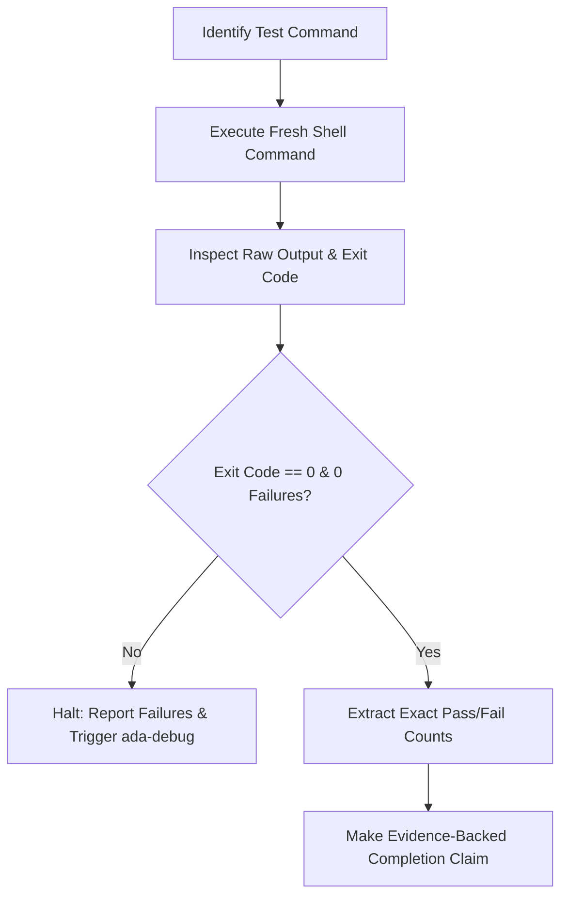

# ada-verify (Evidence-Based Completion Gate)

<EXTREMELY-IMPORTANT>
NO COMPLETION CLAIMS WITHOUT FRESH EMPIRICAL EVIDENCE.
Never claim tasks, features, or fixes are complete or tests are passing without executing the verification command and checking the raw output in the current turn.
</EXTREMELY-IMPORTANT>

## The Verification Gate Protocol

### Protocol Steps

1. **Identify Verification Command**:
   - Determine the exact test or verification command (e.g., `npm test`, `node --test tests/auth.test.js`, `cargo test`).
2. **Execute Fresh in Context**:
   - Run the command using `run_command`. Do NOT rely on runs from earlier turns, memories, or assumptions that changes "should work".
3. **Inspect Output & Exit Code**:
   - Check the exit code: it must be `0`.
   - Inspect the stdout/stderr for unhandled promise rejections, assertion failures, or compilation errors.
4. **Report Empirical Evidence**:
   - State the exact command executed.
   - Quote the pass/fail counts directly from command output (e.g., `✔ 12 tests passed, 0 failed, duration: 45ms`).
   - Only make completion claims when substantiated by fresh command output.

## Anti-Rationalization Guardrails

| Forbidden Speculative Claim | Mandatory Empirical Reality |
|---|---|
| "This should pass now." | Run test command and inspect output. |
| "The syntax looks correct." | Run linter / build compiler. |
| "Changes are trivial, no need to run tests." | Run the full test suite. |
| "Assuming previous test run applies." | Re-run verification afresh after edits. |
